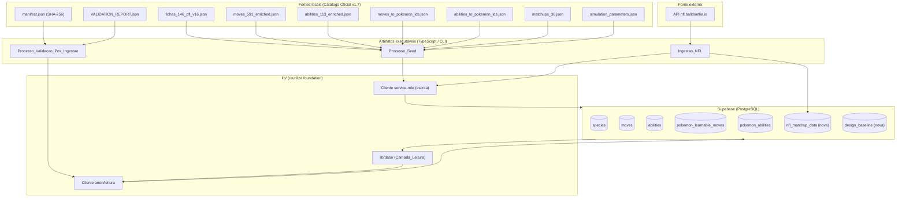
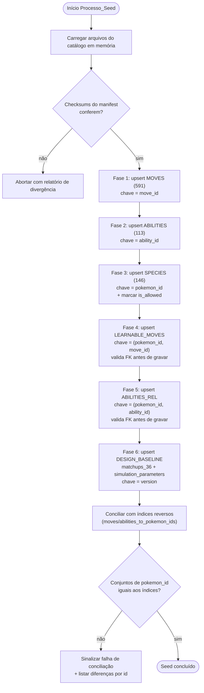
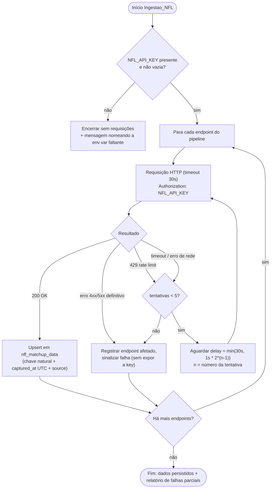

# Documento de Design — pfl-data-catalog

## Overview

A spec `pfl-data-catalog` **popula** o schema criado pela `pfl-foundation` com os dados de referência do Catálogo Oficial v1.7 e com os dados de regras/matchups da NFL, e **expõe uma camada de leitura** para o restante do PFL consultar esse acervo sem tocar fontes externas em tempo de jogo.

Esta spec entrega quatro frentes, materializadas em três artefatos executáveis e uma camada de biblioteca:

1. **`Processo_Seed`** — um CLI TypeScript que lê os arquivos locais do Catálogo Oficial e faz *upsert* idempotente nas tabelas `moves`, `abilities`, `species`, `pokemon_learnable_moves`, `pokemon_abilities` e `design_baseline` via cliente service-role, respeitando a ordem de dependências de chave estrangeira.
2. **`Processo_Validacao_Pos_Ingestao`** — um CLI que confere contagens, exclusões de elegibilidade, integridade referencial e checksums SHA-256, retornando aprovação ou falha com lista de problemas.
3. **Ingestão NFL** — um CLI que consome a API `nfl.balldontlie.io` com credencial via variável de ambiente, resiliência por *retry* com *backoff* exponencial, e persiste em `nfl_matchup_data` de forma idempotente.
4. **`Camada_Leitura` (`lib/data/`)** — funções de consulta ao catálogo, à elegibilidade por espécie e às regras/matchups, lendo exclusivamente do Supabase.

### Princípios de design

- **Preservação fiel**: a estrutura original da PokéAPI/catálogo é gravada em `raw_data` (jsonb) sem conversão. As anotações PFL (curadoria) ficam em colunas separadas, nunca misturadas ao `raw_data`.
- **Idempotência por construção**: toda escrita é um *upsert* por chave primária ou chave natural. Reexecutar o seed converge para o mesmo estado.
- **Validação como porta**: nada é considerado "carregado" sem o `Processo_Validacao_Pos_Ingestao` aprovar contagens, exclusões, FKs e checksums.
- **Separação de responsabilidades**: a ingestão escreve (service-role); a leitura só lê (anon/service-role). O schema estrutural não é alterado — apenas duas tabelas **novas** de dados de regras (`nfl_matchup_data`, `design_baseline`) são adicionadas via migrations.
- **Fronteira de rede fechada em tempo de jogo**: a `Camada_Leitura` nunca chama a API_NFL nem lê arquivos do catálogo.

### Contagens-alvo (fonte: `VALIDATION_REPORT.json`)

| Entidade | Alvo |
|---|---|
| Espécies (`species`) | 146 |
| Golpes (`moves`) | 591 |
| Habilidades (`abilities`) | 113 |
| Relações golpe aprendível (`pokemon_learnable_moves`) | 13564 |
| Relações habilidade disponível (`pokemon_abilities`) | 386 |
| Espécies com `is_allowed = true` | 146 |

### Fora de escopo

Definição de schema estrutural (entregue pela `pfl-foundation`), motor de simulação, interface do usuário, e a *aplicação* da calibração de heurísticas (consumida pela spec do motor). Esta spec apenas persiste os dados de regras e os expõe para leitura.

## Architecture

### Visão de componentes



### Pipeline de ingestão do catálogo (`Processo_Seed`)

A ordem respeita as chaves estrangeiras: entidades independentes (`moves`, `abilities`) primeiro; `species` depois; relações por último.



Cada fase opera em lotes transacionais: uma falha de *upsert* reverte apenas a transação daquele lote e sinaliza o erro, preservando os registros já confirmados (Req. 7.4). Registros inválidos (sem `pokemon_id`/`slug`, ou FK órfã) são **rejeitados e registrados**, mas não interrompem o processamento dos demais (Reqs. 1.5, 4.5, 5.4).

### Fluxo de resiliência da API NFL



A sequência de atrasos entre tentativas é 1s, 2s, 4s, 8s, 16s, com teto em 30s, por no máximo 5 tentativas (Reqs. 9.3, 9.4). Uma falha definitiva em um endpoint não interrompe os demais (Req. 9.5), e a credencial nunca aparece em logs (Reqs. 9.1, 9.6).

### Mapeamento conceitual: dados NFL → calibração de heurísticas

Os `Dados_Matchup_NFL` são **insumo de calibração**, não dados de jogo. O conceito:

- O GDD define 36 matchups ofensiva×defensiva (`matchups_36.json`), cada um com um `offense_probability_delta` *proposto* (`PROPOSED_BALANCE_VALUE`) — um palpite de design ainda não calibrado empiricamente.
- Os dados históricos da NFL (taxas de sucesso de esquemas ofensivos contra defensivos) servem como **evidência empírica** para, futuramente, ajustar esses deltas: a tendência histórica de um esquema ofensivo contra um defensivo informa se o delta proposto deve subir, descer ou permanecer.
- **Esta spec apenas persiste** tanto os deltas de baseline (`design_baseline`) quanto os dados empíricos brutos (`nfl_matchup_data`) e os expõe lado a lado pela `Camada_Leitura`. A **transformação** de evidência histórica em deltas calibrados é responsabilidade da **spec do motor**, que consumirá ambas as tabelas. O `status` do baseline (`PROPOSED_BALANCE_VALUE`, `FROZEN_MVP_DESIGN_BASELINE_NOT_EMPIRICALLY_CALIBRATED`) sinaliza explicitamente ao consumidor que os valores ainda não foram calibrados.

### Decisões de arquitetura e justificativas

- **CLIs separados em vez de um único script**: `seed`, `validate` e `nfl:ingest` têm ciclos de vida distintos (o seed roda a partir de arquivos locais e é determinístico; a ingestão NFL depende de rede e credencial). Separar permite reexecutar validação sem recarregar, e reingerir NFL sem retocar o catálogo.
- **Transações por lote, não por processo**: carregar 13564 relações numa única transação seria frágil e não permitiria retomada parcial (Req. 7.5). Lotes transacionais oferecem idempotência com retomada.
- **Conciliação como verificação, não como fonte**: as relações são derivadas das `fichas` (fonte autoritativa de `learnable_moves`/`ability_options`); os índices reversos (`moves_to_pokemon_ids`, `abilities_to_pokemon_ids`) são usados para **conferir** igualdade de conjuntos (Reqs. 4.3, 5.3). Isso evita dupla fonte de verdade.
- **Duas tabelas novas isoladas**: dados de regras (NFL + baseline) não pertencem ao domínio do catálogo Pokémon; tabelas próprias mantêm o schema estrutural da foundation intocado.

## Components and Interfaces

### 1. Leitores de catálogo (`lib/catalog/loaders.ts`)

Funções puras que leem e validam os arquivos locais, retornando estruturas tipadas. Separam I/O de arquivo da lógica de transformação (facilita PBT sobre a transformação).

```typescript
interface FichaEspecie {
  pokemon_id: number;
  slug: string;
  name_display: string;
  eligible: boolean;
  source_uri: string;
  species_source_uri: string;
  official: {
    types: string[];
    stats: Record<'hp'|'attack'|'defense'|'special-attack'|'special-defense'|'speed', number>;
    height_dm: number;
    weight_hg: number;
    ability_options: { name: string; id: number; is_hidden: boolean; slot: number }[];
    learnable_moves: { id: number; name: string; version_details: unknown[] }[];
  };
}

interface GolpeEnriquecido { id: number; name: string; [k: string]: unknown }
interface HabilidadeEnriquecida { id: number; name: string; [k: string]: unknown }

type IndiceReverso = Record<string, number[]>; // chave = id (string), valor = pokemon_ids

function loadFichas(path: string): FichaEspecie[];
function loadMoves(path: string): GolpeEnriquecido[];
function loadAbilities(path: string): HabilidadeEnriquecida[];
function loadReverseIndex(path: string): IndiceReverso;
function loadManifest(path: string): ManifestEntry[];
```

### 2. Transformadores (`lib/catalog/transform.ts`)

Funções **puras** (sem I/O, sem rede) que convertem registros do catálogo em linhas de banco. Núcleo testável por PBT.

```typescript
interface SpeciesRow {
  pokemon_id: number;
  slug: string;
  types: string[];
  hp: number; attack: number; defense: number;
  special_attack: number; special_defense: number; speed: number;
  height: number; weight: number;
  is_allowed: boolean;
  raw_data: unknown;      // ficha original, fiel
}

interface MoveRow { move_id: number; name: string; raw_data: unknown }
interface AbilityRow { ability_id: number; name: string; raw_data: unknown }
interface LearnableMoveRow { pokemon_id: number; move_id: number; version_details: unknown }
interface PokemonAbilityRow { pokemon_id: number; ability_id: number; is_hidden: boolean; slot: number }

const ALLOWED_IDS: ReadonlySet<number>; // 1..151 menos {144,145,146,150,151}

function isAllowed(pokemonId: number): boolean;        // pokemonId ∈ ALLOWED_IDS
function toSpeciesRow(f: FichaEspecie): SpeciesRow;
function toMoveRow(m: GolpeEnriquecido): MoveRow;
function toAbilityRow(a: HabilidadeEnriquecida): AbilityRow;
function toLearnableMoveRows(fichas: FichaEspecie[]): LearnableMoveRow[]; // deduplicado por (pokemon_id, move_id)
function toPokemonAbilityRows(fichas: FichaEspecie[]): PokemonAbilityRow[]; // deduplicado por (pokemon_id, ability_id)
```

### 3. Conciliador (`lib/catalog/reconcile.ts`)

```typescript
interface ReconDiff {
  id: number;             // move_id ou ability_id
  only_in_db: number[];   // pokemon_ids gravados mas ausentes do índice
  only_in_index: number[];// pokemon_ids no índice mas ausentes da gravação
}

// Compara, por id, o conjunto de pokemon_ids derivado das fichas com o índice reverso.
// Retorna [] quando todos os conjuntos são iguais.
function reconcile(
  derived: Map<number, Set<number>>,
  reverseIndex: IndiceReverso
): ReconDiff[];
```

### 4. Escritor idempotente (`lib/catalog/writer.ts`)

Encapsula os *upserts* via cliente service-role da foundation.

```typescript
interface UpsertResult { inserted: number; updated: number; rejected: RejectedRecord[] }
interface RejectedRecord { kind: string; key: unknown; reason: string }

function upsertMoves(rows: MoveRow[]): Promise<UpsertResult>;        // onConflict: move_id
function upsertAbilities(rows: AbilityRow[]): Promise<UpsertResult>; // onConflict: ability_id
function upsertSpecies(rows: SpeciesRow[]): Promise<UpsertResult>;   // onConflict: pokemon_id
function upsertLearnableMoves(rows: LearnableMoveRow[]): Promise<UpsertResult>;  // onConflict: (pokemon_id, move_id); valida FK
function upsertPokemonAbilities(rows: PokemonAbilityRow[]): Promise<UpsertResult>; // onConflict: (pokemon_id, ability_id); valida FK
function upsertDesignBaseline(rows: DesignBaselineRow[]): Promise<UpsertResult>; // onConflict: version
```

### 5. Cliente NFL (`lib/nfl/client.ts`)

```typescript
interface NflClientConfig {
  baseUrl: string;        // de env (NFL_API_BASE_URL)
  apiKey: string;         // de env (NFL_API_KEY) — nunca logado
  timeoutMs: number;      // 30000
  maxRetries: number;     // 5
  baseDelayMs: number;    // 1000
  maxDelayMs: number;     // 30000
}

type FetchOutcome<T> =
  | { ok: true; data: T }
  | { ok: false; endpoint: string; reason: 'rate_limit'|'timeout'|'network'|'http_error'; attempts: number };

// Backoff: delay(n) = min(maxDelayMs, baseDelayMs * 2^(n-1)); retenta em 429/timeout/rede.
function computeBackoffDelay(attempt: number, cfg: NflClientConfig): number;
function fetchWithRetry<T>(endpoint: string, cfg: NflClientConfig): Promise<FetchOutcome<T>>;
```

### 6. Persistência NFL (`lib/nfl/persist.ts`)

```typescript
interface NflMatchupRow {
  natural_key: string;    // chave natural estável (ex.: offense|defense|season)
  offense_scheme: string;
  defense_scheme: string;
  payload: unknown;       // dados históricos brutos
  captured_at: string;    // ISO 8601 UTC
  source: string;         // "https://nfl.balldontlie.io"
}
function upsertNflMatchups(rows: NflMatchupRow[]): Promise<UpsertResult>; // onConflict: natural_key
```

### 7. Validador (`lib/catalog/validate.ts`)

```typescript
interface ValidationIssue { check: string; detail: string; ids?: (number|string)[] }
interface ValidationOutcome { passed: boolean; issues: ValidationIssue[] }

function validatePostIngestion(expected: ValidationReport): Promise<ValidationOutcome>;
// checa: contagens (146/591/113/13564/386), 146 allowed, exclusões {144,145,146,150,151}=false,
// FKs de ambas as relações, e sha256 recomputado vs manifest.
```

### 8. Camada de leitura (`lib/data/`)

Reutiliza o cliente de leitura da foundation. **Só lê do Supabase.**

```typescript
// lib/data/species.ts
function getAllowedSpecies(): Promise<SpeciesSummary[]>;
// SpeciesSummary = { pokemon_id, slug, types, hp, attack, defense, special_attack, special_defense, speed }

// lib/data/eligibility.ts
function getLearnableMoveIds(pokemonId: number): Promise<Result<number[]>>;
function getAvailableAbilities(pokemonId: number): Promise<Result<{ ability_id: number; is_hidden: boolean }[]>>;
// pokemon_id sem is_allowed → NotFound; sem relações → conjunto vazio (sem erro)

// lib/data/registry.ts
function getMove(moveId: number): Promise<Result<MoveRecord>>;       // inclui raw_data fiel
function getAbility(abilityId: number): Promise<Result<AbilityRecord>>;

// lib/data/rules.ts
function getNflMatchups(): Promise<NflMatchupRow[]>;
function getDesignBaseline(version?: string): Promise<DesignBaselineRow | null>;

type Result<T> = { found: true; value: T } | { found: false };
```

## Data Models

### Tabelas existentes (foundation) — populadas por esta spec

- **`species`**: `pokemon_id` (PK), `slug`, `types`, `hp`, `attack`, `defense`, `special_attack`, `special_defense`, `speed`, `height`, `weight`, `is_allowed`, `raw_data` (jsonb). Anotações PFL em colunas próprias (não em `raw_data`).
- **`moves`**: `move_id` (PK), `name`, `raw_data` (jsonb).
- **`abilities`**: `ability_id` (PK), `name`, `raw_data` (jsonb).
- **`pokemon_learnable_moves`**: `pokemon_id` (FK→species), `move_id` (FK→moves), `version_details` (jsonb), UNIQUE(`pokemon_id`,`move_id`).
- **`pokemon_abilities`**: `pokemon_id` (FK→species), `ability_id` (FK→abilities), `is_hidden`, `slot`, UNIQUE(`pokemon_id`,`ability_id`).

### Tabelas novas (migrations desta spec)

#### Migration `nfl_matchup_data`

```sql
CREATE TABLE IF NOT EXISTS nfl_matchup_data (
  id              bigserial PRIMARY KEY,
  natural_key     text NOT NULL UNIQUE,            -- chave natural idempotente
  offense_scheme  text NOT NULL,
  defense_scheme  text NOT NULL,
  payload         jsonb NOT NULL,                  -- dados históricos brutos
  captured_at     timestamptz NOT NULL,            -- UTC
  source          text NOT NULL DEFAULT 'https://nfl.balldontlie.io'
);

CREATE INDEX IF NOT EXISTS idx_nfl_matchup_schemes
  ON nfl_matchup_data (offense_scheme, defense_scheme);
```

A idempotência vem do `UNIQUE(natural_key)` combinado com `ON CONFLICT (natural_key) DO UPDATE`. `captured_at` é sempre gravado em UTC; `source` identifica a origem (Reqs. 10.2, 10.3). Nenhum registro aqui representa atleta/roster (Req. 10.5).

#### Migration `design_baseline`

Armazena `matchups_36.json` e `simulation_parameters.json` versionados por `version`, com `status` legível (Reqs. 11.1–11.4).

```sql
CREATE TABLE IF NOT EXISTS design_baseline (
  version     text PRIMARY KEY,                 -- ex.: "D1-design-2026-10-09"
  kind        text NOT NULL,                    -- 'matchups_36' | 'simulation_parameters'
  status      text NOT NULL,                    -- PROPOSED_BALANCE_VALUE | FROZEN_MVP_... etc.
  payload     jsonb NOT NULL,                   -- conteúdo fiel do arquivo
  created_at  timestamptz NOT NULL DEFAULT now()
);
```

> Nota de modelagem: como `simulation_parameters.json` tem uma única `version`, mas há dois tipos de artefato (`matchups_36` sem `version` própria e `simulation_parameters` com `version`), a PK é `version` e os matchups do GDD são registrados sob a mesma `version` de design corrente com `kind='matchups_36'`. Caso coexistam dois `kind` na mesma `version`, a PK composta `(version, kind)` será usada. O `status` por matchup é preservado dentro do `payload`, e o `status` agregado do artefato na coluna `status`.

### Elegibilidade (`is_allowed`)

```
ALLOWED_IDS = {1..151} \ {144, 145, 146, 150, 151}  →  |ALLOWED_IDS| = 146
is_allowed(pokemon_id) = pokemon_id ∈ ALLOWED_IDS
```

Qualquer `pokemon_id` fora de 1..151 recebe `is_allowed = false` e é registrado (Req. 6.4).

### Preservação de `raw_data`

O `raw_data` recebe a estrutura de origem **sem conversão**. O contrato de preservação é: para todo registro de origem `x`, ler o `raw_data` gravado reconstrói `x` campo a campo (round-trip JSON canônico), inclusive `power`, `accuracy`, `meta`, descrições (golpes), efeitos/histórico (habilidades) e o bloco `official` (fichas). Anotações PFL moram em colunas dedicadas, fora do `raw_data`.

## Correctness Properties

*Uma propriedade é uma característica ou comportamento que deve valer para todas as execuções válidas do sistema — essencialmente, uma afirmação formal sobre o que o sistema deve fazer. Propriedades são a ponte entre especificações legíveis por humanos e garantias de correção verificáveis por máquina.*

As propriedades abaixo resultam da análise de prework e de uma reflexão de consolidação que eliminou redundâncias (round-trips, contagens por deduplicação, idempotências e fronteiras de leitura foram unificados em propriedades parametrizadas).

### Property 1: Mapeamento fiel de colunas por entidade

*Para toda* ficha de espécie, golpe ou habilidade válidos, a linha de banco produzida pela transformação tem suas colunas de identidade e atributos iguais aos campos correspondentes da origem (espécie: `pokemon_id`, `slug`, `types`, as seis stats, altura, peso do bloco `official`; golpe: `move_id=id`, `name`; habilidade: `ability_id=id`, `name`; relação de habilidade: `is_hidden`, `slot`).

**Validates: Requirements 1.2, 2.2, 3.2, 5.2**

### Property 2: Round-trip de preservação em raw_data e metadados

*Para todo* registro de origem (ficha, golpe, habilidade), relação (`version_details`) ou artefato de baseline (matchup, parâmetros), serializar para a coluna estruturada (`raw_data`/`version_details`/`payload`) e lê-lo de volta reconstrói o conteúdo original campo a campo, sem perda.

**Validates: Requirements 1.3, 2.3, 3.3, 4.2, 11.1, 11.3, 12.5**

### Property 3: Power preservado sem conversão

*Para todo* golpe, o valor de `power` lido de `raw_data` é idêntico ao `power` de origem, sem qualquer transformação em interpretação de força física.

**Validates: Requirements 2.3**

### Property 4: Anotações PFL isoladas do raw_data

*Para todo* registro de espécie, golpe ou habilidade, as Anotações_PFL são gravadas em colunas dedicadas e não aparecem dentro de `raw_data`, enquanto o `raw_data` não contém nenhuma anotação de curadoria.

**Validates: Requirements 1.4, 2.4, 3.4**

### Property 5: Contagem por deduplicação de pares de relação

*Para qualquer* conjunto de fichas, o número de relações gravadas (golpe aprendível e habilidade disponível) é igual ao número de pares distintos — `(pokemon_id, move_id)` e `(pokemon_id, ability_id)` — derivados das fichas, mesmo quando o mesmo par ocorre múltiplas vezes na fonte.

**Validates: Requirements 4.1, 4.6, 5.1, 5.5**

### Property 6: Idempotência do upsert

*Para qualquer* conjunto de registros e qualquer tabela com chave de conciliação (`pokemon_id`, `move_id`, `ability_id`, par de relação, `natural_key` do NFL, `version` do baseline), aplicar o upsert uma vez e aplicá-lo N vezes produzem o mesmo estado final, campo a campo, e preservam as contagens-alvo sem criar duplicatas.

**Validates: Requirements 7.2, 7.3, 10.3, 11.4**

### Property 7: Conciliação é igualdade de conjuntos

*Para todo* `move_id` (e todo `ability_id`), quando as fichas e o índice reverso correspondente derivam da mesma fonte, o conjunto de `pokemon_id` gravados é igual ao conjunto declarado no índice reverso, e a conciliação não reporta divergência.

**Validates: Requirements 4.3, 5.3**

### Property 8: Divergência de conciliação produz diferença exata

*Para qualquer* divergência introduzida entre o conjunto gravado e o índice reverso de um `move_id` ou `ability_id`, a conciliação reporta, para aquele id, exatamente os `pokemon_id` presentes apenas na gravação (`only_in_db`) e exatamente os presentes apenas no índice (`only_in_index`).

**Validates: Requirements 4.4**

### Property 9: Elegibilidade coincide com o conjunto permitido

*Para todo* `pokemon_id`, `is_allowed` é verdadeiro se e somente se o id pertence a `{1..151} \ {144,145,146,150,151}`; consequentemente, após carregar fichas cobrindo o intervalo, a quantidade de espécies com `is_allowed = true` é exatamente a cardinalidade da interseção com o conjunto permitido (146 para o catálogo completo).

**Validates: Requirements 6.1, 6.3**

### Property 10: Validação detecta integridade referencial

*Para qualquer* estado do banco, o `Processo_Validacao_Pos_Ingestao` aprova a integridade referencial se e somente se toda relação de golpe aprendível referencia um `move_id` e um `pokemon_id` existentes e toda relação de habilidade referencia um `ability_id` e um `pokemon_id` existentes; qualquer relação órfã é detectada e reportada com seus identificadores.

**Validates: Requirements 8.3, 8.4**

### Property 11: Validação de contagens e elegibilidade

*Para qualquer* estado do banco, a validação aprova as contagens se e somente se espécies=146, golpes=591 e habilidades=113 conforme `actual_counts`, e aprova a elegibilidade se e somente se há exatamente 146 espécies com `is_allowed = true` e as espécies 144, 145, 146, 150 e 151 têm `is_allowed = false`.

**Validates: Requirements 8.1, 8.2**

### Property 12: Round-trip de checksum SHA-256

*Para todo* conteúdo de JSON cru registrado no manifest, o `sha256` recomputado é igual ao valor registrado quando o conteúdo é íntegro, e diferente sempre que o conteúdo é alterado em qualquer byte.

**Validates: Requirements 8.5**

### Property 13: Backoff exponencial limitado

*Para toda* tentativa `n` em 1..5, o atraso aplicado pelo cliente NFL antes da repetição é `min(30000ms, 1000ms * 2^(n-1))`, e após esgotar as 5 tentativas o resultado sinaliza falha identificando o endpoint afetado; a mesma política de atraso vale para respostas de limite de requisições, timeouts e erros de rede.

**Validates: Requirements 9.3, 9.4**

### Property 14: Logs nunca expõem a credencial

*Para qualquer* valor de `Chave_API_NFL` e qualquer caminho de execução que emita diagnóstico ou erro, nenhuma mensagem de log produzida contém o valor da credencial.

**Validates: Requirements 9.6**

### Property 15: Carimbo UTC e fonte em todo matchup NFL

*Para qualquer* conjunto de `Dados_Matchup_NFL` persistidos com sucesso, toda linha gravada possui `captured_at` em UTC e `source = "https://nfl.balldontlie.io"`.

**Validates: Requirements 10.2**

### Property 16: Leitura não realiza I/O externo

*Para qualquer* consulta da `Camada_Leitura` (catálogo, elegibilidade, registro, matchups ou baseline), nenhuma requisição à API_NFL e nenhum acesso aos arquivos do Catálogo Oficial é realizado durante a leitura; os dados vêm exclusivamente do Supabase.

**Validates: Requirements 10.4, 12.8**

### Property 17: Projeção de elegibilidade por espécie permitida

*Para toda* espécie com `is_allowed = true`, a `Camada_Leitura` retorna exatamente o conjunto de `move_id` de suas relações de golpe aprendível e exatamente o conjunto de `ability_id` (com o respectivo `is_hidden`) de suas relações de habilidade disponível.

**Validates: Requirements 12.2, 12.3**

### Property 18: Consulta de espécies permitidas filtra corretamente

*Para qualquer* estado do banco, `getAllowedSpecies` retorna exatamente as espécies com `is_allowed = true`, cada uma com `pokemon_id`, `slug`, `types` e as seis estatísticas base, e nenhuma espécie com `is_allowed = false`.

**Validates: Requirements 12.1**

## Error Handling

### Ingestão do catálogo (`Processo_Seed`)

- **Checksum divergente (pré-carga)**: se o SHA-256 de um JSON cru não bate com o manifest, o seed aborta antes de escrever e emite um relatório de divergência por recurso. (Reqs. 8.5)
- **Ficha inválida** (sem `pokemon_id`/`slug`): o registro é rejeitado, o `pokemon_id` ausente/ inválido é registrado em `RejectedRecord`, e o processamento continua com as demais fichas. (Req. 1.5)
- **FK órfã em relação** (`move_id`/`ability_id`/`pokemon_id` ausente da tabela base): a relação é rejeitada sem gravação; o par é registrado; os demais pares seguem. (Reqs. 4.5, 5.4)
- **Falha de upsert em lote**: a transação do lote sofre rollback, o erro é sinalizado com a chave envolvida, e os lotes já confirmados permanecem íntegros. (Req. 7.4)
- **Interrupção**: como toda escrita é upsert idempotente por chave, uma reexecução completa a carga até as contagens-alvo sem duplicatas. (Req. 7.5)
- **Falha de conciliação**: ao final, se o conjunto de `pokemon_id` de qualquer `move_id`/`ability_id` difere do índice reverso, o seed sinaliza falha de conciliação e lista, por id divergente, `only_in_db` e `only_in_index`. (Reqs. 4.4)

### Ingestão NFL

- **Credencial ausente/vazia**: encerra sem realizar requisições e retorna mensagem nomeando a variável de ambiente faltante (`NFL_API_KEY`). (Req. 9.2)
- **Rate limit (429) / timeout (>30s) / erro de rede**: retry com backoff `min(30s, 1s·2^(n-1))`, até 5 tentativas; ao esgotar, registra o endpoint afetado e sinaliza falha. (Reqs. 9.3, 9.4)
- **Falha definitiva de um endpoint**: registrada; o pipeline prossegue com os demais endpoints; dados já persistidos ficam inalterados. (Req. 9.5)
- **Confidencialidade**: toda mensagem de erro/diagnóstico é sanitizada para jamais conter o valor da credencial. (Req. 9.6)

### Camada de leitura

- **Identificador inexistente ou `pokemon_id` não permitido**: retorna `Result` com `found: false` (resultado vazio), sem lançar exceção, permanecendo disponível para novas consultas. (Req. 12.6)
- **Espécie permitida sem relações**: retorna conjunto vazio para a dimensão correspondente, sem erro. (Req. 12.4)

### Validação pós-ingestão

- Qualquer verificação falha ⇒ encerra com `passed: false` e `issues[]` contendo o nome da verificação e os identificadores dos registros envolvidos. (Req. 8.6)
- Todas as verificações satisfeitas ⇒ encerra com `passed: true` e `issues` vazio. (Req. 8.7)

## Testing Strategy

A estratégia combina **testes baseados em propriedades (PBT)** para a lógica pura (transformação, deduplicação, conciliação, elegibilidade, backoff, round-trips) e **testes de integração/exemplo** para o comportamento transacional, de rede e de fronteira com o Supabase e a API_NFL.

### Biblioteca de PBT

- Biblioteca: **`fast-check`** (ecossistema TypeScript/Node). Não implementar PBT do zero.
- **Mínimo de 100 iterações** por teste de propriedade (`fc.assert(..., { numRuns: 100 })`).
- Cada teste de propriedade referencia sua propriedade de design via comentário de tag:
  - Formato: `// Feature: pfl-data-catalog, Property {número}: {texto}`

Mapa Propriedade → teste (um teste de propriedade por propriedade):

| Propriedade | Alvo de teste | Geradores principais |
|---|---|---|
| P1 Mapeamento de colunas | `transform.*` | fichas/golpes/habilidades arbitrários |
| P2 Round-trip preservação | serialização de `raw_data`/`payload` | objetos JSON arbitrários aninhados |
| P3 Power sem conversão | `toMoveRow` | golpes com `power` arbitrário (incl. null) |
| P4 Anotações isoladas | `toSpeciesRow`/`toMoveRow`/`toAbilityRow` | registros com anotações PFL arbitrárias |
| P5 Contagem por deduplicação | `toLearnableMoveRows`/`toPokemonAbilityRows` | fichas com pares duplicados |
| P6 Idempotência upsert | `writer`/`persist` com repositório em memória | sequências de upsert repetidas (N arbitrário) |
| P7 Conciliação = conjuntos | `reconcile` | fichas → derivar índice da mesma fonte |
| P8 Divergência exata | `reconcile` | diffs injetados (subconjuntos aleatórios) |
| P9 Elegibilidade | `isAllowed` / marcação | `pokemon_id` em/ fora de 1..151 |
| P10 Integridade FK | `validatePostIngestion` | relações com/sem órfãs |
| P11 Contagens/elegibilidade | `validatePostIngestion` | estados com contagens variadas |
| P12 Round-trip SHA-256 | `sha256` + mutação | conteúdos arbitrários + mutações de byte |
| P13 Backoff | `computeBackoffDelay`/`fetchWithRetry` | `n` em 1..5; mock de resultados 429/timeout |
| P14 Logs sem key | logger sanitizado | keys arbitrárias + caminhos de log |
| P15 UTC + source | `upsertNflMatchups` (repo em memória) | conjuntos de matchups arbitrários |
| P16 Leitura sem I/O externo | `lib/data/*` com espiões de rede/fs | consultas arbitrárias |
| P17 Projeção elegibilidade | `getLearnableMoveIds`/`getAvailableAbilities` | relações arbitrárias por `pokemon_id` |
| P18 Filtro de espécies permitidas | `getAllowedSpecies` | espécies mistas allowed/não-allowed |

### Testes de integração e exemplo

- **Upsert por PK atualiza em vez de duplicar** (Req. 7.1) — integração contra Supabase de teste.
- **Rollback de lote sob falha** (Req. 7.4) — injeção de falha num lote.
- **Retomada após interrupção** (Req. 7.5) — interromper após fases e reexecutar; conferir contagens-alvo e ausência de duplicatas.
- **Checklist de validação com ids** (Reqs. 8.6, 8.7) — estados válidos/ inválidos conhecidos.
- **Config só por env / sem literal de key** (Req. 9.1) — smoke test + verificação estática.
- **Key ausente encerra sem requisição** (Req. 9.2) — exemplo com env vazia e espião de HTTP.
- **Falha persistente de endpoint não interrompe pipeline** (Req. 9.5) — mock de falha definitiva.
- **Persistência na tabela correta e só para calibração** (Reqs. 10.1, 10.5) — integração verificando `nfl_matchup_data` e ausência de escrita em `species`/roster.
- **Exclusões de elegibilidade** (Req. 6.2) — exemplo verificando os 5 ids = `false`.
- **Parâmetros sob a `version` do arquivo** (Req. 11.2) — exemplo lendo `simulation_parameters.json`.
- **Disponibilidade das consultas de regras** (Req. 12.7) — `getNflMatchups`/`getDesignBaseline` retornam o persistido.

### Casos de borda cobertos por geradores

- Fichas inválidas (sem `pokemon_id`/`slug`), pares com FK órfã, `pokemon_id` fora de 1..151, espécies permitidas sem relações, identificadores inexistentes, `power` nulo, listas de `version_details` vazias ou com múltiplos grupos de versão.

### Dados de teste

- **PBT**: geradores sintéticos (`fast-check`) — rápidos, em memória, sem Supabase nem rede.
- **Integração**: subconjunto representativo do catálogo real (ex.: 5–10 fichas) e um banco Supabase de teste; a ingestão NFL usa um servidor mock para exercitar 429/timeout/sucesso sem consumir a API real.
