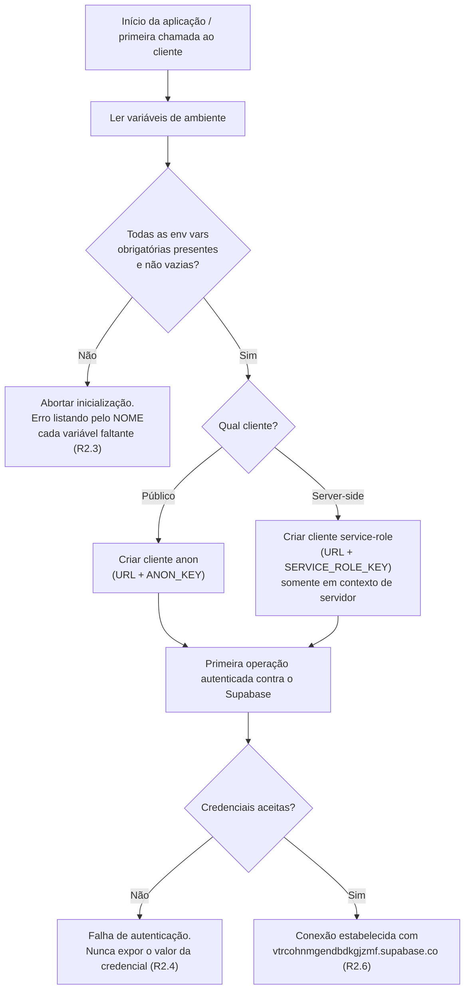
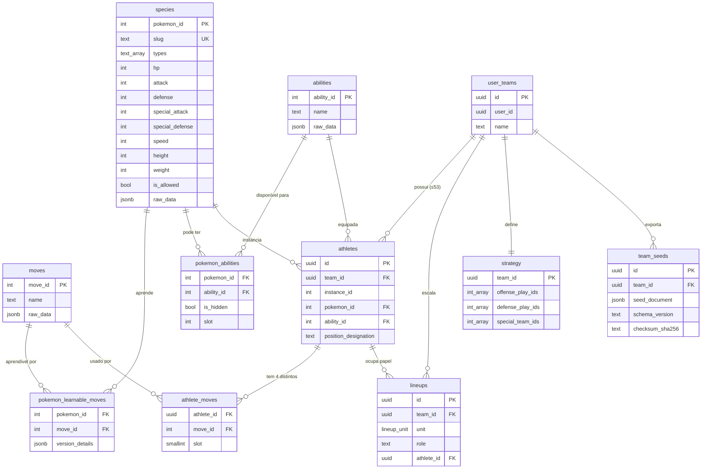

# Documento de Design — pfl-foundation

## Overview

Esta spec entrega a **fundação técnica** do PFL (Pokémon Football League): um projeto Next.js (React + TypeScript, strict mode) pronto para deploy na Vercel, um módulo de acesso ao Supabase configurado por variáveis de ambiente, a instalação do conjunto de regras anti-slop, as convenções base de projeto (lint, estrutura de pastas, nomenclatura de env vars) e, como peça central, o **schema do banco de dados** (migrations DDL) para as entidades do jogo em estado vazio.

O escopo é deliberadamente restrito. **Fora do escopo**: ingestão/seed real do catálogo, motor de simulação de partidas e telas de UI. O entregável é um projeto que compila, conecta ao Supabase e possui um schema migrado e vazio, pronto para ser populado.

### Princípios de design

1. **Fidelidade ao catálogo** — as tabelas de catálogo (`species`, `abilities`, `moves`) preservam a ficha original da PokéAPI/v1.7 em colunas `raw_data jsonb`, sem perda. Colunas tipadas (ex.: stats, tipos, slug) são projeções indexáveis derivadas do `raw_data`, não substitutas dele.
2. **Fonte de verdade operacional normalizada** — `athletes`, `lineups` e `strategy` são tabelas normalizadas com FKs e constraints. São elas que o motor de simulação consultará.
3. **Seed como artefato de intercâmbio** — `team_seeds` guarda o documento `.pflseed.json` serializado (jsonb) com checksum. O seed é o formato portável de export/import; **não** é a fonte de verdade operacional (ver decisão de design D-1).
4. **Segurança por variáveis de ambiente** — nenhuma credencial no código. Separação explícita entre cliente público (anon) e cliente server-side (service role).
5. **Reprodutibilidade** — schema definido só por migrations versionadas, aplicáveis de forma idempotente a um banco vazio.

### Mapeamento requisito → seção

| Requisito | Onde é endereçado |
|-----------|-------------------|
| R1 Estrutura Next.js/Vercel | Architecture · Estrutura de pastas |
| R2 Conexão Supabase via env | Components · Módulo Cliente_Supabase |
| R3 Anti-slop | Architecture · Ferramental e convenções |
| R4 Convenções base | Architecture · Ferramental e convenções |
| R5 Migrations reproduzíveis | Architecture · Estratégia de migrations |
| R6–R10 Catálogo e relações | Data Models |
| R11–R16 Time, atletas, escalação, estratégia, seed | Data Models |
| Regras (roster_cap, 4 golpes, allowed set, checksum) | Data Models + Correctness Properties |

## Architecture

### Visão de alto nível

O PFL é uma aplicação Next.js (App Router) hospedada na Vercel. O backend roda como Vercel Functions (rotas de servidor Next.js e/ou funções isoladas). O estado persistente vive no Supabase (PostgreSQL gerenciado). O acesso ao banco é mediado por um módulo de dados que isola o resto da aplicação dos detalhes do cliente Supabase.

```mermaid
graph TB
    subgraph Vercel
        UI["Camada UI (React/Next.js)<br/>app/, components/"]
        BFF["Backend / Vercel Functions<br/>app/api/, functions/"]
    end
    subgraph "Módulo de dados"
        DATA["Data access layer<br/>lib/data/*"]
        SB["Módulo Cliente_Supabase<br/>lib/supabase/*"]
    end
    subgraph Supabase
        PG[("PostgreSQL<br/>Schema_PFL")]
    end

    UI -->|chama| BFF
    UI -. "leitura pública (anon)" .-> SB
    BFF -->|usa| DATA
    DATA -->|usa| SB
    SB -->|anon client| PG
    SB -->|service-role client<br/>(somente server)| PG
```

A separação de camadas atende R1.6 (diretórios distintos para UI, backend e acesso a dados). O diretório dedicado de Vercel Functions atende R1.5.

### Estrutura de pastas do monorepo

```
pfl/
├─ app/                      # Next.js App Router — camada UI e rotas
│  ├─ (ui)/                  # páginas e layouts (UI)
│  └─ api/                   # Route Handlers (Vercel Functions / backend HTTP)
├─ functions/               # Vercel Functions isoladas de backend (não-UI)
├─ components/              # componentes React reutilizáveis (UI)
├─ lib/
│  ├─ supabase/             # Módulo Cliente_Supabase (anon + service role)
│  │  ├─ env.ts             # validação de variáveis de ambiente
│  │  ├─ public-client.ts   # cliente anon (browser/server)
│  │  └─ server-client.ts   # cliente service-role (somente server)
│  ├─ data/                 # data access layer (consultas, repositórios)
│  └─ seed/                 # (futuro) serialização/checksum de .pflseed.json
├─ supabase/
│  └─ migrations/           # arquivos de migration versionados (DDL)
├─ docs/
│  └─ project-conventions.md # estrutura de pastas + nomenclatura de env (R1.6, R4.3)
├─ .env.example             # nomes das env vars obrigatórias (R2.2)
├─ .gitignore               # ignora .env* locais (R2.5)
├─ eslint.config.*          # lint TS/React (R4.1)
├─ tsconfig.json            # strict mode (R1.1)
├─ vercel.json              # framework Next.js + runtime Node (R1.2)
├─ package.json
└─ package-lock.json        # lock versionado (R4.4)
```

A documentação da estrutura e das convenções de nomenclatura de env vars fica em `docs/project-conventions.md`, versionada (R1.6, R4.3).

### Ferramental e convenções

- **TypeScript strict** (R1.1): `tsconfig.json` com `"strict": true` e flags correlatas. Build via `next build` deve sair com código 0 em ≤300s (R1.3); erros de tipo abortam com código ≠0 e apontam arquivo:linha (R1.4) — comportamento nativo do compilador TS.
- **Vercel** (R1.2): `vercel.json` fixa `framework: "nextjs"` e runtime Node.js; a versão de Node também é fixada em `package.json#engines`.
- **Lint** (R4.1, R4.2): ESLint com presets de TypeScript e React; `next lint`/`eslint .` sem erros sobre o código inicial.
- **Lock de dependências** (R4.4): `package-lock.json` versionado; dependências pinadas.
- **Anti-slop** (R3): executado via `npx antislop-ai`; os artefatos de regras gerados são posicionados no local reconhecido como regras de projeto do agente e versionados no repositório.

### Estratégia de migrations

Atende R5. O schema é definido **exclusivamente** por arquivos SQL versionados em `supabase/migrations/`, aplicados via Supabase CLI (`supabase db push` / `supabase migration up`).

- **Versionamento**: um arquivo por migration, nomeado com prefixo temporal lexicograficamente ordenável, ex. `20261009000001_init_catalog.sql`, `20261009000002_init_teams.sql`. A ordem de aplicação é a ordem lexicográfica do nome.
- **Aplicação**: a CLI mantém uma tabela de controle (`supabase_migrations.schema_migrations`) registrando quais migrations já rodaram; só aplica as pendentes. Isso dá a idempotência de R5.4 (reaplicar a um banco já migrado resulta em estrutura idêntica, pois nenhuma migration já registrada roda de novo).
- **Idempotência interna do DDL**: cada migration usa formas defensivas (`CREATE TABLE IF NOT EXISTS`, `CREATE TYPE ... (guardado por bloco `DO $$ ... EXCEPTION WHEN duplicate_object`)`, `CREATE INDEX IF NOT EXISTS`) para que uma reexecução acidental não falhe.
- **Atomicidade/rollback** (R5.3): cada migration roda dentro de uma transação; qualquer erro faz `ROLLBACK` das alterações parciais daquela migration e sinaliza a falha (comportamento transacional padrão do PostgreSQL + CLI).
- **Estado vazio** (R5.2, R5.5): as migrations criam todas as tabelas das entidades centrais; nenhuma migration insere linhas em `user_teams`, `athletes`, `lineups`, `strategy`, `team_seeds`. (O catálogo também nasce vazio nesta spec; o seed real é outra spec.)

#### Fluxo de inicialização do Módulo Cliente_Supabase



## Components and Interfaces

### Módulo Cliente_Supabase (`lib/supabase/`)

Responsável por toda conexão autenticada ao Supabase. Atende R2 integralmente.

**`env.ts` — validação de variáveis de ambiente**
- Expõe uma função que lê e valida as env vars obrigatórias e retorna um objeto de configuração tipado, ou lança erro.
- Variáveis obrigatórias:
  - `NEXT_PUBLIC_SUPABASE_URL` — URL do projeto (`https://vtrcohnmgendbdkgjzmf.supabase.co`).
  - `NEXT_PUBLIC_SUPABASE_ANON_KEY` — chave pública anônima (cliente público).
  - `SUPABASE_SERVICE_ROLE_KEY` — chave de service role (somente server; **nunca** com prefixo `NEXT_PUBLIC_`, para não vazar ao browser).
- **Validação (R2.3)**: se qualquer uma estiver ausente ou vazia (após `trim`), a função coleta **todos** os nomes faltantes e lança um erro cuja mensagem lista cada nome. A inicialização não prossegue e nenhuma conexão é criada.
- **Sem hardcode (R2.1)**: nenhum valor de credencial no código; só nomes de variáveis.

**`public-client.ts` — cliente anon**
- Cria o cliente Supabase com `URL + ANON_KEY`. Seguro para uso no browser e no servidor. Sujeito às políticas RLS da chave anônima.

**`server-client.ts` — cliente service-role**
- Cria o cliente com `URL + SERVICE_ROLE_KEY`. **Somente em contexto de servidor** (Route Handlers, Vercel Functions). Guarda-se contra importação no bundle de cliente (ex.: `import 'server-only'`), já que a service role ignora RLS e tem acesso privilegiado.

**Separação de segurança (decisão explícita):**

| Aspecto | Cliente público (anon) | Cliente server-side (service role) |
|---|---|---|
| Env var da chave | `NEXT_PUBLIC_SUPABASE_ANON_KEY` | `SUPABASE_SERVICE_ROLE_KEY` |
| Exposto ao browser | Sim (por design, é pública) | **Nunca** |
| Respeita RLS | Sim | Não (bypassa — privilegiado) |
| Uso | leitura pública, operações de usuário autenticado | operações administrativas/backend |

- **Falha de autenticação (R2.4)**: se as variáveis existem mas são rejeitadas pelo Supabase, o módulo propaga uma falha de autenticação sem incluir o valor da credencial na mensagem/log.
- **Arquivos `.env` locais fora do git (R2.5)**: `.gitignore` ignora `.env`, `.env.local`, `.env.*.local`. O repositório contém apenas `.env.example` com nomes e marcadores em branco (R2.2).

### Data access layer (`lib/data/`)

Camada fina que encapsula consultas ao Schema_PFL usando o cliente apropriado. Nesta spec entra apenas a estrutura (sem lógica de negócio de simulação). Isola o restante do app dos detalhes do cliente, atendendo R1.6.

## Data Models

Convenções: PostgreSQL. Tipos `jsonb` para preservar fichas originais (R6.6, R7.3, R8.3, R9.5, R10.5). O DDL abaixo é **conceitual** (a forma final vive nas migrations).

### Decisões de design

**D-1 — Seed serializado (jsonb) vs. tabelas normalizadas.**
`team_seeds` armazena o documento `.pflseed.json` inteiro em `seed_document jsonb`, com `schema_version` e `checksum_sha256`. Em paralelo, `athletes`, `lineups` e `strategy` modelam o mesmo time de forma normalizada.
- **Fonte de verdade operacional**: as tabelas normalizadas. É nelas que o motor de simulação, as validações de FK, o roster_cap e a regra dos 4 golpes atuam. Permitem consultas relacionais e integridade referencial que um blob jsonb não garante.
- **Artefato de intercâmbio**: `team_seeds.seed_document`. É a forma portável para export/import entre instâncias/usuários e para versionamento de compatibilidade (`schema_version`) e verificação de integridade (`checksum_sha256`). Um seed é imutável do ponto de vista de resultado de partida (R16.4/16.5 proíbem aleatoriedade, logs, vencedores).
- **Justificativa**: separar os dois evita acoplar o formato de transporte à modelagem relacional. O seed pode evoluir de schema sem reescrever as tabelas, e as tabelas podem ter índices/constraints que o JSON não expressa. A reconciliação (seed → tabelas e tabelas → seed) é responsabilidade de specs futuras (import/export); aqui apenas garantimos que ambos os lados existem no schema.

**D-2 — Exatamente 4 golpes distintos por atleta.**
Opção escolhida: **tabela filha** `athlete_moves(athlete_id, move_id, slot)` com `UNIQUE(athlete_id, move_id)` (garante distinção) e `UNIQUE(athlete_id, slot)` com `slot IN (1,2,3,4)`. A cardinalidade exata = 4 é imposta por um **trigger `CONSTRAINT TRIGGER DEFERRABLE INITIALLY DEFERRED`** que, no commit, conta as linhas por atleta e rejeita se ≠ 4 (R12.6–12.8).
- Alternativa considerada: 4 colunas FK (`move1_id..move4_id`) com `CHECK` de distinção. Rejeitada: distinção em 4 colunas exige CHECK verboso e dificulta consultas "atletas que usam o golpe X". A tabela filha é mais limpa e naturalmente única; o custo é precisar do trigger de cardinalidade (um `CHECK` não conta linhas de outra tabela).

**D-3 — roster_cap = 53.**
Imposto por **trigger** `BEFORE INSERT` em `athletes` que conta atletas do mesmo `team_id` e rejeita a inserção quando já há 53 (R13). Um `CHECK` de coluna não consegue contar linhas-irmãs, então o trigger é obrigatório. O trigger preserva o estado anterior (a inserção é abortada) e sinaliza erro (R13.2–13.3).

**D-4 — Conjunto de espécies permitidas.**
`species.is_allowed boolean NOT NULL DEFAULT false` (R6.5). A regra "permitida ⇔ `pokemon_id ∈ {1..151} \ {144,145,146,150,151}`" é um invariante de dados do catálogo (populado por outra spec). Nesta fundação, garantimos a coluna e sua semântica; a propriedade de corretude P-1 formaliza a equivalência para validação futura.

### DDL conceitual

```sql
-- ===== Catálogo =====

CREATE TABLE species (
  pokemon_id    integer PRIMARY KEY,                 -- R6.1
  slug          text NOT NULL UNIQUE,                -- R6.2
  types         text[] NOT NULL
                  CHECK (array_length(types,1) BETWEEN 1 AND 2), -- R6.3 (1 a 2 tipos)
  hp              integer NOT NULL CHECK (hp >= 0),            -- R6.4
  attack          integer NOT NULL CHECK (attack >= 0),
  defense         integer NOT NULL CHECK (defense >= 0),
  special_attack  integer NOT NULL CHECK (special_attack >= 0),
  special_defense integer NOT NULL CHECK (special_defense >= 0),
  speed           integer NOT NULL CHECK (speed >= 0),
  height          integer NOT NULL CHECK (height >= 0),
  weight          integer NOT NULL CHECK (weight >= 0),
  is_allowed    boolean NOT NULL DEFAULT false,       -- R6.5
  raw_data      jsonb  NOT NULL                       -- R6.6 (ficha PokéAPI preservada)
);

CREATE TABLE abilities (
  ability_id  integer PRIMARY KEY,                    -- R7.1
  name        text NOT NULL,                          -- R7.2
  raw_data    jsonb NOT NULL                          -- R7.3
);

CREATE TABLE moves (
  move_id   integer PRIMARY KEY,                      -- R8.1
  name      text NOT NULL,                            -- R8.2
  raw_data  jsonb NOT NULL                            -- R8.3
);

-- ===== Relações de elegibilidade =====

CREATE TABLE pokemon_learnable_moves (                -- R9
  pokemon_id      integer NOT NULL REFERENCES species(pokemon_id),  -- R9.2
  move_id         integer NOT NULL REFERENCES moves(move_id),       -- R9.3
  version_details jsonb   NOT NULL,                   -- R9.5 (official.learnable_moves[].version_details)
  UNIQUE (pokemon_id, move_id)                        -- R9.4
);

CREATE TABLE pokemon_abilities (                      -- R10
  pokemon_id  integer NOT NULL REFERENCES species(pokemon_id),  -- R10.2
  ability_id  integer NOT NULL REFERENCES abilities(ability_id),-- R10.3
  is_hidden   boolean NOT NULL,                       -- R10.5
  slot        integer NOT NULL,                       -- R10.5
  UNIQUE (pokemon_id, ability_id)                     -- R10.4
);

-- ===== Time do usuário =====

CREATE TABLE user_teams (                             -- R11
  id       uuid PRIMARY KEY DEFAULT gen_random_uuid(),-- R11.1
  user_id  uuid NOT NULL,                             -- R11.2
  name     text NOT NULL                              -- R11.3
);

CREATE TABLE athletes (                               -- R12
  id                  uuid PRIMARY KEY DEFAULT gen_random_uuid(),
  team_id             uuid NOT NULL REFERENCES user_teams(id) ON DELETE CASCADE,
  instance_id         integer NOT NULL,               -- R12.2
  pokemon_id          integer NOT NULL REFERENCES species(pokemon_id),   -- R12.4
  ability_id          integer NOT NULL REFERENCES abilities(ability_id), -- R12.5
  position_designation text NOT NULL CHECK (char_length(position_designation) <= 50), -- R12.9
  UNIQUE (team_id, instance_id)                        -- R12.2/12.3 (unicidade por time)
);

-- 4 golpes distintos por atleta (D-2) — R12.6/12.8
CREATE TABLE athlete_moves (
  athlete_id uuid NOT NULL REFERENCES athletes(id) ON DELETE CASCADE,
  move_id    integer NOT NULL REFERENCES moves(move_id),  -- R12.6 FK
  slot       smallint NOT NULL CHECK (slot BETWEEN 1 AND 4),
  UNIQUE (athlete_id, move_id),   -- golpes distintos
  UNIQUE (athlete_id, slot),      -- no máx. 4 slots
  PRIMARY KEY (athlete_id, slot)
);

-- cardinalidade exata = 4 (R12.6/12.7): constraint trigger deferido no commit
-- CREATE CONSTRAINT TRIGGER athlete_exactly_4_moves
--   AFTER INSERT OR UPDATE OR DELETE ON athlete_moves
--   DEFERRABLE INITIALLY DEFERRED
--   FOR EACH ROW EXECUTE FUNCTION enforce_exactly_4_moves();

-- roster_cap = 53 (D-3) — R13
-- CREATE TRIGGER athletes_roster_cap
--   BEFORE INSERT ON athletes
--   FOR EACH ROW EXECUTE FUNCTION enforce_roster_cap();  -- rejeita se já há 53 no team_id

-- ===== Escalação =====  (R14)

CREATE TYPE lineup_unit AS ENUM (
  'offense','defense',
  'kickoff','kick_return','punt','punt_return','field_goal','field_goal_block'
);  -- ataque + defesa + 6 special teams

CREATE TABLE lineups (
  id          uuid PRIMARY KEY DEFAULT gen_random_uuid(),
  team_id     uuid NOT NULL REFERENCES user_teams(id) ON DELETE CASCADE,
  unit        lineup_unit NOT NULL,                   -- R14.1
  role        text NOT NULL,                          -- R14.3 (papel dentro da unidade)
  athlete_id  uuid NOT NULL REFERENCES athletes(id),  -- R14.2
  UNIQUE (team_id, unit, role)                         -- 11 papéis distintos por unidade (R14.4)
);
-- R14.4: cada (team_id, unit) comporta 11 papéis; a cardinalidade de 11
-- é validada na camada de aplicação/seed (unidade completa), com a unicidade
-- de (team_id, unit, role) garantindo papéis não repetidos.

-- ===== Estratégia =====  (R15)

CREATE TABLE strategy (
  team_id          uuid PRIMARY KEY REFERENCES user_teams(id) ON DELETE CASCADE, -- R15.1
  offense_play_ids integer[] NOT NULL DEFAULT '{}',   -- R15.2
  defense_play_ids integer[] NOT NULL DEFAULT '{}',   -- R15.3
  special_team_ids integer[] NOT NULL DEFAULT '{}'    -- R15.4
);

-- ===== Seed de time (artefato de intercâmbio) =====  (R16)

CREATE TABLE team_seeds (
  id              uuid PRIMARY KEY DEFAULT gen_random_uuid(),
  team_id         uuid NOT NULL REFERENCES user_teams(id) ON DELETE CASCADE,
  seed_document   jsonb NOT NULL,                     -- documento .pflseed.json (R16.1/16.2)
  schema_version  text  NOT NULL CHECK (char_length(schema_version) > 0), -- R16.1 (não vazio)
  checksum_sha256 text  NOT NULL                      -- R16.3 (determinístico/recomputável)
    CHECK (checksum_sha256 ~ '^[0-9a-f]{64}$'),
  -- R16.2: campos obrigatórios não vazios no documento
  CHECK (seed_document ? 'schema' AND seed_document ? 'ruleset'
     AND seed_document ? 'athletes' AND seed_document ? 'lineups'
     AND seed_document ? 'special_teams_full_units'
     AND seed_document ? 'strategy' AND seed_document ? 'checksum'),
  -- R16.4/16.5: proibição de campos de resultado/aleatoriedade de partida
  CHECK (NOT (seed_document ? 'match_rng' OR seed_document ? 'logs'
          OR seed_document ? 'winners' OR seed_document ? 'results'))
);
```

> Observação sobre R16.6 (checksum recomputado deve bater com o armazenado): a verificação de integridade na importação é feita na camada de aplicação/seed, recomputando o SHA-256 do documento (sem o campo `checksum`, chaves ordenadas, UTF-8, separadores `','`/`':'`) e comparando com `checksum_sha256`. O `CHECK` do banco garante o formato; a igualdade determinística é a propriedade P-5.

### Diagrama ER



## Correctness Properties

*Uma propriedade é uma característica ou comportamento que deve ser verdadeiro em todas as execuções válidas do sistema — essencialmente, uma afirmação formal sobre o que o sistema deve fazer. Propriedades funcionam como a ponte entre especificações legíveis por humanos e garantias de corretude verificáveis por máquina.*

As propriedades abaixo derivam da análise de prework. As regras de setup/ferramental (build TS strict, lint, instalação do anti-slop, aplicação de migrations) não geram propriedades universais — são verificadas por testes de smoke/integração descritos na Testing Strategy.

### Property 1: Equivalência do conjunto de espécies permitidas

*Para toda* `pokemon_id` inteiro, o predicado de permissão deve retornar verdadeiro se e somente se `1 ≤ pokemon_id ≤ 151` e `pokemon_id ∉ {144, 145, 146, 150, 151}`; e, no catálogo, toda espécie com `is_allowed = true` deve satisfazer esse predicado (e vice-versa).

**Validates: Requirements 6.5**

### Property 2: Integridade referencial — toda FK resolve

*Para todo* catálogo (`species`, `moves`, `abilities`) e toda referência inserida em `pokemon_learnable_moves`, `pokemon_abilities`, `athletes` e `athlete_moves`, uma inserção é aceita somente se cada chave estrangeira resolve para uma linha existente na tabela referenciada; qualquer referência a um identificador inexistente é rejeitada e preserva o estado.

**Validates: Requirements 9.2, 9.3, 10.2, 10.3, 12.4, 12.5, 12.6**

### Property 3: Teto do roster nunca excedido

*Para toda* sequência de inserções de atletas em um mesmo `team_id`, a contagem de atletas do time após as operações nunca excede 53, e toda inserção que levaria o total acima de 53 é rejeitada preservando o estado anterior do roster.

**Validates: Requirements 13.1, 13.2, 13.3**

### Property 4: Atleta tem exatamente quatro golpes distintos

*Para todo* atleta e todo conjunto de golpes atribuído, a atribuição é aceita se e somente se contém exatamente quatro `move_id` e todos distintos entre si; atribuições com número diferente de quatro ou com golpes repetidos são rejeitadas.

**Validates: Requirements 12.6, 12.7, 12.8**

### Property 5: Checksum do seed é determinístico e recomputável

*Para todo* documento de Seed_Time, o SHA-256 calculado sobre sua forma canônica (sem o campo de checksum, chaves ordenadas, codificação UTF-8, separadores `','` e `':'`) produz sempre o mesmo valor em recomputações sucessivas; e a importação de um seed é aceita se e somente se o checksum recomputado é igual ao checksum armazenado no documento.

**Validates: Requirements 16.3, 16.6**

### Property 6: Validade estrutural do seed

*Para todo* documento de Seed_Time, a persistência/importação é aceita se e somente se o documento contém, de forma não vazia, todos os campos obrigatórios (`schema`, `ruleset`, `athletes`, `lineups`, `special_teams_full_units`, `strategy`, `checksum`) e não contém nenhum campo de aleatoriedade de partida, logs, vencedores ou resultados.

**Validates: Requirements 16.2, 16.4, 16.5**

### Property 7: Unicidade de instance_id por time

*Para todo* `team_id` e toda sequência de inserções de atletas, duas atletas-instância do mesmo time nunca compartilham o mesmo `instance_id`; uma inserção com `instance_id` já existente no time é rejeitada e preserva o registro existente.

**Validates: Requirements 12.2, 12.3**

## Error Handling

| Situação | Comportamento esperado | Requisito |
|---|---|---|
| Erro de compilação TypeScript no build | Build encerra com código ≠0 e aponta arquivo:linha de cada erro | R1.4 |
| Env var obrigatória ausente/vazia | Inicialização do cliente aborta antes de conectar; erro lista pelo nome cada variável faltante | R2.3 |
| Credenciais rejeitadas na autenticação | Falha de autenticação sem expor o valor da credencial em mensagens/logs | R2.4 |
| Falha ao aplicar uma migration | Transação sofre ROLLBACK das alterações parciais daquela migration; falha é sinalizada | R5.3 |
| FK para id inexistente | PostgreSQL rejeita a operação (foreign key violation); estado preservado | R9.2/9.3, R10.2/10.3, R12.4/12.5/12.6 |
| `instance_id` duplicado no mesmo time | Violação de UNIQUE; operação rejeitada, registro existente preservado | R12.3 |
| Atleta com ≠4 golpes ou golpes repetidos | Constraint trigger / UNIQUE rejeita no commit | R12.7, R12.8 |
| 54ª inserção de atleta no time | Trigger de roster_cap rejeita antes de inserir; estado preservado | R13.2, R13.3 |
| Seed com campo proibido ou campo obrigatório ausente | CHECK (banco) + validação de aplicação rejeitam; estado preservado | R16.2, R16.4, R16.5 |
| Checksum do seed não confere na importação | Importação rejeitada por falha de integridade; estado preservado | R16.6 |

Princípios: erros de credencial nunca ecoam o valor sensível (referenciar por nome da variável); operações que violam invariantes falham de forma atômica, preservando o estado anterior.

## Testing Strategy

Abordagem dupla: **testes de propriedade** para invariantes universais (Correctness Properties) e **testes de exemplo/integração/smoke** para configuração, ferramental e integração com serviços externos.

### Testes baseados em propriedade (PBT)

- **Biblioteca**: `fast-check` (ecossistema TypeScript/Vitest). Não implementar PBT do zero.
- **Iterações**: mínimo de 100 por propriedade.
- **Tag** em cada teste, referenciando a propriedade do design. Formato: `Feature: pfl-foundation, Property {n}: {texto}`.
- **Um teste de propriedade por Correctness Property** (P-1 a P-7):
  - **P-1, P-5, P-6** testam lógica pura (predicado de permissão, checksum canônico, validação estrutural do seed) — in-memory, baratas.
  - **P-2, P-3, P-4, P-7** testam invariantes impostos pelo banco (FK, trigger de roster_cap, cardinalidade de golpes, unicidade de `instance_id`). Executar contra um PostgreSQL de teste dentro de transações com rollback por caso; onde o custo for alto, usar um modelo in-memory da lógica de enforcement como SUT equivalente para as 100 iterações, complementado por 1–2 casos de integração reais.

### Testes de exemplo e edge

- Validação de env vars (R2.3): exemplos cobrindo uma faltante, várias faltantes e vazia-após-trim, afirmando que a mensagem lista cada nome.
- Stats base não negativos (R6.4): casos com valores negativos rejeitados.
- Mensagem de falha de autenticação sem credencial (R2.4).

### Testes de integração e smoke (não-PBT)

- **Build** (R1.3/1.4): `next build` conclui com código 0 em ≤300s; um caso com erro de tipo introduzido valida a saída ≠0 com arquivo:linha.
- **Lint** (R4.2): `eslint` sem erros sobre o código inicial.
- **Anti-slop** (R3): verificar presença dos artefatos de regras versionados no local de regras do projeto.
- **Migrations** (R5.2/5.4/5.5): aplicar as migrations a um banco vazio e afirmar que todas as tabelas centrais existem e estão com zero registros; reaplicar e afirmar estrutura idêntica (idempotência). 1–2 execuções bastam — é verificação de integração da CLI + PostgreSQL, não de lógica variável com input.
- **Conexão** (R2.6): smoke que inicializa o cliente com credenciais válidas e confirma conexão ao projeto Supabase alvo.

### Justificativa de escopo PBT

As regras de setup (TS strict, lint, anti-slop) e de aplicação de migrations têm comportamento determinístico de ferramentas e não variam de forma significativa com input — 100 iterações não encontrariam mais defeitos que 1–2 execuções, portanto são integração/smoke. As propriedades de domínio (permissão de espécies, integridade referencial, teto de roster, 4 golpes distintos, checksum, validade do seed, unicidade de instância) variam de forma rica com o input e se beneficiam de geração massiva de casos — por isso são PBT.
