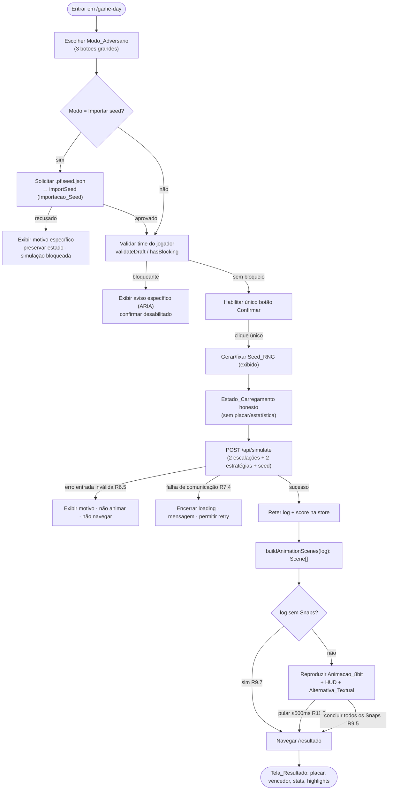
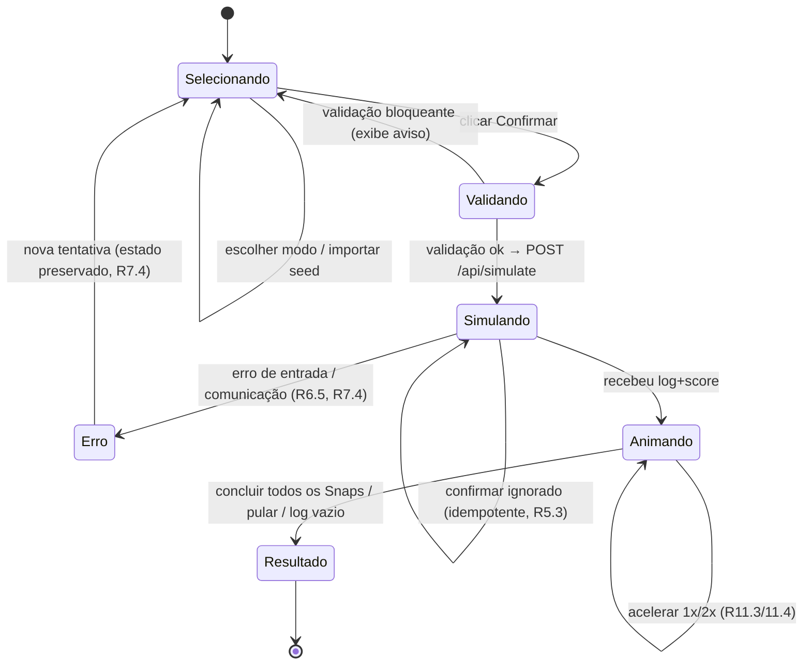

# Documento de Design — pfl-gameday-result-ui

## Overview

A spec `pfl-gameday-result-ui` entrega **as duas telas funcionais restantes** do PFL — **Game Day** (`/game-day`) e **Resultado** (`/resultado`) — fechando o fluxo de quatro telas (Meu Time → Estratégia → Game Day → Resultado). É a quinta e última das cinco specs do projeto, um webapp Next.js (React + TypeScript, App Router) na Vercel sobre Supabase.

A tela Game Day apresenta três modos de adversário em botões grandes, valida elenco e seed antes de simular, confirma a simulação com um clique e **invoca a `Funcao_Simulacao`** (POST `/api/simulate`, já entregue por `pfl-simulation-engine`) passando as duas Escalacoes, as duas Estrategias e um `Seed_RNG`. De posse do `Log_Partida` e do `Placar` retornados, a tela exibe o andamento (placar, quarto, relógio, down/distância, posse, narrativa, clima) e reproduz uma **Animacao_8bit determinística** dos sprites dos Pokémon dos dois times. A tela Resultado apresenta placar final, vencedor/empate, estatísticas sucintas, highlights e navegação de volta.

### O que esta spec entrega

1. **Duas rotas App Router** — `app/game-day/page.tsx` e `app/resultado/page.tsx` — com componentes React de **apresentação** (burros) separados da **lógica de orquestração** client-side.
2. **Store de partida client-side** (`lib/match/store.ts`) que mantém `{ seedRng, log, score, teamModeDoAdversario, status }` e é **compartilhada entre as duas telas** (sobrevive à navegação Game Day → Resultado).
3. **Adaptador de chamada** à `Funcao_Simulacao` (`lib/match/simulate-client.ts`): monta o `SimulateRequest`, trata erro de entrada inválida e falha de comunicação, retém `log`+`score`.
4. **Funções puras e testáveis** que são o coração desta spec:
   - `buildAnimationScenes(log): Scene[]` — mapeia os Snaps do `Log_Partida` para cenas da animação, de forma **pura e determinística**;
   - `selectHighlights(log): Highlight[]` — deriva os highlights do log por regra pura;
   - `determineOutcome(score): Outcome` — vencedor/empate a partir do `Placar`;
   - `modoParaBot(modo): BotMode` — mapeia o `Modo_Adversario` para o modo de bot do motor.
5. **Player de animação** (`components/gameday/AnimationPlayer.tsx`) que apenas **reproduz** a sequência de cenas já computada, com controles de pular/acelerar acessíveis e Alternativa_Textual.
6. **Camada fina de sprites** (`lib/match/sprites.ts`) sobre a Camada_Leitura (`lib/data/`), lendo sprites de `raw_data` com **substituto padrão** quando ausente.

### O que está fora de escopo

A **lógica interna do motor** (spec 3) — esta spec não simula, não calcula resultado e não gera aleatoriedade de jogo; a **montagem de roster e a seleção de estratégia** (spec 4); a **definição do schema** (spec 1); e a **camada de leitura do catálogo** (spec 2), que esta spec apenas consome. A Animacao_8bit é **representação visual** do `Log_Partida` e nunca altera `Placar` nem `Log_Partida`.

### Princípios de design

1. **O log é a única verdade.** Todo valor exibido (placar, quarto, relógio, down/distância, posse, narrativa, clima, estatísticas, highlights, vencedor) é **lido ou derivado por função pura** do `Log_Partida`/`Placar` retornados pela `Funcao_Simulacao`. Nenhum recálculo de resultado no cliente (R6.4, R8.5, R13.4, R14.3, R17.5).
2. **Apresentação separada de lógica.** Componentes React recebem estado + callbacks. As regras de interpretação do log vivem em módulos puros TypeScript (`lib/match/`), testáveis por PBT sem DOM nem rede.
3. **Animação como função pura do log + player burro.** `buildAnimationScenes(log)` produz a sequência completa de cenas de forma determinística; o `AnimationPlayer` só percorre essa sequência. `requestAnimationFrame` é usado **apenas para o timing de reprodução** (cadência), nunca para decidir **quais** cenas existem ou em que ordem (R9, R10).
4. **Validação reusada, nunca reimplementada.** A validação do time do jogador reusa `validateDraft`/`hasBlocking` de `lib/validation/` (spec 4); a seed do adversário no Modo_Importar_Seed reusa `importSeed` do fluxo de Importacao_Seed (spec 4). Esta spec não redefine "válido" (R3, R4).
5. **Seed de RNG separado do seed de time.** O `Seed_RNG` é gerado/fornecido como entrada distinta, nunca derivado do seed de time; é **exibido ao jogador** e permite Reproducao_Por_Seed (R6.2, R16.3).
6. **Carregamento honesto.** Enquanto a `Funcao_Simulacao` roda e o log não chegou, a tela mostra Estado_Carregamento e **não exibe** placar/estatística/andamento (R7). Erros são legíveis e associados por ARIA (R7.4, R17.7).
7. **Anti-slop como filtro.** Botões grandes rotulados, foco visível, teclado, contraste, estados distinguíveis por mais de um recurso visual, Alternativa_Textual, nenhum número sem origem. Seguimos as regras anti-slop instaladas pela foundation (R17).

### Rastreabilidade requisito → seção

| Requisito | Seção principal |
|---|---|
| R1 Modos em botões grandes | Components (Game Day) · Acessibilidade |
| R2 Mapeamento modo→bot | `modoParaBot` · Integração com o motor · Property 8 |
| R3 Importação de seed do adversário | Integração com o motor · Error Handling |
| R4 Validação antes de simular | Fluxo Game Day · Validação · Error Handling |
| R5 Confirmação com um clique | Fluxo Game Day · Máquina de estados |
| R6 Invocação com Seed_RNG | Integração com o motor · Data Models |
| R7 Carregamento honesto | Máquina de estados · Error Handling |
| R8 Andamento da partida | Components (Game Day) · HUD |
| R9 Animação dirigida pelo log | Player de animação · `buildAnimationScenes` |
| R10 Determinismo da animação | `buildAnimationScenes` · Correctness Properties |
| R11 Pular/acelerar/alternativa | Player de animação · Controles · Acessibilidade |
| R12 Efeitos inertes na narrativa | HUD/Narrativa · `buildAnimationScenes` |
| R13 Placar final e resultado | Components (Resultado) · `determineOutcome` |
| R14 Estatísticas e highlights | Components (Resultado) · `selectHighlights` |
| R15 Navegação | Rotas · Components (Resultado) |
| R16 Determinismo/reprodução por seed | Store · Integração · Correctness Properties |
| R17 Acessibilidade/anti-slop | Anti-slop e Acessibilidade |

## Architecture

### Visão de alto nível

Esta spec vive quase inteiramente no **cliente** (dois Client Components com uma store compartilhada), consumindo um único endpoint de backend já existente (`POST /api/simulate`) e a Camada_Leitura para sprites. A lógica de interpretação do log é um conjunto de **funções puras** reutilizáveis.

```mermaid
graph TB
    subgraph Browser["Browser (Client Components)"]
        GD["/game-day page.tsx<br/>orquestração"]
        RES["/resultado page.tsx<br/>apresentação"]
        STORE[("MatchStore (client-side)<br/>seedRng + log + score + status")]
        PLAYER["AnimationPlayer<br/>(player burro: reproduz cenas)"]
        HUD["HUD de andamento<br/>+ Alternativa_Textual"]
    end

    subgraph Pure["Módulos puros (sem DOM, sem rede)"]
        SCENES["buildAnimationScenes(log): Scene[]"]
        HL["selectHighlights(log): Highlight[]"]
        OUT["determineOutcome(score): Outcome"]
        MAP["modoParaBot(modo): BotMode"]
        READ["readers: progresso/estatísticas do log"]
    end

    subgraph Reuse["Reuso de specs anteriores"]
        VAL["lib/validation/ (spec 4)<br/>validateDraft / hasBlocking"]
        IMP["lib/seed/import (spec 4)<br/>importSeed"]
        SPR["lib/match/sprites.ts →<br/>lib/data/ (spec 2) raw_data"]
    end

    subgraph Backend["Backend existente (spec 3)"]
        API["POST /api/simulate<br/>Funcao_Simulacao"]
    end

    GD --> VAL
    GD --> IMP
    GD -->|SimulateRequest| API
    API -->|{ log, score }| STORE
    GD --> STORE
    STORE --> PLAYER
    STORE --> HUD
    PLAYER --> SCENES
    PLAYER --> SPR
    HUD --> READ
    STORE --> RES
    RES --> HL
    RES --> OUT
    GD --> MAP
```

**Fronteira de pureza.** As funções `buildAnimationScenes`, `selectHighlights`, `determineOutcome`, `modoParaBot` e os leitores de andamento **não** fazem I/O, não leem relógio de sistema, não usam `Math.random` nem `Date`. Recebem o `Log_Partida`/`Placar`/modo como entrada e devolvem dados. Isso torna o determinismo da animação (R10) e a rastreabilidade dos valores (R8.5, R17.5) verificáveis por teste.

### Rotas (App Router)

```
app/
├─ game-day/
│  └─ page.tsx                 # Tela_Game_Day (Client Component: orquestra validação→confirmar→simular→animar)
└─ resultado/
   └─ page.tsx                 # Tela_Resultado (apresentação do log+placar já na store)
```

Não há novos Route Handlers nesta spec: o único backend chamado é `POST /api/simulate` (spec 3). As Server Actions de salvar/exportar/importar time pertencem à spec 4; o Modo_Importar_Seed reusa o pipeline `importSeed` client-side de `lib/seed/import`.

### Estado da partida compartilhado entre telas

As duas telas compartilham a **mesma store de partida** (`MatchStore`), um documento em memória no cliente. A navegação Game Day → Resultado **não** reenvia a simulação: `/resultado` lê o `log`+`score` já retidos. Como Next.js App Router não garante preservação de estado de módulo entre navegações duras, a store é um **React Context + provider montado acima das duas rotas** (num layout comum) complementado por um snapshot em `sessionStorage` serializado de forma estável, para sobreviver a refresh/deep-link em `/resultado`. O roteamento usa `router.push('/resultado')`; nenhum dado de partida trafega pela URL exceto o `Seed_RNG` exibível (rastreabilidade, R16.3), que também fica na store.

> Decisão: **router state via store compartilhada**, não query string. O `Log_Partida` é grande e não deve ir na URL; apenas o `Seed_RNG` é exibido ao jogador (e opcionalmente refletido na URL como rótulo de rastreabilidade, sem ser a fonte de verdade).

### Fluxo das telas (Game Day → animação → Resultado)



### Máquina de estados da tela Game Day

A orquestração client-side é modelada como uma FSM explícita na store, o que torna "um clique só", "loading honesto" e "não reenviar" invariantes verificáveis (R5.2, R5.3, R7).



### Decisões de arquitetura e justificativas

- **Funções puras no centro.** Extrair `buildAnimationScenes`, `selectHighlights`, `determineOutcome` e `modoParaBot` como puras permite (a) PBT com 100+ iterações sem DOM/rede e (b) garantir que a animação e o resultado são **função do log**, nunca de entropia local (R10, R13.4, R14.3).
- **Player separado do planejador de cenas.** O `AnimationPlayer` recebe `Scene[]` prontas e só gerencia índice/cadência/velocidade. Pular = ir ao fim da lista; acelerar = reduzir o intervalo entre avanços. A **sequência** nunca depende do player (R9.1, R10.1).
- **Cadência derivada do log, não do relógio real.** Cada `Scene` carrega uma `durationHint` derivada deterministicamente do próprio Snap (ex. função do tempo decorrido no relógio de jogo entre Snaps). O `requestAnimationFrame` só compara tempo decorrido de parede contra essa `durationHint × fator de velocidade` para decidir **quando** avançar; nunca **para onde** (R10.2).
- **Reuso estrito de validação e import.** Chamar `validateDraft`/`importSeed` das specs anteriores evita divergência de "válido" entre telas (R4, R3) e mantém esta spec sem lógica de regras de time.
- **Sprites com substituto puro.** `lib/match/sprites.ts` resolve a URL do sprite a partir de `raw_data` da espécie (via Camada_Leitura); se ausente, devolve o **sprite substituto padrão** empacotado no app, sem acesso externo (R9.2, R9.6).
- **Store compartilhada, não refetch.** Reter `log`+`score` na store evita simular de novo ao navegar (determinismo trivial entre telas) e permite reproduzir a mesma animação a partir do mesmo log (R16.2).

## Components and Interfaces

### Contratos consumidos (de specs anteriores)

Esta spec **não redefine** estes tipos; importa-os. Reproduzidos aqui para fixar o contrato de consumo.

```typescript
// de pfl-simulation-engine (app/api/simulate + lib/sim/types)
interface SimulateRequest {
  home: LineupInput; away: LineupInput;
  strategyHome: StrategyInput; strategyAway: StrategyInput;
  seed: string;                 // Seed_RNG em decimal, "0".."2^64-1"
  botModeHome?: BotMode; botModeAway?: BotMode;   // 'random' | 'curti' | 'seeded'
}
interface SimulateResponse { log: GameLog; score: Score; }
interface SimulateError { error: string; field?: string; }

type Weather = 'CLEAR' | 'RAIN' | 'WIND' | 'HEAT' | 'COLD';
interface StateSnapshot {
  quarter: number; gameClock: number;      // décimos de segundo (inteiro)
  down: number; distance: number; ballOn: number;
  possession: 'home' | 'away';
  score: { home: number; away: number };
  weather: Weather;
}
interface LogEvent {
  seq: number; type: string;               // LogEventType
  snap?: number; tick?: number;
  state: StateSnapshot;
  narrative: string;
  detail: Record<string, unknown>;
  powerReason?: string;                    // 'SUPPRESSED_IN_SPHERE' | 'INERT_WITH_WARNING' | ...
}
interface GameStats {
  rushes: { attempts: number; yards: number };
  passes: { attempts: number; completions: number; yards: number; interceptions: number };
  turnovers: number; fouls: number;
  scoringSummary: { type: 'TD'|'FG'|'SAFETY'|'PAT'|'TWO_PT'; team: 'home'|'away'; quarter: number }[];
}
interface GameLog {
  seedUsed: string; baselineVersion: string; baselineStatus: string;
  events: LogEvent[]; stats: GameStats;
}
interface Score { home: number; away: number; final: boolean; tie: boolean }

// de pfl-team-strategy-ui (lib/validation, lib/seed/import, lib/team/model)
type BotMode = 'random' | 'curti' | 'seeded';
function validateDraft(draft: TeamDraft, elig: EligibilitySnapshot, anat: AnatomyConventions): ValidationWarning[];
function hasBlocking(warnings: ValidationWarning[]): boolean;
function importSeed(rawBytes: Uint8Array, elig: EligibilitySnapshot): ImportResult; // { ok:true, draft } | { ok:false, reason }

// de pfl-data-catalog (lib/data) — species.raw_data contém o objeto `sprites` da PokéAPI
function getAllowedSpecies(): Promise<SpeciesSummary[]>;
// acesso a raw_data da espécie para extrair sprites (ver lib/match/sprites.ts)
```

### Store de partida (`lib/match/store.ts`)

Documento em memória compartilhado pelas duas telas, com transições puras e um snapshot serializável.

```typescript
type MatchPhase = 'Selecionando' | 'Validando' | 'Simulando' | 'Animando' | 'Resultado' | 'Erro';

interface MatchState {
  phase: MatchPhase;
  modo: ModoAdversario | null;              // seleção atual (R1.2)
  seedRng: string | null;                   // Seed_RNG exibível (R16.3), distinto do seed de time (R6.2)
  adversarioSeedDraft: TeamDraft | null;    // time do adversário quando Modo_Importar_Seed (R3.3)
  log: GameLog | null;                      // retido após sucesso (R6.3)
  score: Score | null;
  erro: MatchError | null;                  // mensagem legível + alvo ARIA (R7.4, R17.7)
}

type ModoAdversario = 'bot_aleatorio' | 'desafiar_curti' | 'importar_seed';
interface MatchError { kind: 'VALIDATION' | 'IMPORT' | 'INPUT' | 'NETWORK'; message: string; field?: string; }

interface MatchStore {
  getState(): MatchState;
  selecionarModo(modo: ModoAdversario): void;         // R1.2 (só na fase Selecionando)
  setAdversarioSeed(draft: TeamDraft): void;          // após importSeed aprovado (R3.3)
  iniciarSimulacao(seedRng: string): void;            // Selecionando→Validando→Simulando (R5.2)
  concluirSimulacao(log: GameLog, score: Score): void;// Simulando→Animando (R6.3)
  registrarErro(e: MatchError): void;                 // Simulando→Erro (R6.5, R7.4)
  irParaResultado(): void;                            // Animando→Resultado
  reset(): void;
  // persistência de sobrevivência a refresh/deep-link em /resultado
  snapshot(): string;                                 // stableStringify do estado
  restore(snapshot: string): void;
}
```

Regra de idempotência (R5.3): `iniciarSimulacao` só transita de `Selecionando`; chamadas na fase `Simulando` são ignoradas. A store **nunca** calcula placar/estatística — apenas retém o que o motor devolveu (R6.4).

### Adaptador de chamada ao motor (`lib/match/simulate-client.ts`)

```typescript
interface SimulateInput {
  playerLineup: LineupInput; playerStrategy: StrategyInput;
  adversaryLineup: LineupInput; adversayStrategy: StrategyInput;
  seedRng: string;                        // decimal uint64; distinto do seed de time (R6.2)
  botModeAway: BotMode;                   // modoParaBot(modo) (R2)
}

type SimulateOutcome =
  | { ok: true; log: GameLog; score: Score }
  | { ok: false; kind: 'INPUT'; message: string; field?: string }   // 400 do motor (R6.5)
  | { ok: false; kind: 'NETWORK'; message: string };                // falha de comunicação (R7.4)

// Monta o SimulateRequest, faz POST /api/simulate uma única vez e normaliza o erro.
async function runSimulation(input: SimulateInput): Promise<SimulateOutcome>;
```

- Monta o corpo com **as duas escalações, as duas estratégias e o `Seed_RNG`** (R6.1).
- Erro `400 { error, field }` do motor → `{ ok:false, kind:'INPUT' }` (não anima nem navega, R6.5).
- Exceção de rede/timeout → `{ ok:false, kind:'NETWORK' }` (encerra loading, permite retry, R7.4).
- Sucesso → `{ ok:true, log, score }` retido na store (R6.3). Nenhum valor é recalculado (R6.4).

### Mapeamento modo → bot (`lib/match/modo.ts`)

```typescript
// Função pura e total sobre os três modos suportados (R2.4).
function modoParaBot(modo: ModoAdversario): BotMode {
  switch (modo) {
    case 'bot_aleatorio':  return 'random';   // Bot aleatório (R2.1)
    case 'desafiar_curti': return 'curti';    // Bot Curti, preset CURTI (R2.2)
    case 'importar_seed':  return 'seeded';   // Bot de seed de terceiros (R2.3)
  }
}
const MODOS_SUPORTADOS: readonly ModoAdversario[] =
  ['bot_aleatorio', 'desafiar_curti', 'importar_seed'];   // R2.4
```

O tipo `ModoAdversario` é fechado nos três modos; a UI só oferece esses três (R1.1, R2.4). Nenhum outro valor é construível.

### Geração do Seed_RNG (`lib/match/seed-rng.ts`)

```typescript
// Gera um Seed_RNG uint64 como string decimal. Fonte de entropia APENAS na geração
// de uma NOVA partida (não dentro de nenhuma função pura). Para reprodução, o jogador
// pode reinformar um seed anterior.
function gerarSeedRng(): string;                        // "0".."18446744073709551615"
function parseSeedRng(entrada: string): string | null;  // valida faixa uint64; null se inválido
```

O `Seed_RNG` **não** é derivado do seed de time (R6.2); a store o guarda e a tela o exibe de forma rastreável (R16.3). Reusar o mesmo `Seed_RNG` + mesmas escalações/estratégias reproduz log, placar e animação (R16.1, R16.2).

### Leitores de andamento (`lib/match/progress.ts`)

Funções puras que projetam o `Log_Partida` nos valores exibidos pelo HUD. Nenhuma inventa números: tudo vem do `state`/`narrative`/`detail` dos eventos (R8.5, R17.5).

```typescript
interface ProgressFrame {
  score: { home: number; away: number };   // R8.1 (do state.score)
  quarter: number; gameClockDeci: number;  // R8.2
  down: number; distance: number;          // R8.2
  possession: 'home' | 'away';             // R8.2
  weather: Weather;                        // R8.4 (apenas exibe; nunca sorteia)
  narrative: string;                       // R8.3
  warnings: string[];                      // avisos de Efeito_Inerte/powerReason do Snap (R12.1)
}

// Projeta o evento de índice i em um ProgressFrame legível (ordem determinística do log).
function progressAt(log: GameLog, eventIndex: number): ProgressFrame;
// Formata o relógio (décimos → mm:ss) e rótulos de down/distância para exibição.
function formatClock(gameClockDeci: number): string;
```

Os `warnings` reúnem o `powerReason` do evento (ex. `INERT_WITH_WARNING`, `SUPPRESSED_IN_SPHERE`) e o texto correspondente do `detail`, exibidos **junto** à narrativa do Snap. A tela nunca representa bônus que o log não aplicou (R12.2, R12.3).

### Planejador de cenas da animação (`lib/match/animation.ts`)

O coração determinístico da Animacao_8bit. **Função pura**: mesmo log ⇒ mesmas cenas.

```typescript
interface SpriteRef { pokemonId: number; }   // resolvido para imagem pelo player via lib/match/sprites

interface Scene {
  index: number;                 // 0..N-1, na ordem determinística do log
  snap: number;                  // número do Snap representado
  eventIndex: number;            // índice do LogEvent de origem (rastreabilidade)
  offense: 'home' | 'away';      // posse neste Snap
  offenseSprites: SpriteRef[];   // Pokémon da unidade ofensiva (do log/escalação)
  defenseSprites: SpriteRef[];   // Pokémon da unidade defensiva
  resultKind: string;            // tipo de resultado (ganho, passe, TD, turnover...) do detail
  narrative: string;             // Narrativa_Snap (= Alternativa_Textual)
  warnings: string[];            // avisos inertes/supressão do Snap (R12.1)
  durationHint: number;          // duração-base da cena em ms, DERIVADA do log (não do relógio real)
}

// Mapeia os Snaps do Log_Partida para a sequência de cenas, na mesma ordem determinística,
// sem omitir, reordenar nem repetir Snaps (R9.1). Pura: sem Math.random, sem Date (R10.2).
// Log sem Snaps → retorna [] (R9.7).
function buildAnimationScenes(log: GameLog): Scene[];
```

Mapeamento Snap → cena (puro e testável):

1. Filtra os eventos que representam Snaps jogados (ex. `type` em `{SNAP, PLAY_RESULT}`), preservando a ordem crescente de `seq`.
2. Para cada Snap, lê posse (`state.possession`), monta `offenseSprites`/`defenseSprites` a partir dos Pokémon das unidades daquele lado (identificados por `pokemonId` no log/escalação resolvida), extrai `resultKind` do `detail`, `narrative` do evento e `warnings` do `powerReason`/`detail`.
3. Deriva `durationHint` deterministicamente do próprio Snap — por exemplo, proporcional ao tempo de relógio consumido entre este Snap e o anterior (`clamp` em `[MIN_MS, MAX_MS]`), **sem** consultar o relógio real.
4. Numera `index` sequencialmente. Resultado: uma lista cuja identidade é função pura do `log`.

### Player de animação (`components/gameday/AnimationPlayer.tsx`)

Componente de apresentação que **reproduz** `Scene[]`; não decide a sequência.

```typescript
interface AnimationPlayerProps {
  scenes: Scene[];                 // de buildAnimationScenes(log)
  speed: 1 | 2;                    // 1x/2x (R11.3/11.4)
  onAdvance?: (index: number) => void;  // para sincronizar HUD/Alternativa_Textual
  onComplete: () => void;          // chamado ao concluir todas as cenas (R9.5)
}
```

Reprodução:
- Mantém `currentIndex`. Um laço de `requestAnimationFrame` acumula tempo decorrido de parede; quando atinge `scenes[currentIndex].durationHint / speed`, avança para `currentIndex + 1`. O `rAF` só controla **cadência**; a lista é imutável (R10.1, R10.2).
- **Pular** (`Controle_Pular`): define `currentIndex = scenes.length` e chama `onComplete` em ≤500ms (R11.2). Como não há recomputação, é imediato.
- **Acelerar** (`Controle_Acelerar`): alterna `speed` 1x↔2x; só muda o divisor de cadência, nunca o log (R11.3, R11.4).
- Cada sprite é resolvido por `resolveSprite(pokemonId)`; ausência → substituto padrão (R9.6).
- `scenes.length === 0` → chama `onComplete` imediatamente (log vazio, R9.7).

Controles e Alternativa_Textual (R11.1, R11.5, R11.6, R17):
- `Controle_Pular` e `Controle_Acelerar` são `<button>` reais, focáveis e acionáveis por teclado (Enter/Espaço), com rótulo textual e indicador de foco visível.
- A Alternativa_Textual é uma região `aria-live="polite"` que exibe a `narrative` (+`warnings`) da cena corrente e também a lista completa de narrativas, de modo que o andamento seja compreensível **sem** a animação, independentemente de ter sido pulada/acelerada/reproduzida (R11.5, R17.4).
- Quando a animação não está disponível ou já concluiu, os controles de pular/acelerar são ocultados e a Alternativa_Textual permanece acessível (R11.7).

### Camada fina de sprites (`lib/match/sprites.ts`)

```typescript
interface SpriteResolution { src: string; isFallback: boolean; alt: string; }

// Resolve o sprite 8-bit a partir de raw_data da espécie (Camada_Leitura).
// Nunca acessa fontes externas em tempo de execução (R9.2); ausência → substituto padrão (R9.6).
function resolveSprite(pokemonId: number, species: SpeciesRawIndex): SpriteResolution;
```

- `species.raw_data` da PokéAPI contém o objeto `sprites` (ex. `front_default`, `versions.generation-i...` para arte 8-bit). O resolvedor escolhe de forma **determinística** a entrada 8-bit preferida presente; se nenhuma estiver disponível, retorna `{ src: SPRITE_SUBSTITUTO, isFallback: true }` (R9.6).
- O `SPRITE_SUBSTITUTO` é um asset empacotado no app (ex. `public/sprites/substituto.png`), nunca uma URL externa.
- `alt` descreve o Pokémon para leitores de tela (acessibilidade, R17.4).

### Componentes da Tela Game Day (`components/gameday/`)

| Componente | Responsabilidade | Requisitos |
|---|---|---|
| `SeletorModo` | Três `<button>` grandes rotulados: "Bot aleatório", "Desafiar Curti", "Importar seed". Marca o selecionado por mais de um recurso visual. | R1.1–R1.3, R17.2, R17.3, R17.6 |
| `ImportadorSeedAdversario` | No Modo_Importar_Seed, pede `.pflseed.json`, chama `importSeed`; em recusa, exibe o motivo específico associado por ARIA e bloqueia a simulação. | R3.1–R3.4, R17.7 |
| `BotaoConfirmar` | Único controle de confirmação; habilitado só quando validação ok e modo selecionado; idempotente durante `Simulando`. | R4.5, R5.1–R5.3, R17.3 |
| `EstadoCarregamento` | Indicador honesto "simulando a partida"; nenhum placar/estatística visível. | R7.1–R7.3 |
| `PainelAndamento` (HUD) | Placar, quarto, relógio, down/distância, posse, clima e narrativa do Snap corrente via `progressAt`. | R8.1–R8.5, R12.1 |
| `AnimationPlayer` | Reproduz as cenas (acima). | R9, R10, R11 |
| `AlternativaTextual` | Região `aria-live` com a narrativa + avisos do log. | R11.5, R12.1, R17.4 |
| `AvisoErro` | Mensagem legível de erro de validação/importação/entrada/comunicação, associada por ARIA ao controle; permite retry. | R6.5, R7.4, R17.7 |
| `SeedRngDisplay` | Exibe o `Seed_RNG` da partida corrente de forma rastreável/copiável. | R16.3 |

### Componentes da Tela Resultado (`components/result/`)

| Componente | Responsabilidade | Requisitos |
|---|---|---|
| `PlacarFinal` | Placar final de cada time direto do `Score`. | R13.1, R13.4 |
| `ResultadoDesfecho` | Vencedor (maior pontuação) ou empate, via `determineOutcome`. | R13.2–R13.4 |
| `EstatisticasPartida` | Corridas, passes, turnovers, faltas de `log.stats` (`GameStats`). | R14.1, R14.3 |
| `Highlights` | Lista de highlights de `selectHighlights(log)`. | R14.2, R14.3 |
| `NavegacaoResultado` | Botões rotulados "Voltar ao Game Day" (→ `/game-day`) e "Editar time" (→ Meu Time, `/time`). | R15.1–R15.3 |

### Resultado: funções puras (`lib/match/result.ts`)

```typescript
type Outcome =
  | { kind: 'winner'; team: 'home' | 'away' }   // pontuações diferentes (R13.2)
  | { kind: 'tie' };                            // iguais ao fim do tempo regulamentar (R13.3)

// Deriva o desfecho exclusivamente do Placar (R13.4). Não recalcula nada do log.
function determineOutcome(score: Score): Outcome;

interface Highlight {
  eventIndex: number;        // rastreabilidade ao evento de origem (R14.3)
  quarter: number; clock: string;
  kind: string;              // TD, FG, SAFETY, TURNOVER, FALTA relevante...
  text: string;              // derivado da narrativa/detail do evento
}

// Deriva os highlights SOMENTE do Log_Partida, por regra pura e determinística (R14.2, R14.3).
// Ex.: seleciona eventos de scoring (scoringSummary) e turnovers na ordem do log.
function selectHighlights(log: GameLog): Highlight[];
```

`determineOutcome` usa `score.home`/`score.away`; `score.tie` do motor é coerente com igualdade. `selectHighlights` percorre `log.events`/`log.stats.scoringSummary` em ordem determinística, sem inventar eventos (todo highlight referencia um `eventIndex`).

### Acessibilidade e anti-slop (transversal)

- **Teclado e ordem de foco** (R17.1): todos os controles (três botões de modo, importar, confirmar, pular, acelerar, navegação do resultado) são elementos interativos nativos, em ordem de DOM que segue a sequência visual; nenhum controle inacessível por teclado.
- **Foco visível** (R17.2, R11.6): indicador de foco com contraste suficiente, distinto dos estados de erro/seleção.
- **Alvos grandes rotulados** (R17.3): os três modos e o confirmar têm área ampla e rótulo textual explícito (não só ícone).
- **Alternativa_Textual** (R17.4, R11.5): a narrativa do log torna o andamento compreensível sem a animação.
- **Origem rastreável** (R17.5, R8.5, R14.3): todo número vem do `Log_Partida`/`Placar`/Camada_Leitura; nenhum valor é fabricado no cliente.
- **Mais de um recurso visual** (R17.6): estados de foco/erro/seleção se distinguem por forma/ícone/borda além da cor; texto legível sobre o fundo.
- **ARIA em erros** (R17.7): mensagens de erro/validação associadas por `aria-describedby`/`aria-errormessage` ao controle, anunciadas por leitor de tela ao focar.

## Data Models

Esta spec **não cria tabelas**. Seus modelos são **estruturas em memória** no cliente, derivadas dos contratos das specs anteriores. Nenhuma persistência própria além do snapshot de sessão da store (que serializa `MatchState`).

### Estado da partida (store, em memória)

```typescript
interface MatchState {
  phase: 'Selecionando' | 'Validando' | 'Simulando' | 'Animando' | 'Resultado' | 'Erro';
  modo: ModoAdversario | null;
  seedRng: string | null;            // uint64 decimal, distinto do seed de time (R6.2, R16.3)
  adversarioSeedDraft: TeamDraft | null;   // só no Modo_Importar_Seed (R3.3)
  log: GameLog | null;               // retido do motor (R6.3), fonte de todo andamento (R6.4)
  score: Score | null;               // retido do motor
  erro: MatchError | null;
}
```

Invariantes (verificados pela FSM e pelas Correctness Properties):

```
phase = 'Animando'  ⇒ log ≠ null ∧ score ≠ null                 (R6.3)
phase = 'Resultado' ⇒ log ≠ null ∧ score ≠ null
phase ∈ {'Selecionando','Validando','Simulando'} ⇒ HUD/placar não exibidos  (R7.3)
seedRng é string decimal em [0, 2^64−1] quando ≠ null           (R6.1, R6.2)
modo ∈ {'bot_aleatorio','desafiar_curti','importar_seed'}        (R1.1, R2.4)
score e log vêm EXCLUSIVAMENTE da Funcao_Simulacao               (R6.4, R8.5, R17.5)
```

### Cenas de animação (derivadas, puras)

```typescript
// Scene[] = buildAnimationScenes(log) — ver Components.
// Invariantes:
//   scenes.length = número de Snaps jogados no log            (R9.1)
//   scenes[i].index = i, em ordem crescente de seq do log     (R9.1, R10.1)
//   nenhum Snap omitido/reordenado/repetido                   (R9.1)
//   buildAnimationScenes é determinística: log ⇒ scenes       (R10.1, R10.2)
//   log sem Snaps ⇒ scenes = []                               (R9.7)
```

### Projeções de leitura (derivadas, puras)

```typescript
// ProgressFrame = progressAt(log, i)   — HUD de andamento (R8)
// Outcome       = determineOutcome(score) — desfecho (R13)
// Highlight[]   = selectHighlights(log)   — resumo de eventos (R14)
// SpriteResolution = resolveSprite(pokemonId, speciesRawIndex) — sprite 8-bit ou substituto (R9.2, R9.6)
```

Todas as projeções têm como entrada **apenas** dados do motor (`GameLog`/`Score`) ou da Camada_Leitura (`raw_data`), nunca entropia local — base das propriedades de rastreabilidade e determinismo.

### Fonte dos sprites 8-bit

- Os sprites vêm de `species.raw_data.sprites` (estrutura fiel da PokéAPI preservada por `pfl-data-catalog`). O resolvedor seleciona de forma determinística a melhor entrada 8-bit disponível.
- `SPRITE_SUBSTITUTO` é um asset local empacotado (`public/`), usado quando a espécie não tem sprite disponível, **sem** acesso externo (R9.6).

## Correctness Properties

*Uma propriedade é uma característica ou comportamento que deve valer para todas as execuções válidas do sistema — essencialmente, uma afirmação formal sobre o que o sistema deve fazer. Propriedades são a ponte entre especificações legíveis por humanos e garantias de correção verificáveis por máquina.*

Esta spec é dominada por **funções puras** que interpretam o `Log_Partida`/`Placar` (`buildAnimationScenes`, `selectHighlights`, `determineOutcome`, `modoParaBot`, `progressAt`, `resolveSprite`) e por transições puras da store. Essas funções são o alvo natural de testes de propriedade. A UI estática, a navegação, a acessibilidade visual e a integração com o endpoint do motor são cobertas por testes de componente/a11y/integração (ver Testing Strategy), não por propriedades universais.

As propriedades abaixo resultam da análise de prework e de uma **reflexão de consolidação** que eliminou redundâncias: a rastreabilidade (6.4, 8.1, 8.2, 8.4, 8.5, 13.4, 14.3, 17.5) foi unificada numa propriedade transversal de "origem rastreável", complementada por propriedades específicas de projeção; o determinismo da animação (10.1, 10.2, 16.2) foi unificado; a bijeção ordenada Snap↔cena (9.1, 9.3) virou uma propriedade; as recusas com preservação de estado (3.2, 4.3, 4.4) foram parametrizadas por regra; o mapeamento modo→bot (2.1–2.4) virou uma propriedade de totalidade; o gate de confirmação (4.5, 5.1) e a idempotência (5.2, 5.3) foram unificados; e os avisos inertes (12.1–12.3) foram consolidados numa propriedade de fidelidade.

### Property 1: Mapeamento modo → bot é total e correto

*Para todo* `Modo_Adversario` em `MODOS_SUPORTADOS`, `modoParaBot` é definido e retorna exatamente o modo de bot correspondente (`bot_aleatorio`→`random`, `desafiar_curti`→`curti`, `importar_seed`→`seeded`), e o conjunto de modos ofertados tem cardinalidade três — nenhum modo fora desses é construível ou mapeável.

**Validates: Requirements 2.1, 2.2, 2.3, 2.4**

### Property 2: Seleção de modo registra exatamente o modo escolhido

*Para todo* `Modo_Adversario`, aplicar `selecionarModo(modo)` a partir da fase `Selecionando` resulta em `state.modo === modo`, sem afetar nenhum outro campo da partida.

**Validates: Requirements 1.2**

### Property 3: Gate de confirmação habilita se e somente se validação aprovada e modo selecionado

*Para todo* estado da store, o controle de confirmação está habilitado se e somente se há um `Modo_Adversario` selecionado, a validação do time do jogador não tem avisos bloqueantes (`hasBlocking(validateDraft(...)) === false`) e — no `Modo_Importar_Seed` — a seed do adversário foi aprovada; enquanto existir qualquer condição pendente ou recusada, o controle permanece indisponível.

**Validates: Requirements 4.5, 5.1**

### Property 4: Validação bloqueante impede a simulação e preserva o estado

*Para todo* `TeamDraft` cujo `validateDraft` produz ao menos um aviso bloqueante, acionar a confirmação não invoca a `Funcao_Simulacao`, mantém a Escalacao e a Estrategia inalteradas e registra um erro cuja mensagem identifica o item inválido e o motivo.

**Validates: Requirements 4.1, 4.3**

### Property 5: Recusa de seed/validação do adversário preserva o estado e explica o motivo

*Para toda* `ImportResult` com `ok === false` (qualquer `ImportRejection`), ao processá-la a store não entra em `Simulando`, preserva o `adversarioSeedDraft` anterior e o estado corrente da tela, e registra um erro cuja mensagem reflete o motivo específico da recusa; a simulação só prossegue quando a seed foi aprovada.

**Validates: Requirements 3.2, 4.2, 4.4**

### Property 6: Confirmação é idempotente por partida

*Para toda* sequência de acionamentos do controle de confirmação de uma mesma partida, `runSimulation` é invocada no máximo uma vez: `iniciarSimulacao` só transita da fase `Selecionando`, e qualquer acionamento durante `Simulando`/`Animando` é um no-op.

**Validates: Requirements 5.2, 5.3**

### Property 7: O request de simulação contém as duas escalações, as duas estratégias e o Seed_RNG

*Para toda* confirmação válida, o corpo enviado a `POST /api/simulate` contém, presentes e não vazios, a Escalacao do jogador, a Escalacao do adversário, a Estrategia do jogador, a Estrategia do adversário e o `seed`, e o `botModeAway` é `modoParaBot(modo)`.

**Validates: Requirements 6.1, 2.3**

### Property 8: Seed_RNG é independente do seed de time

*Para todo* par (seed de time, `Seed_RNG`), o `seed` enviado ao motor é exatamente o `Seed_RNG` fornecido; variar arbitrariamente o seed de time (ou o `teamSeedId` da seed importada) não altera o `Seed_RNG` enviado, e o `Seed_RNG` nunca é derivado do seed de time.

**Validates: Requirements 6.2**

### Property 9: Sucesso retém log e placar e avança para a animação

*Para todo* `{ log, score }` retornado com sucesso, `concluirSimulacao` resulta em `state.log === log`, `state.score === score` e `phase === 'Animando'`, sem qualquer transformação de valores.

**Validates: Requirements 6.3**

### Property 10: Origem rastreável de todo valor exibido

*Para todo* `Log_Partida`/`Placar` e todo valor apresentado pelas telas Game Day e Resultado (placar, quarto, relógio, down, distância, posse, clima, narrativa, estatísticas, highlights, desfecho, sprite), existe uma origem no `Log_Partida`, no `Placar` ou na Camada_Leitura da qual o valor é função pura; nenhum número é fabricado no cliente e nenhum resultado é recalculado.

**Validates: Requirements 6.4, 8.5, 13.4, 14.3, 17.5**

### Property 11: Projeção de andamento espelha o estado do evento

*Para todo* `Log_Partida` e todo índice de evento `i`, `progressAt(log, i)` retorna placar, quarto, relógio, down, distância, posse e clima **iguais** aos de `log.events[i].state`, e a narrativa igual à de `log.events[i].narrative`.

**Validates: Requirements 8.1, 8.2, 8.4**

### Property 12: Narrativas exibidas seguem a ordem determinística do log

*Para todo* `Log_Partida`, a sequência de narrativas apresentada no andamento é exatamente a sequência de `narrative` dos eventos de Snap em ordem crescente de `seq`, sem reordenação, omissão ou repetição.

**Validates: Requirements 8.3**

### Property 13: Cenas da animação são uma bijeção ordenada dos Snaps do log

*Para todo* `Log_Partida`, `buildAnimationScenes(log)` produz uma cena por Snap jogado, em ordem crescente de `seq`, com `index` sequencial `0..N-1`, cada cena referenciando (`eventIndex`) um Snap existente; nenhum Snap é omitido, reordenado ou repetido e nenhuma cena é fabricada sem Snap de origem.

**Validates: Requirements 9.1, 9.3**

### Property 14: `buildAnimationScenes` é pura e determinística

*Para todo* `Log_Partida`, chamar `buildAnimationScenes(log)` duas vezes — sob qualquer valor de `Date.now`, `Math.random` ou estado de ambiente — produz `Scene[]` estruturalmente idênticas; a sequência deriva exclusivamente do log, e a mesma garantia vale para `progressAt`, de modo que reproduzir o mesmo log gera a mesma sequência de andamento e de animação.

**Validates: Requirements 10.1, 10.2, 16.2**

### Property 15: Reprodução, pular e acelerar não alteram log nem placar

*Para toda* reprodução (incluindo pular e qualquer alternância de velocidade), o `Log_Partida` e o `Placar` retidos permanecem idênticos (igualdade profunda) antes e depois; a animação atua apenas como representação visual.

**Validates: Requirements 9.4**

### Property 16: Conclusão e pular conduzem ao resultado usando o placar do log

*Para toda* `Scene[]`, atingir o fim da reprodução **ou** acionar o `Controle_Pular` leva à fase `Resultado` usando o mesmo `Placar` e o resultado já presentes no log, sem recálculo; o pular define o índice ao fim e dispara a conclusão imediatamente (sem recomputar cenas).

**Validates: Requirements 9.5, 11.2**

### Property 17: Log sem Snaps produz zero cenas e vai direto ao resultado

*Para todo* `Log_Partida` sem Snaps, `buildAnimationScenes(log) === []` e o player conclui imediatamente, conduzindo à Tela_Resultado com o `Placar` presente no log, sem exibir quadros de confronto.

**Validates: Requirements 9.7**

### Property 18: Alternância de velocidade é determinística entre 1x e 2x

*Para toda* quantidade `N` de acionamentos do `Controle_Acelerar` a partir de 1x, a velocidade resultante é 2x quando `N` é ímpar e 1x quando `N` é par, e nenhum acionamento altera o `Log_Partida` nem o `Placar`.

**Validates: Requirements 11.3, 11.4**

### Property 19: Alternativa_Textual equivale à narrativa do log, invariante ao modo de reprodução

*Para todo* `Log_Partida`, o conteúdo da Alternativa_Textual é exatamente a sequência de `narrative` (com os avisos) das cenas de `buildAnimationScenes(log)`, idêntico independentemente de a Animacao_8bit ter sido pulada, acelerada ou reproduzida integralmente, de modo que o andamento é compreensível sem a animação.

**Validates: Requirements 11.5, 17.4**

### Property 20: Fidelidade de avisos de efeito inerte, sem bônus silencioso

*Para todo* Snap cujo evento registra um `Efeito_Inerte` ou aviso de ativação (`powerReason`/`detail`), a cena e o HUD exibem esse aviso junto à narrativa correspondente; e a representação da jogada reflete apenas o resultado (`resultKind`) que o log registra, nunca um bônus que o log não aplicou.

**Validates: Requirements 12.1, 12.2, 12.3**

### Property 21: Sprite vem da Camada_Leitura ou do substituto local, nunca de fonte externa

*Para todo* `pokemonId` e índice de `raw_data`, `resolveSprite` retorna um `src` extraído de `species.raw_data.sprites` quando disponível e, caso contrário, o `SPRITE_SUBSTITUTO` empacotado no app com `isFallback === true`; em nenhum caso acessa fontes externas em tempo de execução, e a ausência de sprite não interrompe a reprodução dos demais Snaps.

**Validates: Requirements 9.2, 9.6**

### Property 22: Desfecho derivado exclusivamente do placar

*Para todo* `Placar`, `determineOutcome(score)` retorna `winner` com o time de maior pontuação quando `score.home ≠ score.away`, e `tie` quando `score.home === score.away`; a função depende apenas de `score`, sem recalcular ou inventar resultado.

**Validates: Requirements 13.2, 13.3, 13.4**

### Property 23: Estatísticas exibidas igualam `GameStats` do log

*Para todo* `Log_Partida`, as estatísticas apresentadas (corridas, passes, turnovers, faltas) são exatamente os valores de `log.stats`, sem agregação própria divergente.

**Validates: Requirements 14.1**

### Property 24: Highlights são derivados, determinísticos e rastreáveis ao log

*Para todo* `Log_Partida`, `selectHighlights(log)` é determinística e cada `Highlight` referencia (`eventIndex`) um evento existente do log; nenhum highlight é fabricado sem origem no `Log_Partida`.

**Validates: Requirements 14.2, 14.3**

### Property 25: Seed_RNG exibido é o seed da partida corrente

*Para toda* partida concluída com sucesso, o `Seed_RNG` exibido ao jogador é igual ao `seed` enviado ao motor e ao `log.seedUsed` retornado, de forma rastreável.

**Validates: Requirements 16.3**

### Property 26: Erros de entrada e de comunicação não animam nem navegam, e preservam a retomada

*Para toda* resposta de erro da chamada ao motor — `INPUT` (entrada inválida/incompleta) ou `NETWORK` (falha de comunicação) — a store entra na fase `Erro` exibindo o motivo legível, não inicia a Animacao_8bit nem navega para a Tela_Resultado, encerra o Estado_Carregamento e preserva a possibilidade de nova tentativa a partir do estado anterior.

**Validates: Requirements 6.5, 7.4**

### Property 27: Exibição de andamento só ocorre com log recebido

*Para todo* estado em que `phase ∈ {Selecionando, Validando, Simulando}` (log ainda não recebido), nenhum placar, estatística ou valor de andamento é apresentável; esses valores só se tornam disponíveis quando `log` e `score` passam a existir na store.

**Validates: Requirements 7.3**

## Error Handling

O tratamento de erros mantém a tela honesta: nenhuma animação ou navegação ocorre sem um `Log_Partida` válido, e toda mensagem é legível e associada por ARIA ao controle de origem (R17.7).

### Erros antes de simular (validação e importação)

| Situação | Tratamento | Requisito |
|---|---|---|
| Validação do time do jogador com aviso bloqueante | Confirmar permanece desabilitado; exibe aviso específico (item + motivo) associado por ARIA; Escalacao/Estrategia preservadas; não invoca o motor | R4.1, R4.3, R4.5, R17.7 |
| `importSeed` recusa o `.pflseed.json` do adversário | `MatchError { kind:'IMPORT' }` com a mensagem do `reason` (passo + motivo); simulação bloqueada; `adversarioSeedDraft` e estado da tela preservados | R3.2, R4.2, R4.4 |
| Arquivo de seed tratado como dados | O pipeline só parseia JSON/bytes; nenhum conteúdo é executado | R3.4 |

### Erros na chamada ao motor

| Situação | Tratamento | Requisito |
|---|---|---|
| `400 { error, field }` (entrada inválida/incompleta) | `MatchError { kind:'INPUT', message, field }`; fase `Erro`; **não** anima, **não** navega; encerra loading | R6.5 |
| Falha de comunicação (rede/timeout/exceção) | `MatchError { kind:'NETWORK' }`; encerra loading; mensagem "a simulação não foi concluída"; permite nova tentativa a partir do estado preservado | R7.4 |
| Sucesso | Retém `log`+`score`; transita para `Animando` | R6.3 |

### Erros/bordas durante a animação

| Situação | Tratamento | Requisito |
|---|---|---|
| `Log_Partida` sem Snaps | `buildAnimationScenes` retorna `[]`; conclui imediatamente → Tela_Resultado com o placar do log | R9.7 |
| Sprite de um Pokémon ausente na Camada_Leitura | `resolveSprite` devolve o substituto padrão local (`isFallback`); reprodução dos demais Snaps continua, sem acesso externo | R9.6, R9.2 |
| Animação indisponível ou já concluída | Oculta `Controle_Pular`/`Controle_Acelerar`; conduz ao estado final; mantém a Alternativa_Textual acessível | R11.7 |

Princípios: nenhuma mensagem de erro ecoa dados sensíveis; o estado da partida é tratado como imutável (log/score nunca mutados pela UI); toda recuperação de erro parte de um estado consistente preservado.

## Testing Strategy

Abordagem dupla: **testes de propriedade (PBT)** para as funções puras e transições de store (invariantes universais sobre logs/placares/estados variados) e **testes de exemplo/componente/a11y/integração** para UI estática, navegação, acessibilidade e a borda com o endpoint do motor.

### Biblioteca e configuração de PBT

- **Biblioteca**: [`fast-check`](https://github.com/dubzzz/fast-check) (gerador de propriedades para TypeScript), integrada ao runner de testes do projeto (Vitest/Jest). Não reimplementamos PBT do zero.
- **Mínimo de 100 iterações por propriedade** (`fc.assert(fc.property(...), { numRuns: 100 })`).
- **Geradores de domínio**: construímos *arbitraries* para `GameLog` (sequências de `LogEvent` com `StateSnapshot` coerentes, `seq` crescente, Snaps com/sem `powerReason`, logs vazios), `Score` (incluindo empates e extremos), `ModoAdversario`, `TeamDraft`/`ValidationWarning` (com e sem avisos bloqueantes), `ImportResult` (ok/recusa em cada `ImportStep`) e índices de `raw_data` com/sem `sprites`. Os geradores cobrem explicitamente os edge cases (log vazio, sprite ausente, placar empatado).
- **Tag de rastreabilidade** em cada teste de propriedade, no formato: `// Feature: pfl-gameday-result-ui, Property {número}: {texto da propriedade}`.
- **Determinismo**: as propriedades 14 e 15 injetam `Date.now`/`Math.random` adulterados no ambiente para confirmar que `buildAnimationScenes`/`progressAt` ignoram entropia externa.

### Mapa propriedade → alvo de teste

| Propriedade | Função/alvo (SUT) | Gerador principal |
|---|---|---|
| P1 Mapa modo→bot | `modoParaBot`, `MODOS_SUPORTADOS` | todos os `ModoAdversario` |
| P2 Seleção de modo | `store.selecionarModo` | `ModoAdversario` |
| P3 Gate de confirmação | `confirmarHabilitado(state)` | estados + `ValidationWarning[]` |
| P4 Validação bloqueante | orquestração + `hasBlocking` | `TeamDraft`/`ValidationWarning[]` |
| P5 Recusa de seed/validação | processamento de `ImportResult` | `ImportRejection` por passo |
| P6 Idempotência | `store.iniciarSimulacao` | sequências de acionamentos |
| P7 Forma do request | `simulate-client` (montagem) | escalações/estratégias/seed |
| P8 Independência do seed | montagem do `seed` | (seedTime, seedRng) |
| P9 Retenção de log/placar | `store.concluirSimulacao` | `GameLog`/`Score` |
| P10 Rastreabilidade | `progressAt`/`determineOutcome`/`selectHighlights` | `GameLog`/`Score` |
| P11 Projeção de andamento | `progressAt` | `GameLog` |
| P12 Ordem de narrativas | `progressAt`/leitura em ordem | `GameLog` |
| P13 Bijeção Snap↔cena | `buildAnimationScenes` | `GameLog` |
| P14 Determinismo da animação | `buildAnimationScenes`/`progressAt` | `GameLog` + ambiente adulterado |
| P15 Imutabilidade na reprodução | player + log retido | `Scene[]` + `GameLog` |
| P16 Conclusão/pular → resultado | player `onComplete`/pular | `Scene[]`/`Score` |
| P17 Log vazio | `buildAnimationScenes` | log sem Snaps |
| P18 Toggle de velocidade | reducer de velocidade do player | N acionamentos |
| P19 Alternativa_Textual | derivação de narrativas | `GameLog` |
| P20 Avisos inertes | `buildAnimationScenes`/`progressAt` | eventos com `powerReason` |
| P21 Sprite/fallback | `resolveSprite` | `raw_data` com/sem `sprites` |
| P22 Desfecho | `determineOutcome` | `Score` |
| P23 Estatísticas | projeção de `GameStats` | `GameLog.stats` |
| P24 Highlights | `selectHighlights` | `GameLog` |
| P25 Seed exibido | `SeedRngDisplay`/store | `seed`/`log.seedUsed` |
| P26 Erros input/network | `simulate-client`/store | `SimulateError`/exceções |
| P27 Andamento só com log | gate de exibição | estados por fase |

### Testes de exemplo, componente, acessibilidade e integração

- **Componente (Game Day)**: `SeletorModo` renderiza três botões grandes rotulados (R1.1, R1.3); `EstadoCarregamento` aparece em `Simulando` e some ao receber log (R7.1, R7.2); `BotaoConfirmar` desabilitado sob validação pendente (R5.1).
- **Componente (Resultado)**: `PlacarFinal`, `EstatisticasPartida` e `Highlights` renderizam exatamente os valores do log/placar (R13.1, R14.1); `NavegacaoResultado` chama `router.push('/game-day')` e `router.push('/time')` com roteador mockado (R15.1–R15.3).
- **Animação (exemplos)**: controles de pular/acelerar visíveis durante a reprodução (R11.1); medição de que o pular conclui em ≤500ms (R11.2).
- **Acessibilidade (a11y)**: navegação por `Tab` cobre todos os controles na ordem visual (R17.1); indicador de foco visível (R17.2, R11.6); alvos grandes rotulados (R17.3); estados foco/erro/seleção distinguíveis por mais de um recurso visual (R17.6); mensagens de erro associadas por `aria-describedby`/`aria-errormessage` e anunciadas ao focar (R17.7); Alternativa_Textual em `aria-live` (R17.4). Ferramentas: `@testing-library/react` + `jest-axe`/`axe-core` para checagens automatizadas, complementadas por verificação manual com leitor de tela (a validação completa de WCAG exige teste manual com tecnologia assistiva).
- **Integração (borda com o motor)**: contra um mock determinístico de `POST /api/simulate`, confirmar que (a) reenviar o mesmo request produz o mesmo `log`/`score` (R16.1, herdado do determinismo do motor); (b) `400` vira estado de erro `INPUT` sem animar/navegar (R6.5); (c) exceção de rede vira estado `NETWORK` com retry (R7.4). O Modo_Importar_Seed usa um `.pflseed.json` de exemplo válido e um inválido para exercitar o fluxo `importSeed` (R3.1–R3.3).
- **Segurança (smoke)**: afirmar que o fluxo de importação apenas parseia dados e nunca executa conteúdo do arquivo (R3.4).

### Equilíbrio e justificativa de escopo

As funções puras concentram as propriedades porque seu comportamento **varia significativamente com a entrada** (logs de tamanhos/formas diversas, placares arbitrários, modos, resultados de validação) e 100+ iterações encontram bugs que poucos exemplos não encontrariam (ordenação, bordas de empate, log vazio, sprite ausente, determinismo). A UI estática, a navegação e a acessibilidade visual **não variam com input de domínio** e são verificadas por exemplos/a11y; o determinismo de ponta a ponta da simulação pertence ao motor (spec 3) e aqui é apenas **herdado** via mock determinístico, evitando chamadas custosas repetidas. Testes unitários de exemplo complementam as propriedades em pontos de integração entre store, player e HUD.
