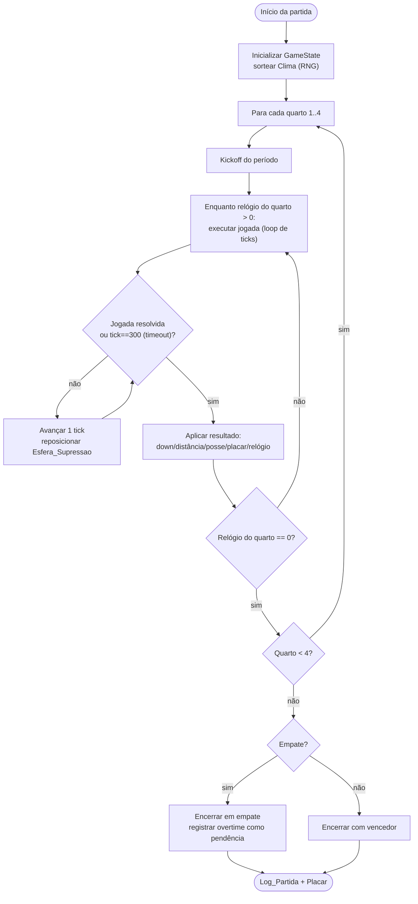
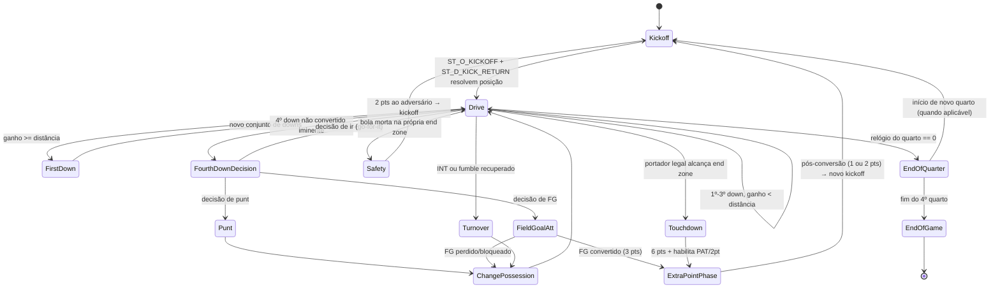
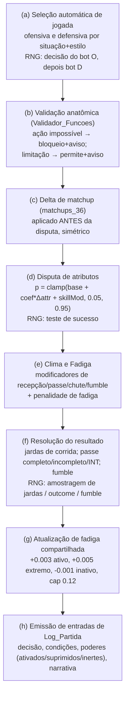

# Documento de Design — pfl-simulation-engine

## Overview

A spec `pfl-simulation-engine` entrega o **núcleo lógico determinístico** do PFL: dado duas Escalacoes, duas Estrategias e um `Seed_RNG`, o motor simula uma partida completa de futebol americano (4 quartos de tempo regulamentar) e produz um `Log_Partida` reproduzível byte a byte e um `Placar`. O motor executa **exclusivamente no backend** (Vercel Function) e não expõe sua lógica ao cliente.

Esta é a terceira de cinco specs. Ela consome a `pfl-foundation` (schema: `athletes` com `instance_id` único por time, `ability_id`, 4 golpes por atleta, `lineups`, `strategy`, `team_seeds`) e a `pfl-data-catalog` (camada de leitura `lib/data/`: `getAllowedSpecies`, `getLearnableMoveIds`, `getAvailableAbilities`, `getMove`, `getAbility`, `getNflMatchups`, `getDesignBaseline`, mais as tabelas `design_baseline` e `nfl_matchup_data`).

### O que esta spec entrega

1. **`Motor_Simulacao`** — núcleo TypeScript **puro** (função `(entrada) → saída`, sem I/O, sem relógio de sistema, sem entropia externa), organizado em camadas.
2. **`Gerador_RNG`** — PRNG determinístico com seed explícito, reproduzível e independente de plataforma.
3. **Lógica dos 3 modos de Bot** — políticas de escolha de jogada que compartilham o mesmo motor, as mesmas regras e o mesmo RNG.
4. **`Funcao_Simulacao`** — Vercel Function que valida a entrada, invoca o núcleo puro e devolve `{ log, placar }`.

### O que está fora de escopo

Telas e componentes de UI, fluxo de montagem de time (roster/escalação/export-import de seed), prolongamento (overtime — o MVP termina em empate ao fim do tempo regulamentar), calibração empírica automática de deltas (fica como **gancho documentado**, Req. 11), e a *definição* do schema (entregue pela foundation).

### Princípios de design

- **Pureza como chave do determinismo.** O núcleo é uma função pura. Toda fonte de variação (RNG, clima, disputas, amostragem de jardas, decisões de bot) entra pela assinatura e sai no resultado. Nenhum `Math.random`, `Date.now()`, `crypto` não-determinístico, `performance.now()` ou leitura de ambiente dentro do núcleo.
- **RNG único e ordem fixa de consumo.** Todo valor aleatório vem de um único `Gerador_RNG` semeado pelo `Seed_RNG`. A ordem de consumo é fixa e documentada por fase da jogada, garantindo reprodutibilidade.
- **Baseline não calibrado, sinalizado.** Os parâmetros (`simulation_parameters`) e os `matchups_36` vêm do `design_baseline` com `status = FROZEN_MVP_DESIGN_BASELINE_NOT_EMPIRICALLY_CALIBRATED`. O motor os trata como referência versionada e carimba essa origem no log.
- **Efeitos sobrenaturais inertes, nunca silenciosos.** No MVP, todo efeito adicional de golpe/habilidade é inerte-com-aviso: zero bônus, sempre logado. As únicas regras universais que modelamos ativamente são a `Esfera_Supressao` e a telecinese.
- **Nunca inventar mecânica.** Lacunas de regra viram `Decisao_Produto_Pendente` rastreável no log, nunca uma mecânica improvisada.
- **Fronteira de I/O estreita.** O carregamento de dados (`lib/data/`) acontece no adaptador de backend, *antes* de chamar o núcleo. O núcleo recebe os dados já resolvidos como entrada imutável.

### Rastreabilidade requisito → seção

| Requisito | Seção principal |
|---|---|
| R1 Determinismo e RNG | Architecture · RNG determinístico · Correctness Properties |
| R2 Loop de ticks, relógio, quartos | Loop de simulação · Máquina de estados |
| R3 Downs, distância, pontuação | Máquina de estados · Regras de pontuação |
| R4 Seleção automática de jogadas | Pipeline de resolução · Bots |
| R5 Matchups_36 | Matchups e baseline |
| R6 Modelo probabilístico e fadiga | Disputa de atributos · Fadiga |
| R7 Clima | Inicialização · Modificadores de clima |
| R8 Esfera de supressão | Esfera de supressão |
| R9 Efeitos inertes | Política de efeitos inertes |
| R10 Validação anatômica | Validador anatômico |
| R11 Special teams | Máquina de estados · Special teams |
| R12 Modos de bot | Bots |
| R13 Log e estatísticas | Log determinístico |
| R14 Faltas e lacunas | Faltas e Decisao_Produto_Pendente |
| R15 Função de backend | Funcao_Simulacao |

## Architecture

### Arquitetura em camadas

O motor é dividido em duas camadas com responsabilidades estritamente separadas. O **adaptador de backend** faz todo o I/O (ler `lib/data/`, validar entrada HTTP, serializar saída). O **núcleo puro** não conhece rede, banco, relógio nem ambiente — recebe um `ResolvedInput` imutável e devolve um `SimulationResult`.

```mermaid
graph TB
    subgraph Cliente["Cliente (fora desta spec)"]
        REQ["POST /api/simulate<br/>escalações + estratégias + seed"]
    end

    subgraph Backend["Adaptador de backend — Vercel Function (impuro)"]
        FN["Funcao_Simulacao<br/>handler server-only"]
        VAL["Validação de entrada<br/>(forma, faixas, seed uint64)"]
        LOAD["Resolução de dados via lib/data/<br/>getDesignBaseline, getMove,<br/>getAbility, getNflMatchups"]
        SER["Serialização estável do Log + Placar"]
    end

    subgraph Nucleo["Motor_Simulacao — núcleo PURO (determinístico)"]
        RNG["Gerador_RNG (PRNG com seed)"]
        STATE["GameState imutável + transições puras"]
        LOOP["Loop de ticks / jogadas"]
        FSM["Máquina de estados do jogo"]
        PIPE["Pipeline de resolução de jogada"]
        SPHERE["Esfera_Supressao"]
        INERT["Política de efeitos inertes"]
        ANAT["Validador_Funcoes (anatomia)"]
        BOTS["Políticas de bot (escolha de jogada)"]
        PROB["Modelo_Probabilistico + Fadiga"]
        LOG["Construtor do Log_Partida"]
    end

    REQ --> FN --> VAL --> LOAD
    LOAD -->|ResolvedInput imutável| Nucleo
    Nucleo -->|SimulationResult| SER --> FN
    FN -->|{ log, placar }| REQ

    RNG --> LOOP
    LOOP --> FSM --> PIPE
    PIPE --> SPHERE & INERT & ANAT & PROB
    FSM --> BOTS
    PIPE --> LOG
```

**Fronteira de pureza (invariante de arquitetura).** A assinatura do núcleo é:

```typescript
function simulate(input: ResolvedInput): SimulationResult;
// SimulationResult = { log: GameLog; score: Score; seedUsed: bigint }
```

`ResolvedInput` contém **tudo** que o núcleo precisa (escalações resolvidas com stats/tipo/golpes/habilidades já lidos do catálogo, estratégias, `simulation_parameters`, `matchups_36`, tabela de disposição de efeitos, e o `Seed_RNG`). O núcleo não faz nenhuma chamada assíncrona. Isso torna o determinismo verificável: a mesma `ResolvedInput` sempre produz o mesmo `SimulationResult`.

### Por que separar núcleo e adaptador

- **Determinismo auditável** (R1.1, R1.5): isolando o I/O e o relógio no adaptador, o núcleo não tem como depender de entropia externa. Testar o núcleo é trivial e reprodutível.
- **Server-only** (R15.6): a lógica vive no núcleo importado só pela função de backend; o bundle do cliente nunca a recebe.
- **Troca de transporte sem tocar na lógica**: a Vercel Function é um adaptador fino; o núcleo poderia ser chamado por um worker ou por testes sem mudança.

### Organização de módulos (proposta)

```
lib/sim/
  rng.ts            # Gerador_RNG (PRNG sfc32 em 64 bits via dois lanes de 32 bits)
  state.ts          # GameState imutável + transições puras
  clock.ts          # loop de ticks, relógio, quartos, play_timeout
  fsm.ts            # máquina de estados (kickoff/drive/scoring/turnover/...)
  play/
    select.ts       # seleção de jogada por situação + estilo (política de bot/jogador)
    pipeline.ts     # pipeline de resolução de jogada (orquestra as fases)
    probability.ts  # Modelo_Probabilistico (base/coef/clamp/skill_mod), corrida e passe
    fatigue.ts      # fadiga compartilhada por instance_id
    weather.ts      # sorteio e modificadores de clima
    sphere.ts       # Esfera_Supressao
    inert.ts        # política de efeitos inertes
    anatomy.ts      # Validador_Funcoes
  matchups.ts       # lookup de matchups_36 + delta simétrico + gancho de calibração NFL
  log.ts            # construção e serialização estável do Log_Partida
  stats.ts          # estatísticas agregadas
  simulate.ts       # função pura simulate(input): orquestra tudo
  types.ts          # tipos compartilhados (ResolvedInput, GameState, eventos de log...)

lib/sim/bots/
  policy.ts         # interface PlayPolicy (escolha de jogada) + presets
  randomBot.ts      # sorteia preset via RNG
  curtiBot.ts       # preset CURTI
  seededBot.ts      # time importado + preset padrão

app/api/simulate/route.ts   # Funcao_Simulacao (adaptador de backend)
```

## Components and Interfaces

Esta seção reúne os componentes e interfaces do `Motor_Simulacao` sob um guarda-chuva único. Cada subseção abaixo detalha um componente do núcleo puro (ou do adaptador de backend), com suas responsabilidades, contratos e assinaturas TypeScript. Os componentes seguem a organização de módulos descrita em Architecture (`lib/sim/`), e são, na ordem: o **RNG determinístico** (`Gerador_RNG`), o **loop de simulação, relógio e quartos**, a **máquina de estados do fluxo de jogo** (FSM), o **pipeline de resolução de jogada**, a **Esfera de supressão**, a **política de efeitos inertes**, o **validador anatômico** (`Validador_Funcoes`), os **bots** (políticas de escolha de jogada), os **matchups e baseline**, a **calibração NFL** (gancho opcional), o **log determinístico** e, por fim, a **`Funcao_Simulacao`** (adaptador de backend). Todas as interfaces preservam a fronteira de pureza definida em Architecture: o núcleo recebe um `ResolvedInput` imutável e devolve um `SimulationResult`, sem I/O nem entropia externa.

### RNG determinístico

#### Escolha do algoritmo: sfc32 semeado em 64 bits

Adoto **sfc32** (Small Fast Counter, 32 bits) como o gerador, com estado interno de quatro palavras de 32 bits, semeado a partir do `Seed_RNG` (uint64) por um expansor **SplitMix64**.

**Justificativa da escolha:**

- **Independência de plataforma.** JavaScript só tem inteiros exatos até 2^53 e `number` é float64. sfc32 opera inteiramente em aritmética de 32 bits via operadores bitwise (`>>>`, `<<`, `|`, `+` com `>>> 0`), que são exatos e idênticos em qualquer motor JS/V8 e em qualquer arquitetura. Isso satisfaz "independente de SO e hardware" (R1.1). Um gerador que dependesse de `BigInt` de 64 bits em caminho quente seria mais lento sem ganho de reprodutibilidade; sfc32 dá reprodutibilidade exata com `number`.
- **Qualidade suficiente.** sfc32 passa a bateria PractRand e tem período longo (mínimo garantido 2^32, esperado ~2^127). Para simulação de jogo (não criptografia) é mais do que suficiente, e é um dos geradores recomendados para uso com `fast-check`/`pure-rand`.
- **Semeadura robusta.** O `Seed_RNG` uint64 é expandido por SplitMix64 para preencher os quatro lanes de 32 bits de sfc32, evitando estados iniciais fracos (ex. seed 0).
- **Alternativas consideradas.** `mulberry32` (estado de 32 bits — espaço de seed pequeno demais para um seed de 64 bits); `xoshiro256**`/`PCG64` (exigiriam `BigInt` em caminho quente); `Math.random` (proibido por R1.2/R1.5, não semeável). sfc32 é o ponto ótimo entre reprodutibilidade exata com `number`, qualidade e velocidade.

### Contrato do Gerador_RNG

```typescript
interface Rng {
  // Próximo float em [0,1) com 32 bits de precisão. Avança o estado.
  nextFloat(): number;
  // Inteiro uniforme em [min, max] inclusivo, sem viés de módulo (rejection sampling).
  nextInt(min: number, max: number): number;
  // Snapshot opcional do estado interno (para log/debug), não usado na resolução.
  state(): readonly [number, number, number, number];
}

// Semeadura determinística: SplitMix64(seed) → 4 lanes de 32 bits → sfc32.
function createRng(seed: bigint): Rng;
```

Regras invioláveis (R1.2, R1.5):

- Todo valor aleatório da partida vem **deste** `Rng`, criado uma única vez a partir do `Seed_RNG`.
- O núcleo nunca chama `Math.random`, `Date`, `crypto`, `performance` nem lê variáveis de ambiente.
- `Seed_RNG` é entrada distinta do seed de time; um nunca deriva do outro (R1.3). O seed de time apenas identifica a Escalacao importada no modo bot-seed.

### Ordem fixa de consumo do RNG

A reprodutibilidade exige que o RNG seja consumido **na mesma ordem** para a mesma trajetória de estado. A ordem é:

1. **Inicialização da partida**: sorteio de `Clima` (1 consumo — ver seção Clima). Opcional: posse inicial do kickoff, se sorteada.
2. **Por jogada (snap)**, nesta ordem exata, pulando passos não aplicáveis à jogada:
   1. Decisão do bot ofensivo (se a política consome RNG).
   2. Decisão do bot defensivo (se a política consome RNG).
   3. Disputa de atributos (1 consumo para o teste de sucesso contra a probabilidade final).
   4. Amostragem de resultado dependente do tipo de jogada: jardas de corrida/perda, jardas-alvo de passe, resultado de completo/incompleto/INT, teste de fumble, resultado de special teams.

Cada ponto de consumo é documentado no código com um comentário `// RNG consume #k: <motivo>` e emite (em modo debug) uma entrada no log com a contagem acumulada de consumos, permitindo verificar a ordem fixa. Jogadas que não envolvem passe não consomem o RNG de "jardas-alvo de passe"; a ordem relativa dos passos **aplicáveis** é sempre a mesma.

### Loop de simulação, relógio e quartos

- **Tick** = 0,1 s (`tick_s = 0.1`). O loop interno de uma jogada avança por ticks; a `Esfera_Supressao` é reposicionada a cada tick antes de resolver qualquer poder (R8.2).
- **Quarto** = 900 s (`quarter_seconds = 900`), quatro quartos (R2.2). O `Relogio_Jogo` decresce conforme ticks e as regras de parada de relógio (R2.3).
- **Play_Timeout** = 30 s (`play_timeout_s = 30`). Se uma jogada atinge 30 s de simulação sem resolução, o motor a encerra e registra o encerramento por tempo limite (R2.4). O limite de ticks por jogada é `play_timeout_s / tick_s = 300` ticks.
- **Fim de jogo** (R2.5, R2.6): quando o relógio do 4º quarto chega a zero, a partida termina. Se empatada, termina em empate e registra o prolongamento como `Decisao_Produto_Pendente`. Sem overtime no MVP.

Para preservar o determinismo, a duração de uma jogada em ticks não vem de um relógio real: é derivada do resultado da jogada (ex. jardas ganhas → tempo decorrido por uma função determinística), nunca do tempo de parede.



### Máquina de estados do fluxo de jogo

O fluxo de posse é modelado como uma FSM pura: cada transição recebe o `GameState` e o resultado de uma jogada e devolve o próximo estado. Special teams são acionados **por estado**, de forma situacional e nunca aleatória (R11.4).



Gatilhos de special teams (R11.1–R11.3):

| Estado | Jogada ofensiva (ST) | Resposta defensiva (ST) |
|---|---|---|
| Chute inicial (pós-pontuação / início de período) | `ST_O_KICKOFF` | `ST_D_KICK_RETURN` |
| Decisão de punt (4º down) | `ST_O_PUNT` | `ST_D_PUNT_RETURN` |
| Tentativa de FG / ponto extra | `ST_O_FIELD_GOAL` | `ST_D_KICK_BLOCK` |

Special teams podem reutilizar indivíduos da mesma equipe fora de snaps simultâneos, mantendo a fadiga compartilhada por `instance_id` (R11.5).

#### Regras de pontuação (R3)

| Evento | Pontos | Condição |
|---|---|---|
| Touchdown | 6 | portador legal alcança a end zone adversária em posse física (R3.3) |
| Field goal | 3 | tentativa convertida (R3.4) |
| Safety | 2 (ao adversário) | portador derrubado / bola morta na própria end zone (R3.5) |
| Ponto extra (chute) | 1 | PAT convertido (R3.6) |
| Conversão de 2 pontos | 2 | conversão convertida (R3.6) |

A posição da bola é mantida em jardas relativas às goal lines e usada para determinar touchdown, safety e tentativas (R3.7). Downs: 4 tentativas para 10 jardas; alcançar a distância concede novo conjunto; não alcançar após o 4º down transfere posse na posição corrente (R3.1, R3.2). Toda a resolução é rastreável contra a edição NFL 2026 (R3.8).

### Pipeline de resolução de jogada

Cada snap é resolvido por um pipeline de fases puras, na ordem abaixo. A figura destaca onde cada valor aleatório é consumido do RNG.



#### (a) Seleção de jogada

A seleção escolhe uma `Jogada_Ofensiva` e uma `Jogada_Defensiva` do `Catalogo_Jogadas` (18 jogadas) considerando Down, Distancia, posição no campo, Relogio_Jogo, Clima, Fadiga e o estilo da Estrategia (R4.1, R4.2). Nunca cria jogada fora do catálogo (R4.3). A política é injetada (ver Bots); o RNG, quando a política precisa desempatar/sortear por pesos, é consumido **primeiro para o ataque, depois para a defesa** — ordem fixa.

#### (b) Validação anatômica

O `Validador_Funcoes` roda antes de qualquer resolução. Ação impossível → bloqueia e registra aviso (R10.9); limitação → permite e registra aviso de limitação (R10.10). Se a jogada selecionada não satisfaz pré-condições de formação legal, o motor aborta a execução com erro determinado e registra, sem substituição oculta de jogada (R4.4).

#### (c) Delta de matchup

Localiza o par (ofensiva × defensiva) em `matchups_36` e aplica o `offense_probability_delta` **antes** da disputa (R5.1, R5.2). O delta é **simétrico**: a vantagem concedida ao ataque é exatamente a desvantagem da defesa (R5.3). Delta zero (matchup neutro) deixa a resolução por conta dos atributos (R5.4).

#### (d) Disputa de atributos — Modelo_Probabilistico

```
Δattr        = (soma de atributos relevantes do lado ofensivo - lado defensivo) normalizada em [-1, 1]
p_bruta      = base + difference_coefficient * Δattr + delta_matchup + skillMod + climaMod
skillMod     ∈ [-skill_mod_max_abs, +skill_mod_max_abs] = [-0.15, +0.15]
p_final      = clamp(p_bruta, min, max) = clamp(p_bruta, 0.05, 0.95)
sucesso      = rng.nextFloat() < p_final      // RNG consume: teste de sucesso
```

com `base = 0.5`, `difference_coefficient = 0.45`, `min = 0.05`, `max = 0.95`, `skill_mod_max_abs = 0.15` (R6.1–R6.3). O clamp é a última operação sobre a probabilidade; nenhum modificador posterior pode tirá-la de [0.05, 0.95].

#### (e)/(f) Clima, fadiga e resolução do resultado

- **Corrida** (R6.8): `ganho = 2 + round(4 * clamp(run_advantage, 0, 1))`; quando o gap é perdido, perda amostrada em `[-4, -1]` jardas (RNG).
- **Passe** (R6.9): jardas-alvo amostradas em `[3, 10]` (curto) e `[12, 35]` (profundo) (RNG). Resultado completo/incompleto/INT decidido pela disputa + modificadores de clima; secundária sem recepção física → deflexão/incompleto, nunca INT (R10.5).
- **Fumble**: teste contra probabilidade base + `+0.02` sob RAIN (R7.2) (RNG).
- **Modificadores de clima** (R7.2–R7.5): RAIN recepção `-0.04`, fumble `+0.02`; WIND passe profundo `-0.05`, chute longo `-0.05`; HEAT fadiga `+0.002`/snap; COLD recepção `-0.02`.

#### (g) Fadiga compartilhada

Aplicada por `instance_id` após o snap (ver seção Data Models). Ativo `+0.003`, ação extrema `+0.005`, inativo `-0.001`, cap `0.12`, compartilhada entre todas as unidades do mesmo indivíduo e persistente por toda a partida (R6.4–R6.7, R11.5).

#### (h) Log

Emite as entradas da jogada (decisão, condições, resolução de poderes, narrativa) — ver seção Log determinístico.

### Esfera de supressão

A `Esfera_Supressao` é a região esférica de raio `suppression_radius_yards = 2` centrada na bola, incluindo a casca (pontos exatamente a 2 jardas) como interior (R8.1). Ela acompanha a bola: quando a bola muda de posição em um tick, a esfera é reposicionada **no mesmo tick, antes** de resolver qualquer poder sobrenatural daquele tick (R8.2).

```typescript
interface Vec3 { x: number; y: number; z: number }

// Interior inclui a casca: distância <= raio.
function isInsideSphere(ballPos: Vec3, point: Vec3, radiusYards: number): boolean {
  const d2 = (point.x-ballPos.x)**2 + (point.y-ballPos.y)**2 + (point.z-ballPos.z)**2;
  return d2 <= radiusYards * radiusYards;   // <= garante inclusão da casca
}
```

Regras (prioridade absoluta sobre qualquer outra regra de efeito, R8.3):

- Enquanto um atleta/efeito sobrenatural está **dentro** da esfera, poderes sobrenaturais não ativam nem afetam a jogada (R8.3). Um efeito previamente ativo que entra na esfera é **suspenso imediatamente** enquanto permanecer dentro (R8.4).
- Dentro da esfera, anatomia, física natural e **momentum já adquirido por meios físicos** são preservados (R8.5).
- Enquanto a bola está em **posse física** (contato contínuo + controle mecânico estável), bola e portador são protegidos contra poderes externos sobrenaturais (R8.6).
- Bola **solta e fora** da esfera pode ser manipulada por ação sobrenatural externa (R8.7); mas deslocamento por manipulação sobrenatural externa **não** constitui posse, interceptação nem touchdown, e isso é registrado (R8.8).

**Nota de MVP.** Como no MVP todos os efeitos são inertes (ver abaixo), a esfera e a telecinese são as regras universais que, ainda assim, precisam ser **modeladas e logadas**: a cada tick registramos a posição da esfera e, em qualquer tentativa de poder, o motivo da não-ativação (supressão ou inércia). Isso mantém o log honesto e prepara o terreno para a eventual ativação de efeitos em specs futuras.

### Política de efeitos inertes com aviso

Carregamos a **tabela de disposição** de efeitos de `effects_52_mvp_disposition.json` (persistida no `design_baseline`/`effects` e lida como parte do `ResolvedInput`). A função que resolve a disposição é pura:

```typescript
type EffectStatus = 'INERT_WITH_WARNING' | string;

interface InertDecision {
  inert: boolean;         // true no MVP para todo efeito adicional
  reason: string;         // ex.: 'INERT_WITH_WARNING' | 'SEM_DISPOSICAO_APROVADA'
  effectId: string;
  athleteInstanceId: number;
}

// Dado um efeito adicional de golpe/habilidade, retorna "inerte + motivo".
// Nunca aplica bônus silenciosamente.
function resolveEffectDisposition(
  effectId: string,
  dispositionTable: ReadonlyMap<string, EffectStatus>,
  athleteInstanceId: number
): InertDecision;
```

Regras (R9):

- Status `INERT_WITH_WARNING` → inerte (R9.1). Efeito **sem registro** na tabela → tratado como inerte, com aviso de ausência de disposição aprovada (R9.2).
- Efeito inerte permanece equipável mas aplica **zero** bônus a todos os atributos afetados (R9.3).
- Quando um efeito inerte seria relevante numa jogada, registra **exatamente um** aviso por ocorrência (identificando efeito + atleta) e **não altera** nenhum atributo ou resultado (R9.4, R9.6). O resultado da jogada é idêntico ao que ocorreria sem o efeito equipado.
- `Propriedades_Naturais` (anatomia, stats oficiais, locomoção, tipo/resistências) continuam valendo sem modificação (R9.5).
- As regras universais fixas (Esfera_Supressao e telecinese) são sempre aplicadas; bônus de clima/contato/proteção só quando a regra específica estiver parametrizada no baseline (R9.7).

### Validador anatômico (Validador_Funcoes)

Mapa de requisitos anatômicos por posição, derivado de `ANATOMY_DECISIONS_FINAL.md`:

| Posição | Requisito | Exceções aprovadas |
|---|---|---|
| QB | recebimento de snap tangível + lançamento físico (R10.1) | — |
| C (center) | snap físico para trás (R10.2) | Venusaur CURTI: snap por vinha corpórea tangível (R10.8) |
| RB | posse física da bola, incl. handoff na boca p/ quadrúpedes (R10.3) | Rapidash: recebe handoff na boca |
| WR / TE / CB (recepção/INT) | contato físico + controle + equivalente a dois pés no campo (R10.4) | — |
| CB / S sem recepção física | disputa resolvida como deflexão/incompleto, nunca INT por magnetismo/telecinese (R10.5) | Magneton: desvia, não intercepta |
| K / P | impacto físico por membro, casco ou superfície corporal (R10.6) | — |

```typescript
type AnatomyOutcome =
  | { kind: 'ok' }
  | { kind: 'allowed_with_limitation'; warning: string }  // R10.10
  | { kind: 'blocked'; warning: string };                 // R10.9

function validateAnatomy(
  athlete: ResolvedAthlete,
  role: Position,
  action: PlayAction
): AnatomyOutcome;
```

- Ação anatomicamente impossível → `blocked` + aviso (R10.9).
- Atribuição possível só com limitação → `allowed_with_limitation` + aviso (R10.10).
- Telecinese nunca constitui recepção (R10.7); secundária sem recepção física → deflexão/incompleto (R10.5).
- A exceção do Venusaur permite o snap por vinha tangível, **sem** tratar golpe sobrenatural como snap pré-snap gratuito (R10.8).

### Bots

Os três modos de bot compartilham o **mesmo motor, as mesmas regras, o mesmo `Gerador_RNG`, a mesma Fadiga e a mesma Esfera_Supressao** que o time do jogador. Nenhum bot recebe atributos ocultos, bônus de atributos nem leitura do estado oculto do adversário (R12.1). O que muda entre modos é **somente a política de escolha de jogada**, e todas consomem o RNG na mesma ordem (R12.7).

```typescript
interface PlaySelectionContext {
  down: number; distance: number; fieldPosition: number;
  gameClock: number; weather: Weather;
  fatigueByInstance: ReadonlyMap<number, number>;
  hasPossession: boolean;
}

interface PlayPolicy {
  // Escolhe uma jogada do catálogo. Recebe o Rng compartilhado; consome-o
  // (se necessário) na ordem fixa O→D. Pura em relação a (contexto, estado do rng).
  choosePlay(ctx: PlaySelectionContext, catalog: PlayCatalog, rng: Rng): PlayId;
}
```

Estratégia por **pesos situacionais**: cada preset define, em `play_selection`, pesos por situação (ex. 3º-and-long favorece passe; vento forte reduz passe profundo). A escolha é um sorteio ponderado consumindo um único `rng.nextFloat()` quando há mais de uma opção com peso positivo; com uma única opção, não consome RNG. A ordem é sempre ataque primeiro, defesa depois.

Modos (R12.2–R12.6):

| Modo | Política | RNG | Erro |
|---|---|---|---|
| Aleatório | sorteia exatamente 1 dos 4 presets (BALANCED/GROUND/AERIAL/CURTI) e usa suas variações restritas ao catálogo | sorteio do preset na inicialização | — |
| Curti | usa o preset `CURTI` com seu perfil tático | conforme pesos | — |
| Seed de terceiros | mantém **exatamente** o time importado (sem modificar atributos) e aplica a IA do preset padrão | conforme pesos | seed inválida → rejeita, não inicia, erro "seed inválida", preserva estado (R12.5) |
| (modo não suportado) | — | — | recusa execução, erro "modo inválido", não inicia (R12.6) |

Nenhum bot usa poderes fora do `Catalogo_Jogadas` (R12.2). Mesma seed + mesmo estado inicial ⇒ mesma sequência de escolhas (R12.7).

### Matchups e baseline

`matchups_36` e `simulation_parameters` são lidos de `design_baseline` via `getDesignBaseline(version?)` no adaptador e entregues ao núcleo dentro do `ResolvedInput`. O lookup de matchup é uma função pura por par `(ofensiva, defensiva)`:

```typescript
interface Matchup { offense: PlayId; defense: PlayId; offense_probability_delta: number }

interface Baseline {
  version: string;              // ex. "D1-design-2026-10-09"
  status: string;               // FROZEN_MVP_DESIGN_BASELINE_NOT_EMPIRICALLY_CALIBRATED
  simulationParameters: SimulationParameters;
  matchups: ReadonlyMap<string, number>;  // chave `${offense}|${defense}` → delta
}

// Delta simétrico: retorna o delta ofensivo; a desvantagem defensiva é exatamente -delta
// aplicada ao mesmo cálculo (p ofensivo sobe delta; p defensivo "espelhado" cai delta).
function matchupDelta(b: Baseline, offense: PlayId, defense: PlayId): number;
```

O motor marca a **origem versionada** e o **status não-calibrado** no log a cada aplicação de matchup e nos parâmetros do modelo (R5.5, R6.10).

### Calibração NFL (gancho opcional, não aplicado no MVP)

`getNflMatchups()` fornece dados históricos empíricos que **poderiam** informar ajuste dos deltas. No MVP, os deltas vêm **exclusivamente do baseline**; a calibração é um **gancho documentado**, não aplicado automaticamente:

```typescript
// Gancho puro e explícito. No MVP, calibrate NÃO é chamado pelo pipeline;
// os deltas usados são os do baseline. Fica disponível para uma decisão de produto futura.
function calibrateDeltas(
  baseline: Baseline,
  nfl: readonly NflMatchupRow[],
  enabled: boolean   // default false no MVP
): Baseline;         // enabled=false → retorna baseline inalterado
```

Enquanto `enabled` for `false` (MVP), `calibrateDeltas` é identidade sobre os deltas. Qualquer uso futuro exigirá decisão de produto explícita e será registrado no log. Isso mantém o determinismo: o resultado só muda se a decisão de produto mudar a entrada.

### Log determinístico

#### Estrutura do Log_Partida

O `Log_Partida` é uma lista **ordenada** de eventos. Cada evento carrega um índice sequencial (`seq`) e o estado-resumo vigente, garantindo ordenação determinística (R13.6).

```typescript
type LogEventType =
  | 'MATCH_INIT' | 'WEATHER_ROLL' | 'KICKOFF' | 'SNAP' | 'TICK'
  | 'PLAY_SELECTED' | 'MATCHUP_APPLIED' | 'ATTR_CONTEST' | 'PLAY_RESULT'
  | 'SCORE' | 'POSSESSION_CHANGE' | 'POWER_SUPPRESSED' | 'POWER_INERT'
  | 'TELEKINESIS_NOTE' | 'ANATOMY_WARNING' | 'FOUL' | 'PENDING_DECISION'
  | 'TIMEOUT' | 'QUARTER_END' | 'GAME_END';

interface StateSnapshot {
  quarter: number; gameClock: number;        // décimos de segundo (inteiro) p/ estabilidade
  down: number; distance: number;
  ballOn: number;                             // jardas relativas à goal line
  possession: 'home' | 'away';
  score: { home: number; away: number };
  weather: Weather;
}

interface LogEvent {
  seq: number;                 // índice sequencial determinístico
  type: LogEventType;
  snap?: number;               // número do snap, quando aplicável
  tick?: number;               // tick dentro da jogada, quando aplicável
  state: StateSnapshot;
  narrative: string;           // narrativa por snap/evento (R13.4)
  detail: Record<string, JsonValue>;  // chaves ordenadas na serialização
  // Motivo de ativação/não-ativação de poder (R13.2):
  powerReason?: string;        // 'SUPPRESSED_IN_SPHERE' | 'INERT_WITH_WARNING' | 'TELEKINESIS_NOT_POSSESSION' | ...
}

interface GameLog {
  seedUsed: string;            // Seed_RNG em decimal (uint64) — R1.7
  baselineVersion: string;     // origem versionada — R5.5, R6.10
  baselineStatus: string;      // FROZEN_MVP_... — não calibrado
  events: LogEvent[];
  stats: GameStats;            // R13.5
}
```

Registros obrigatórios:

- Por **snap**: posição da bola, posse, decisão de jogada, clima e fadiga vigentes (R13.1); placar, quarto, relógio, down, distância, posse (R13.3); narrativa (R13.4).
- Ativação/não-ativação de poder com motivo, incluindo inércia e supressão na esfera (R13.2).
- Clima sorteado e modificadores aplicados (R7.6); seed utilizado (R1.7); origem versionada e status não-calibrado do baseline (R5.5, R6.10).
- Faltas e sua resolução (R14.3); `Decisao_Produto_Pendente` para lacunas e overtime (R2.5, R14.4).

#### Serialização estável (comparação byte a byte)

Para garantir igualdade byte a byte entre execuções com a mesma entrada (R1.1, R13.6), o log é serializado por um **serializador JSON canônico**: chaves ordenadas lexicograficamente em todos os níveis, sem espaços variáveis, inteiros para o relógio (décimos de segundo) para evitar divergência de ponto flutuante na saída.

```typescript
function stableStringify(value: JsonValue): string; // ordena chaves recursivamente
```

#### Estatísticas agregadas

```typescript
interface GameStats {
  rushes: { attempts: number; yards: number };
  passes: { attempts: number; completions: number; yards: number; interceptions: number };
  turnovers: number;
  fouls: number;
  scoringSummary: { type: 'TD'|'FG'|'SAFETY'|'PAT'|'TWO_PT'; team: 'home'|'away'; quarter: number }[];
}
```

As estatísticas são derivadas determinísticamente dos eventos (corridas, passes, turnovers, faltas, resumo de scoring — R13.5). A soma de pontos do `Placar` é coerente com os eventos de scoring (ver Correctness Properties).

### Faltas e Decisao_Produto_Pendente

- O motor detecta e aplica faltas de formação, elegibilidade e interferência conforme a edição NFL 2026 (R14.1) e registra cada falta e sua resolução de forma rastreável (R14.3).
- A estratégia Pokémon de qualquer time nunca autoriza descumprir faltas aplicáveis (R14.2).
- Situação de regra não decidida pelo contrato autoritativo → registrada como `Decisao_Produto_Pendente`, nunca mecânica inventada (R14.4). Overtime é o caso canônico (R2.5).

### Funcao_Simulacao (Vercel Function)

Adaptador de backend fino, server-only (R15.1, R15.6).

#### Contrato

```typescript
// app/api/simulate/route.ts  (Vercel Function / Next.js Route Handler, runtime server-only)

interface SimulateRequest {
  home: LineupInput;      // Escalacao do mandante
  away: LineupInput;      // Escalacao do visitante
  strategyHome: StrategyInput;
  strategyAway: StrategyInput;
  seed: string;           // Seed_RNG em decimal, 0 .. 2^64-1
}

interface SimulateResponse {
  log: GameLog;
  score: Score;
}

interface SimulateError {
  error: string;          // descrição
  field?: string;         // campo inválido identificado (R15.4)
}
```

#### Fluxo

```mermaid
flowchart TD
    IN([POST /api/simulate]) --> V["Validar forma e faixas:<br/>escalações, estratégias,<br/>seed presente e 0..2^64-1"]
    V -->|inválido| ERR["400 { error, field }<br/>não executa a partida (R15.4, R1.6)"]
    V -->|válido| RES["Resolver dados via lib/data/:<br/>getDesignBaseline, getMove,<br/>getAbility, (getNflMatchups: gancho)"]
    RES --> BUILD["Montar ResolvedInput imutável"]
    BUILD --> CORE["simulate(ResolvedInput) — núcleo puro"]
    CORE --> OUT["Serializar log (stableStringify) + placar"]
    OUT --> RESP([200 { log, score }])
```

Regras:

- Aceita as duas escalações, as estratégias de ambos e o seed (R15.2).
- Sucesso → retorna `log` e `placar` do núcleo (R15.3).
- Entrada inválida/incompleta → erro descritivo com o campo inválido, **sem** executar a partida (R15.4). Seed ausente/fora de faixa → recusa a inicialização, sem log nem placar, com indicação de erro (R1.6).
- Duas invocações com entradas idênticas → `log` e `placar` idênticos (R15.5), herdado do determinismo do núcleo.
- Execução só no backend; a lógica do núcleo nunca vai ao cliente (R15.6).

## Data Models

### ResolvedInput (entrada do núcleo puro)

```typescript
interface ResolvedAthlete {
  instanceId: number;             // instance_id (único por time) — fadiga indexada por este id
  pokemonId: number;
  types: string[];
  stats: { hp: number; attack: number; defense: number;
           specialAttack: number; specialDefense: number; speed: number };
  abilityId: number;
  moveIds: [number, number, number, number];   // exatamente 4 (foundation)
  additionalEffectIds: string[];               // efeitos adicionais → política inerte
  positionDesignation: string;
}

interface ResolvedLineup {
  teamSeedId?: string;            // identifica time importado (modo bot-seed); nunca deriva o Seed_RNG
  units: Record<LineupUnit, ResolvedAthlete[]>;  // ataque/defesa/special teams
}

interface ResolvedInput {
  home: ResolvedLineup;
  away: ResolvedLineup;
  strategyHome: Strategy;         // preset/estilo/prioridades
  strategyAway: Strategy;
  botModeHome?: BotMode;          // 'random' | 'curti' | 'seeded'
  botModeAway?: BotMode;
  baseline: Baseline;             // simulation_parameters + matchups_36 + status
  effectDisposition: ReadonlyMap<string, EffectStatus>;  // effects_52_mvp_disposition
  nflMatchups?: readonly NflMatchupRow[];   // gancho de calibração (não aplicado no MVP)
  seed: bigint;                   // Seed_RNG, 0 .. 2^64-1
}
```

O `ResolvedInput` é **imutável** e **autossuficiente**: não há leitura externa durante a simulação.

### GameState (estado imutável, transições puras)

```typescript
interface GameState {
  quarter: number;                // 1..4
  gameClockDeci: number;          // relógio do quarto em décimos de segundo (inteiro): 9000 = 900s
  down: number;                   // 1..4
  distance: number;               // jardas para o 1º down
  ballOn: number;                 // posição da bola (jardas relativas à goal line)
  possession: 'home' | 'away';
  score: { home: number; away: number };
  weather: Weather;
  phase: GamePhase;               // estado da FSM (Kickoff/Drive/...)
  fatigue: ReadonlyMap<number, number>;   // instance_id → penalidade [0, 0.12]
  ballPos: Vec3;                  // posição espacial p/ Esfera_Supressao
  snapCount: number;
}

type Weather = 'CLEAR' | 'RAIN' | 'WIND' | 'HEAT' | 'COLD';
type GamePhase = 'Kickoff'|'Drive'|'FourthDownDecision'|'Punt'|'FieldGoalAtt'
  |'Touchdown'|'ExtraPointPhase'|'Safety'|'Turnover'|'ChangePossession'
  |'EndOfQuarter'|'EndOfGame';
```

Toda transição é `(GameState, PlayResolution) → GameState`, retornando um novo objeto (sem mutação), o que torna o histórico reconstruível e o determinismo trivial de verificar.

### Fadiga compartilhada por instance_id

A fadiga é indexada por `instance_id`, não por unidade. Se o mesmo indivíduo atua em ataque e em special teams, as duas participações somam/leem a mesma entrada do mapa (R6.7, R11.5).

```typescript
const FATIGUE_ACTIVE = 0.003;
const FATIGUE_EXTREME = 0.005;
const FATIGUE_INACTIVE_RECOVERY = 0.001;
const FATIGUE_MAX = 0.12;
const HEAT_FATIGUE_PER_SNAP = 0.002;

// Transição pura: aplica deltas e faz clamp em [0, 0.12] para TODO instance_id.
function applyFatigue(
  prev: ReadonlyMap<number, number>,
  activeInstances: ReadonlySet<number>,
  extremeInstances: ReadonlySet<number>,
  inactiveInstances: ReadonlySet<number>,
  weather: Weather
): ReadonlyMap<number, number>;
```

### Parâmetros do modelo (de design_baseline/simulation_parameters)

```typescript
interface SimulationParameters {
  base: number;                   // 0.5
  difference_coefficient: number; // 0.45
  min: number;                    // 0.05
  max: number;                    // 0.95
  skill_mod_max_abs: number;      // 0.15
  tick_s: number;                 // 0.1
  quarter_seconds: number;        // 900
  play_timeout_s: number;         // 30
  suppression_radius_yards: number; // 2
  weather: Record<Weather, number>;          // probabilidades: CLEAR .40, RAIN .20, WIND .15, HEAT .15, COLD .10
  weather_modifiers: {
    RAIN: { reception: -0.04; fumble: 0.02 };
    WIND: { deep_pass: -0.05; long_kick: -0.05 };
    HEAT: { fatigue_per_snap: 0.002 };
    COLD: { reception: -0.02 };
  };
  fatigue: { active: 0.003; extreme_action: 0.005; inactive_snap_recovery: 0.001; max_penalty: 0.12 };
  run: { base: 2; coef: 4; loss_min: -4; loss_max: -1 };
  pass: { short: [3, 10]; deep: [12, 35] };
}
```

### Sorteio de clima (ordem e determinismo)

O clima é sorteado uma vez na inicialização, consumindo **um** `rng.nextFloat()`, mapeado por faixas cumulativas na ordem fixa `CLEAR, RAIN, WIND, HEAT, COLD` (R7.1):

```
r = rng.nextFloat()
r < 0.40            → CLEAR
r < 0.60            → RAIN
r < 0.75            → WIND
r < 0.90            → HEAT
caso contrário      → COLD
```

### Score (saída)

```typescript
interface Score { home: number; away: number; final: boolean; tie: boolean }
```

## Correctness Properties

*Uma propriedade é uma característica ou comportamento que deve valer para todas as execuções válidas do sistema — essencialmente, uma afirmação formal sobre o que o sistema deve fazer. Propriedades são a ponte entre especificações legíveis por humanos e garantias de correção verificáveis por máquina.*

As propriedades abaixo resultam da análise de prework seguida de uma **reflexão de consolidação** que eliminou redundâncias. Em particular: o determinismo byte a byte (1.1) subsume as garantias de ausência de entropia externa (1.5), de ordenação determinística do log (13.6), de reprodutibilidade das escolhas de bot (12.7) e de reprodutibilidade da função de backend (15.5), todas unificadas na Propriedade 1. As transições de fadiga (6.4–6.7, 11.5) foram unificadas numa propriedade abrangente de fadiga. As cláusulas de inércia (9.1–9.7) foram consolidadas em três propriedades (disposição, não-alteração do resultado, aviso único). As cláusulas anti-telecinese (8.8, 10.5, 10.7) foram unificadas. A completude do log por snap (13.1, 13.3, 13.4) foi unificada.

### Property 1: Determinismo byte a byte

*Para toda* `ResolvedInput` válida e todo `Seed_RNG`, executar `simulate` duas vezes — em qualquer ordem, com qualquer valor de relógio de sistema, `Math.random` ou `crypto` no ambiente — produz `Log_Partida` e `Placar` idênticos byte a byte após serialização canônica (`stableStringify`), independentemente de SO, arquitetura e execuções intermediárias.

**Validates: Requirements 1.1, 1.5, 12.7, 13.6, 15.5**

### Property 2: RNG é a única fonte de entropia, derivada só do Seed_RNG

*Para toda* `ResolvedInput`, toda a variação aleatória da partida é função exclusiva do `Seed_RNG`: fixando o `Seed_RNG` e variando arbitrariamente o `teamSeedId` (ou qualquer dado que não seja o seed de RNG), a trajetória do `Gerador_RNG` (a sequência de `nextFloat`) e a saída permanecem idênticas; e nenhum valor aleatório é obtido de fonte distinta do `Gerador_RNG`.

**Validates: Requirements 1.2, 1.3**

### Property 3: Sensibilidade ao seed

*Para* um conjunto representativo de `ResolvedInput`, existem seeds distintos que produzem `Log_Partida` diferentes, demonstrando que o seed efetivamente dirige a aleatoriedade (seeds diferentes podem divergir).

**Validates: Requirements 1.4**

### Property 4: Seed registrado no log

*Para todo* `Seed_RNG` válido, o `Log_Partida` resultante contém `seedUsed` igual à representação decimal do seed de entrada.

**Validates: Requirements 1.7**

### Property 5: Ordem fixa de consumo do RNG

*Para toda* jogada, os pontos de consumo do `Gerador_RNG` ocorrem sempre na mesma ordem relativa dos passos aplicáveis (decisão de bot ofensivo, decisão de bot defensivo, teste de sucesso da disputa, amostragens de resultado), pulando apenas os passos inaplicáveis à jogada, de modo que o número e a ordem de consumos são função determinística do tipo de jogada e do estado.

**Validates: Requirements 1.2**

### Property 6: Relógio discreto e monotônico por quarto

*Para toda* partida, `gameClockDeci` é sempre inteiro (décimos de segundo), nunca aumenta dentro de um mesmo quarto, e cada decréscimo é múltiplo de 1 décimo (0,1 s); a partida tem no máximo quatro quartos e não há evento de simulação após `GAME_END`.

**Validates: Requirements 2.1, 2.3, 2.6**

### Property 7: Encerramento por tempo limite de jogada

*Para toda* jogada que não resolve em até 300 ticks (30 s / 0,1 s), o motor encerra a jogada exatamente no 300º tick e emite um evento `TIMEOUT` no `Log_Partida`.

**Validates: Requirements 2.4**

### Property 8: Empate ao fim do tempo regulamentar vira pendência

*Para todo* estado em que o relógio do 4º quarto chega a zero com placar empatado, a partida encerra em empate (`score.tie === true`) e o `Log_Partida` registra o prolongamento como `Decisao_Produto_Pendente`, sem simular 5º quarto.

**Validates: Requirements 2.5**

### Property 9: Downs, distância e troca de posse

*Para toda* sequência de ganhos de jardas em um drive, alcançar a `Distancia` necessária reinicia o down para 1 e a distância para 10; não alcançá-la incrementa o down; e um 4º down não convertido transfere a posse ao adversário na posição corrente da bola.

**Validates: Requirements 3.1, 3.2**

### Property 10: Posição da bola e eventos de pontuação coerentes

*Para toda* trajetória, a posição da bola (`ballOn`) permanece dentro do campo em relação às goal lines, e os eventos de touchdown e safety ocorrem se e somente se a bola, em posse física, cruza a respectiva goal line conforme a regra; a manipulação remota nunca dispara esses eventos.

**Validates: Requirements 3.3, 3.5, 3.7**

### Property 11: Soma de pontos coerente com eventos de scoring

*Para toda* partida, o `Placar` final de cada time é exatamente a soma dos pontos dos eventos de scoring daquele time no `scoringSummary` (TD=6, FG=3, SAFETY=2 ao adversário, PAT=1, conversão de 2 pontos=2), sem pontos órfãos e sem evento de scoring sem contrapartida no placar.

**Validates: Requirements 3.3, 3.4, 3.5, 3.6**

### Property 12: Jogada selecionada pertence sempre ao catálogo

*Para todo* contexto de seleção, a jogada ofensiva e a jogada defensiva escolhidas pertencem às 18 jogadas do `Catalogo_Jogadas` (6 ofensivas, 6 defensivas, 6 de special teams quando aplicável), e nenhuma jogada fora do catálogo é jamais produzida.

**Validates: Requirements 4.1, 4.3, 12.2**

### Property 13: Todo snap registra decisão e fatores de situação

*Para todo* snap, o `Log_Partida` contém um evento `PLAY_SELECTED` com a jogada escolhida e os fatores de situação considerados (down, distância, posição, relógio, clima, fadiga).

**Validates: Requirements 4.5**

### Property 14: Delta de matchup é o do baseline, aplicado antes da disputa, de forma simétrica

*Para todo* par (`Jogada_Ofensiva`, `Jogada_Defensiva`), o delta aplicado é exatamente o `offense_probability_delta` do par em `matchups_36`, somado à probabilidade **antes** do teste de sucesso da disputa, e de forma simétrica: a vantagem concedida ao ataque equivale à desvantagem imposta à defesa (a soma dos efeitos espelhados é zero).

**Validates: Requirements 5.1, 5.2, 5.3**

### Property 15: Origem versionada e status não-calibrado no log

*Para toda* partida, o `Log_Partida` registra `baselineVersion` e `baselineStatus` iguais aos do `design_baseline` fornecido, sinalizando explicitamente que os parâmetros e os matchups constituem baseline de design não calibrado.

**Validates: Requirements 5.5, 6.10**

### Property 16: Fórmula da probabilidade de disputa

*Para toda* combinação de atributos, delta de matchup, modificador de habilidade e modificador de clima, a probabilidade bruta é exatamente `base + difference_coefficient * Δattr + delta_matchup + skillMod + climaMod` com `base = 0.5` e `difference_coefficient = 0.45`.

**Validates: Requirements 6.1**

### Property 17: Clamp de probabilidade sempre em [0.05, 0.95]

*Para toda* combinação de atributos, deltas, modificadores de habilidade e de clima — inclusive valores extremos — a probabilidade final de qualquer disputa está sempre no intervalo fechado [0.05, 0.95].

**Validates: Requirements 6.2**

### Property 18: Modificador de habilidade limitado a ±0.15

*Para todo* modificador de habilidade proposto, o valor efetivamente aplicado tem módulo menor ou igual a `skill_mod_max_abs = 0.15`.

**Validates: Requirements 6.3**

### Property 19: Fadiga compartilhada, acumulada e limitada

*Para toda* sequência de snaps e todo `instance_id`, a fadiga é indexada por indivíduo (compartilhada entre todas as unidades em que ele atua e persistente por toda a partida), acrescida de `0.003` por snap ativo (`0.005` em ação extrema), reduzida de `0.001` por snap inativo, com acréscimo adicional de `0.002` por snap sob clima HEAT, e permanece sempre no intervalo [0, 0.12].

**Validates: Requirements 6.4, 6.5, 6.6, 6.7, 7.4, 11.5**

### Property 20: Ganho e perda de corrida pela fórmula

*Para todo* `run_advantage`, o ganho de corrida é exatamente `2 + round(4 * clamp(run_advantage, 0, 1))`; quando o gap de corrida é perdido, a perda amostrada está sempre no intervalo [-4, -1] jardas.

**Validates: Requirements 6.8**

### Property 21: Jardas-alvo de passe nos intervalos definidos

*Para toda* amostragem do `Gerador_RNG`, as jardas-alvo de passe curto pertencem a [3, 10] e as de passe profundo a [12, 35].

**Validates: Requirements 6.9**

### Property 22: Sorteio de clima pelas faixas cumulativas

*Para todo* valor `r` em [0, 1) do `Gerador_RNG`, o clima sorteado é determinado pelas faixas cumulativas na ordem fixa `CLEAR` (r < 0.40), `RAIN` (r < 0.60), `WIND` (r < 0.75), `HEAT` (r < 0.90) e `COLD` (caso contrário), de modo que as probabilidades resultantes são 0.40/0.20/0.15/0.15/0.10.

**Validates: Requirements 7.1**

### Property 23: Modificadores de clima aplicados conforme o clima

*Para toda* jogada, sob `RAIN` a recepção recebe `-0.04` e a probabilidade de fumble recebe `+0.02`; sob `WIND` o passe profundo e o chute longo recebem `-0.05`; sob `COLD` a recepção recebe `-0.02`; e sob `CLEAR` nenhum desses modificadores é aplicado.

**Validates: Requirements 7.2, 7.3, 7.5**

### Property 24: Clima e modificadores registrados no log

*Para toda* partida, o `Log_Partida` contém o clima sorteado e os modificadores aplicados.

**Validates: Requirements 7.6**

### Property 25: Esfera de supressão inclui a casca e segue a bola

*Para todo* ponto e toda posição da bola, o ponto está dentro da `Esfera_Supressao` se e somente se sua distância à bola é menor ou igual a 2 jardas (a casca a exatamente 2 jardas é interior); e, a cada tick em que a bola muda de posição, o centro da esfera coincide com a nova posição da bola antes de qualquer resolução de poder sobrenatural daquele tick.

**Validates: Requirements 8.1, 8.2**

### Property 26: Supressão neutraliza poderes sobrenaturais com prioridade absoluta

*Para todo* atleta ou efeito sobrenatural situado dentro da `Esfera_Supressao`, nenhum poder sobrenatural ativa ou altera o resultado da jogada; um efeito previamente ativo cujo portador entra na esfera é suspenso imediatamente nesse tick; e a anatomia, a física natural e o momentum físico já adquiridos permanecem inalterados pela supressão.

**Validates: Requirements 8.3, 8.4, 8.5**

### Property 27: Posse física protege contra poderes externos

*Para toda* situação em que a bola está em posse física (contato contínuo e controle mecânico estável), nenhum poder externo sobrenatural afeta a bola ou o portador.

**Validates: Requirements 8.6**

### Property 28: Manipulação remota nunca é posse, interceptação nem touchdown

*Para todo* deslocamento da bola causado por manipulação sobrenatural externa (telecinese ou magnetismo), o resultado nunca é registrado como posse, interceptação ou touchdown, e a ocorrência é logada; consequentemente, atleta de secundária sem recepção física nunca produz interceptação, apenas deflexão ou passe incompleto.

**Validates: Requirements 8.7, 8.8, 10.5, 10.7**

### Property 29: Disposição de efeito é sempre inerte-com-motivo

*Para todo* efeito adicional de golpe ou habilidade, `resolveEffectDisposition` retorna `inert = true` quando o status é `INERT_WITH_WARNING`, e também quando o efeito não possui registro na tabela de disposição — neste caso com motivo de ausência de disposição aprovada.

**Validates: Requirements 9.1, 9.2**

### Property 30: Efeito inerte não altera o resultado da jogada

*Para toda* jogada e todo efeito inerte equipado, o resultado da jogada (jardas, completo/incompleto/INT, fumble, pontuação) é idêntico ao resultado da mesma jogada sem o efeito equipado: zero bônus a qualquer atributo de desempenho, nenhuma mecânica, bônus ou penalidade aplicada, enquanto as `Propriedades_Naturais` (stats, tipo, locomoção, resistências) permanecem válidas e inalteradas pela política de inércia.

**Validates: Requirements 9.3, 9.5, 9.6, 9.7**

### Property 31: Efeito inerte relevante gera exatamente um aviso

*Para toda* ocorrência em que um efeito inerte seria relevante numa jogada, o `Log_Partida` registra exatamente um aviso identificando o efeito e o atleta associado.

**Validates: Requirements 9.4**

### Property 32: Validação anatômica por posição

*Para todo* atleta e toda posição, o `Validador_Funcoes` exige o requisito anatômico correspondente (QB: snap tangível + lançamento físico; center: snap físico para trás; RB: posse física incluindo handoff na boca para quadrúpedes; WR/TE/CB em recepção/INT: contato + controle + equivalente a dois pés; K/P: impacto físico corpóreo), aplicando as exceções aprovadas (Rapidash boca, Venusaur vinha, Magneton desvia-não-intercepta).

**Validates: Requirements 10.1, 10.2, 10.3, 10.4, 10.6**

### Property 33: Ação impossível bloqueia, limitação permite, ambas logam

*Para toda* ação, se ela é anatomicamente impossível o motor a bloqueia e registra um aviso; se é possível apenas com limitação, o motor permite a atribuição e registra o aviso de limitação; em nenhum caso há substituição oculta de jogada.

**Validates: Requirements 10.9, 10.10, 4.4**

### Property 34: Special teams acionados por estado, não por acaso

*Para todo* estado de jogo, o chute inicial aciona exatamente `ST_O_KICKOFF` + `ST_D_KICK_RETURN`, a decisão de punt aciona `ST_O_PUNT` + `ST_D_PUNT_RETURN`, e a tentativa de FG/ponto extra aciona `ST_O_FIELD_GOAL` + `ST_D_KICK_BLOCK`; a seleção de special teams é função determinística do estado e não consome o `Gerador_RNG` de escolha.

**Validates: Requirements 11.1, 11.2, 11.3, 11.4**

### Property 35: Bot não recebe vantagem oculta

*Para todo* modo de bot, trocar o controlador do time (jogador ↔ bot) mantendo a mesma política de escolha não altera atributos, fadiga, esfera nem acesso a informação: a política só enxerga o contexto público, nunca o estado oculto do adversário, e nenhum bot ganha atributos ou bônus ocultos.

**Validates: Requirements 12.1**

### Property 36: Preservação do time importado no modo seed de terceiros

*Para toda* seed de terceiros válida, o time importado é mantido exatamente (atributos idênticos aos importados, sem modificação) e a IA de escolha de jogadas aplicada é a do preset padrão.

**Validates: Requirements 12.4**

### Property 37: Completude do log por snap

*Para todo* snap, o `Log_Partida` registra a posição da bola, a posse, a decisão de jogada, o clima e a fadiga vigentes, além do `StateSnapshot` completo (placar, quarto, relógio, down, distância, posse) e uma narrativa não vazia.

**Validates: Requirements 13.1, 13.3, 13.4**

### Property 38: Motivo de toda (não) ativação de poder

*Para toda* ativação ou não-ativação de habilidade ou golpe numa jogada, o `Log_Partida` registra o motivo, incluindo os casos de efeito inerte e de supressão dentro da `Esfera_Supressao`.

**Validates: Requirements 13.2**

### Property 39: Estatísticas agregadas coerentes com os eventos

*Para toda* partida, as estatísticas agregadas (corridas, passes, completos, interceptações, turnovers, faltas e resumo de scoring) são exatamente a contagem dos eventos correspondentes no `Log_Partida`.

**Validates: Requirements 13.5**

### Property 40: Faltas detectadas, logadas e inescapáveis pela estratégia

*Para toda* formação ou ação que viola uma regra de falta aplicável (formação, elegibilidade, interferência), o motor detecta a falta, registra a falta e sua resolução no `Log_Partida`, e nenhuma estratégia de time é capaz de desativar a detecção.

**Validates: Requirements 14.1, 14.2, 14.3**

### Property 41: Lacuna de regra vira pendência rastreável

*Para toda* situação não decidida pelo contrato autoritativo, o motor registra uma `Decisao_Produto_Pendente` no `Log_Partida` e não aplica nenhuma mecânica inventada.

**Validates: Requirements 14.4**

### Property 42: Validação de entrada da função de backend

*Para toda* requisição da `Funcao_Simulacao` com um campo ausente ou inválido — incluindo `Seed_RNG` ausente ou fora de [0, 2^64 − 1], escalação, estratégia ou campo malformado — a função retorna um erro descritivo identificando o campo inválido e não executa a partida (sem produzir `Log_Partida` nem `Placar`).

**Validates: Requirements 1.6, 15.4**

## Error Handling

O tratamento de erros respeita a fronteira de camadas: a **validação de entrada** ocorre no adaptador de backend, antes de o núcleo ser invocado; o **núcleo puro** nunca lança por entropia externa (não há) e trata lacunas de regra como dados de log, não como exceções.

### Validação de entrada (adaptador — `Funcao_Simulacao`)

| Situação | Tratamento | Requisito |
|---|---|---|
| `Seed_RNG` ausente, não inteiro, negativo ou ≥ 2^64 | 400 `{ error, field: "seed" }`; não resolve dados, não invoca o núcleo | R1.6, R15.4 |
| Escalação ausente/incompleta (unidade faltante, atleta sem 4 golpes, `instance_id` duplicado) | 400 `{ error, field }` nomeando o campo; sem execução | R15.4 |
| Estratégia ausente/ inválida (preset desconhecido) | 400 `{ error, field }`; sem execução | R15.4 |
| Modo de bot não suportado (≠ aleatório/curti/seed) | 400 `{ error: "modo inválido", field: "botMode" }`; sem execução, estado preservado | R12.6 |
| Seed de terceiros inválida / não interpretável | 400 `{ error: "seed inválida", field }`; sem execução, estado anterior preservado sem alterações | R12.5 |

A validação é **total**: nenhuma partida inicia com entrada inválida, e nenhuma substituição silenciosa de valor acontece. O seed é parseado para `bigint` e verificado contra a faixa `[0n, 2n**64n - 1n]`.

### Erros determinados dentro do núcleo (viram eventos de log, não exceções)

| Situação | Tratamento | Requisito |
|---|---|---|
| Jogada sem pré-condição de formação legal | aborta a execução daquela jogada com erro determinado + evento de log; nunca troca a jogada ocultamente | R4.4 |
| Ação anatomicamente impossível | `Validador_Funcoes` → `blocked` + `ANATOMY_WARNING` | R10.9 |
| Atribuição possível só com limitação | `allowed_with_limitation` + `ANATOMY_WARNING` | R10.10 |
| Jogada não resolve em 300 ticks | encerra no 300º tick + evento `TIMEOUT` | R2.4 |
| Efeito adicional sem disposição aprovada | tratado como inerte + `POWER_INERT` com motivo de ausência de disposição | R9.2 |
| Poder sobrenatural dentro da esfera | suprimido + `POWER_SUPPRESSED` | R8.3, R13.2 |
| Lacuna de regra não decidida pelo contrato | `PENDING_DECISION` (`Decisao_Produto_Pendente`); nenhuma mecânica inventada | R14.4 |
| Fim do 4º quarto empatado | encerra em empate + `PENDING_DECISION` (overtime) | R2.5 |

### Princípios de robustez

- **Falha cedo no adaptador, nunca no núcleo**: entradas inválidas são barradas antes de qualquer resolução; o núcleo assume `ResolvedInput` já válida.
- **Determinismo preservado sob erro**: os caminhos de erro determinado (timeout, bloqueio anatômico, supressão, inércia, pendência) são eles próprios determinísticos e logados, de modo que o `Log_Partida` permanece idêntico byte a byte para a mesma entrada.
- **Sem efeitos colaterais ocultos**: nenhuma correção silenciosa (jogada substituída, bônus aplicado, mecânica improvisada). Tudo que o motor não decide por contrato é registrado como pendência.

## Testing Strategy

A estratégia combina **testes baseados em propriedades (PBT)** para a lógica pura e determinística do núcleo com **testes de exemplo/integração** para contratos, configuração e caminhos de borda. O motor é um alvo ideal para PBT: é uma função pura `(entrada) → saída` com invariantes universais fortes (determinismo, clamps, limites de fadiga, geometria da esfera, coerência de placar), cujo espaço de entrada é grande e cujas regressões são difíceis de pegar com exemplos isolados.

### Biblioteca de PBT

- Biblioteca: **`fast-check`** (ecossistema TypeScript/Node). Não implementar PBT do zero.
- **Mínimo de 100 iterações** por teste de propriedade (`fc.assert(prop, { numRuns: 100 })`).
- Para reprodutibilidade dos próprios testes, fixar a `seed` do `fast-check` em CI.
- Cada teste de propriedade referencia sua propriedade de design por comentário de tag:
  - Formato: `// Feature: pfl-simulation-engine, Property {número}: {texto}`

### Geradores (`fast-check`)

- **Seed_RNG**: `fc.bigInt({ min: 0n, max: 2n**64n - 1n })`; e geradores de seeds inválidos (negativos, `>= 2^64`, não-inteiros, ausentes) para o caminho de validação.
- **ResolvedAthlete / ResolvedLineup**: atletas com stats arbitrárias, 4 golpes distintos, `instance_id` únicos por time, posições do catálogo, efeitos adicionais arbitrários (incluindo ids ausentes da tabela de disposição).
- **Estratégia / preset**: um dos quatro presets + variações de pesos.
- **Baseline**: `simulation_parameters` com os valores congelados + `matchups_36` com deltas arbitrários (incluindo zero e extremos ±).
- **Contexto espacial**: `ballPos` e pontos arbitrários para a esfera; distâncias exatamente iguais a 2 jardas para exercitar a casca.
- **Trajetórias de jogada**: sequências de ganhos de jardas e de participação ativa/inativa por `instance_id` para fadiga e downs.

### Mapa Propriedade → teste (um teste de propriedade por propriedade)

| Propriedade | Alvo de teste | Geradores principais |
|---|---|---|
| P1 Determinismo byte a byte | `simulate` + `stableStringify` | ResolvedInput + seed; ambiente com `Date`/`Math.random` mockados variáveis |
| P2 RNG única fonte, só do seed | `simulate` com `Rng` instrumentado | seed fixo, `teamSeedId` variável |
| P3 Sensibilidade ao seed | `simulate` | mesma entrada, pares de seeds distintos |
| P4 Seed no log | `simulate` → `log.seedUsed` | seed arbitrário |
| P5 Ordem fixa de consumo RNG | `pipeline` com `Rng` espião | tipos de jogada variados |
| P6 Relógio discreto/monotônico | `clock`/`state` | trajetórias arbitrárias |
| P7 Timeout de jogada | `pipeline` com jogada não-resolvível | cenário forçado |
| P8 Empate → pendência | `fsm`/`simulate` | estado empatado no fim do 4º |
| P9 Downs/distância/posse | `fsm` transições | sequências de ganhos |
| P10 Posição da bola e scoring | `fsm`/`state` | trajetórias; posições de goal line |
| P11 Soma de pontos coerente | `stats`/`simulate` | partidas arbitrárias |
| P12 Jogada ∈ catálogo | `play/select` | contextos arbitrários |
| P13 Log de decisão + fatores | `log` por snap | partidas arbitrárias |
| P14 Delta simétrico antes da disputa | `matchups`/`probability` | pares (O,D) + deltas |
| P15 Origem versionada/status | `log` | baselines arbitrários |
| P16 Fórmula da probabilidade | `probability.compute` | atributos/deltas/mods |
| P17 Clamp [0.05, 0.95] | `probability.compute` | extremos de atributos/mods |
| P18 skill_mod ≤ ±0.15 | `probability.applySkillMod` | skillMods arbitrários (incl. fora da faixa) |
| P19 Fadiga compartilhada/limitada | `fatigue.applyFatigue` | sequências de snaps + reuso em unidades + HEAT |
| P20 Corrida ganho/perda | `probability.run` | run_advantage arbitrário |
| P21 Jardas-alvo de passe | `probability.pass` | rng arbitrário |
| P22 Sorteio de clima | `weather.roll` | r em [0,1) arbitrário |
| P23 Modificadores de clima | `weather.modifiers` | cada clima |
| P24 Clima logado | `log` | partidas arbitrárias |
| P25 Esfera inclui casca e segue a bola | `sphere.isInsideSphere` + reposicionamento | pontos + distância ==2; trajetórias de bola |
| P26 Supressão com prioridade | `sphere`/`pipeline` | efeitos dentro/fora; efeito ativo entrando |
| P27 Posse física protege | `sphere`/`pipeline` | posse física + poder externo |
| P28 Manipulação remota ≠ posse/INT/TD | `sphere`/`anatomy`/`pipeline` | deslocamentos externos; secundária sem recepção |
| P29 Disposição inerte-com-motivo | `inert.resolveEffectDisposition` | efeitos com/sem registro |
| P30 Inerte não altera resultado | `pipeline` com/sem efeito | mesma jogada, efeito inerte toggled |
| P31 Aviso único por ocorrência | `log`/`inert` | ocorrências de efeito inerte relevante |
| P32 Validação anatômica por posição | `anatomy.validateAnatomy` | atletas × posições + exceções |
| P33 Bloqueio/limitação logados | `anatomy`/`pipeline` | ações impossíveis/limitadas |
| P34 Special teams por estado | `fsm` | estados de kickoff/punt/FG |
| P35 Bot sem vantagem oculta | `simulate` com troca jogador↔bot | mesma política, controlador variável |
| P36 Preservação do time importado | `bots/seededBot` | seeds válidas |
| P37 Completude do log por snap | `log` | partidas arbitrárias |
| P38 Motivo de (não)ativação | `log`/`pipeline` | poderes suprimidos/inertes |
| P39 Estatísticas coerentes | `stats` | partidas arbitrárias |
| P40 Faltas detectadas/logadas | `fsm`/`log` | formações/ações ilegais; estratégias variadas |
| P41 Lacuna → pendência | `fsm`/`log` | situações não cobertas |
| P42 Validação de entrada da função | `app/api/simulate` handler | campos ausentes/ inválidos; seeds fora de faixa |

### Testes de exemplo e integração

- **Estrutura de 4 quartos de 900s** (R2.2) — exemplo verificando o número de quartos e o relógio inicial.
- **Pontuação por tipo** (R3.4, R3.6) — exemplos de FG (3), safety (2), PAT (1), 2pt (2).
- **Sensibilidade da seleção a fatores** (R4.2) — exemplos onde variar down/distância/clima muda a distribuição de escolha (3rd-and-long aumenta passe; vento reduz passe profundo).
- **Matchup neutro delta=0** (R5.4) — exemplo: delta zero não altera a probabilidade.
- **Exceção Venusaur CURTI center** (R10.8) — exemplo: snap por vinha permitido, sem bônus pré-snap.
- **Modo Curti** (R12.3) — exemplo: usa o preset CURTI, sem atributos extras.
- **Contrato da função** (R15.1, R15.2, R15.3, R15.6) — smoke test do handler: aceita os 5 campos, retorna `{ log, score }`, e verificação (estática) de que o núcleo não é importado no bundle do cliente (server-only).
- **Rastreabilidade NFL 2026** (R3.8) — checagem documental (não automatizada).

### Casos de borda cobertos por geradores

- Seeds nos extremos (0 e 2^64 − 1) e inválidos; climas de probabilidade mínima (COLD); distâncias de esfera exatamente iguais a 2 jardas; fadiga saturando em 0.12; indivíduo atuando em ataque e special teams no mesmo jogo (fadiga compartilhada); jogadas que esgotam o `play_timeout`; empate no fim do 4º quarto; efeitos adicionais ausentes da tabela de disposição; matchups com delta extremo levando a probabilidade a saturar no clamp.

### Dados de teste

- **PBT**: geradores sintéticos (`fast-check`) — rápidos, em memória, sem Supabase nem rede (o núcleo é puro e não faz I/O).
- **Integração do adaptador**: `ResolvedInput` montado a partir de um subconjunto representativo do catálogo e de um `design_baseline` de teste; a resolução de dados (`lib/data/`) é mockada ou apontada para um Supabase de teste, mas a simulação em si não depende dele.
