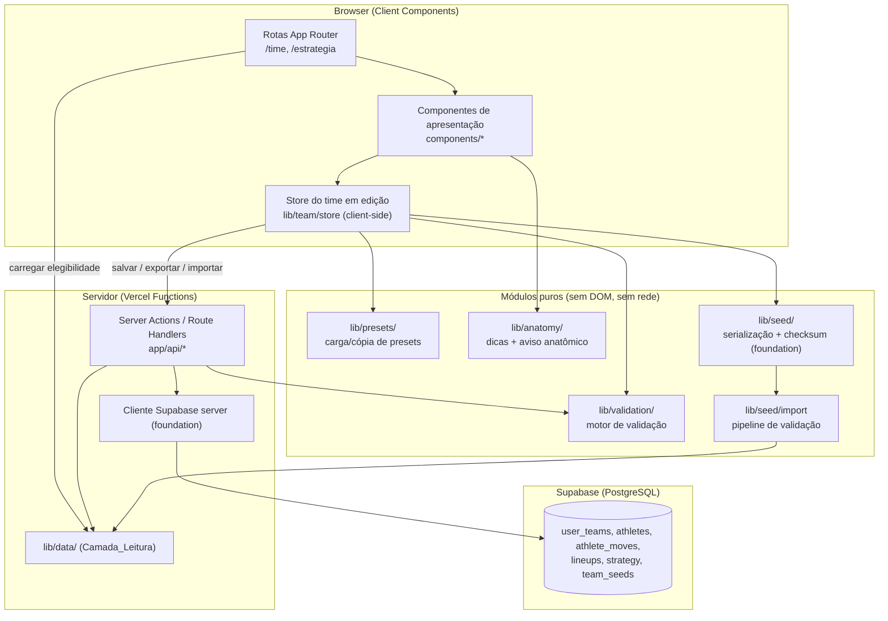
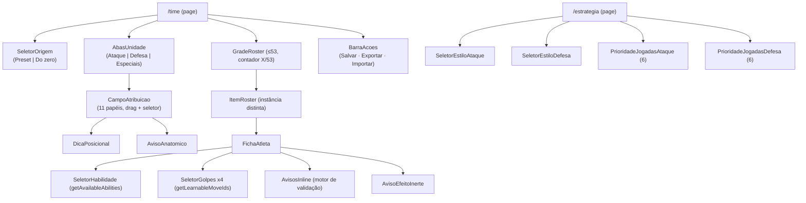
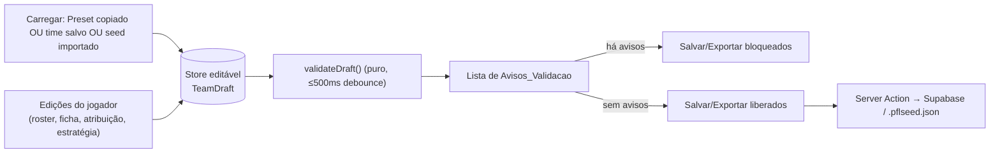

# Documento de Design — pfl-team-strategy-ui

## Overview

A spec `pfl-team-strategy-ui` entrega **duas das quatro telas funcionais** do PFL — **Meu Time** e **Estratégia** — mais a lógica de **exportação e importação de seed** no formato `.pflseed.json`. É a quarta das cinco specs do projeto, construída sobre a `pfl-foundation` (projeto Next.js, cliente Supabase, schema do banco, regras anti-slop, módulo `lib/seed/`) e sobre a `pfl-data-catalog` (`lib/data/`: `getAllowedSpecies`, `getLearnableMoveIds`, `getAvailableAbilities`, `getMove`, `getAbility`).

O entregável é um conjunto de rotas Next.js (App Router), componentes React de apresentação, uma **store client-side** do time em edição, um **motor de validação puro** reutilizável, módulos puros de **presets**, **anatomia/dicas**, **serialização de seed** e **pipeline de importação**, mais os Route Handlers / Server Actions que persistem no Supabase pelas tabelas da foundation (`user_teams`, `athletes`, `athlete_moves`, `lineups`, `strategy`, `team_seeds`).

### Princípios de design

1. **Apresentação separada de lógica.** Componentes React são "burros" (recebem estado + callbacks). Toda regra vive em módulos puros TypeScript (`lib/team/`, `lib/validation/`, `lib/seed/`, `lib/anatomy/`, `lib/presets/`), testáveis por PBT sem DOM nem rede.
2. **Fonte única de elegibilidade.** Toda decisão de "espécie permitida / golpe aprendível / habilidade disponível" vem da `Camada_Leitura` (`lib/data/`). Esta spec **nunca** acessa fontes externas em tempo de execução e **não inventa** nenhum número (anti-slop R17.5).
3. **Edição não destrutiva.** Carregar um Preset **copia** sua definição para a store editável; a definição original jamais é mutada (R1.5, R10.2). O mesmo vale para o estado persistido durante uma importação recusada (R15.11).
4. **Validação como porta.** Salvar e importar reusam o **mesmo** motor de validação puro. Nada é persistido com um `Aviso_Validacao` ativo (R7.6, R9.3).
5. **Seed canônico e verificável.** A exportação e o checksum reutilizam `lib/seed/` da foundation (SHA-256 canônico: sem o campo `checksum_sha256`, chaves ordenadas, UTF-8, separadores `','`/`':'`). Round-trip export→import é fiel (R16).
6. **Anti-slop como filtro, não estilo.** Acessibilidade por teclado, foco visível, estados distinguíveis por mais de um recurso visual, avisos específicos associados por ARIA. Seguimos as regras anti-slop instaladas pela foundation (filtro de qualidade, não um tema visual).

### Fora de escopo

Telas Game Day e Resultado (spec 5), motor de simulação (spec 3), geração de resultado/aleatoriedade de partida, ingestão de catálogo (spec 2) e definição de schema (spec 1). Esta spec não simula partidas nem produz logs/vencedores. As Unidades_Special_Teams são tratadas como automáticas, **sem** interface de edição de jogadas (R12.6).

### Mapeamento requisito → seção

| Requisito | Onde é endereçado |
|-----------|-------------------|
| R1 Ponto de partida (preset/zero) | Architecture · Presets · Components (Meu Time) |
| R2 Grade do roster ≤53 | Components · Data Models (store) · Validação |
| R3 Alternância de unidades | Architecture (rotas/componentes) · Components |
| R4 Atribuição arrastar/seletor | Components · Acessibilidade |
| R5 Dica posicional / anatomia | Dicas e Anatomia (`lib/anatomy/`) |
| R6 Ficha do atleta | Components · Camada_Leitura |
| R7 Validação inline | Motor de validação (`lib/validation/`) |
| R8 Efeito inerte / anatômico | Components · `lib/anatomy/` · Camada_Leitura |
| R9 Salvar | Server Actions · Validação |
| R10 Presets copiáveis / Curti | Presets (`lib/presets/`) |
| R11–R12 Estratégia | Tela Estratégia · Data Models (strategy) |
| R13 11 identidades por unidade | Motor de validação · Data Models |
| R14 Exportação de seed | Seed Export (`lib/seed/`) |
| R15 Importação de seed | Seed Import (pipeline) |
| R16 Round-trip | Seed Export + Import · Correctness Properties |
| R17 Acessibilidade / anti-slop | Anti-slop e Acessibilidade |

## Architecture

### Visão de alto nível



A camada de leitura de elegibilidade (`lib/data/`) é consultada tanto no servidor (ao hidratar as páginas com Server Components) quanto encapsulada por Route Handlers finos que o cliente chama para popular seletores (espécies, golpes aprendíveis, habilidades). A **persistência** (salvar, exportar, importar) passa por Server Actions que revalidam no servidor antes de escrever — o cliente nunca é a única barreira de validação.

### Rotas (App Router)

```
app/
├─ time/
│  └─ page.tsx                 # Tela_Meu_Time (Server Component shell + Client island)
├─ estrategia/
│  └─ page.tsx                 # Tela_Estrategia
└─ api/
   ├─ eligibility/route.ts     # GET: espécies permitidas, golpes aprendíveis, habilidades (proxy fino de lib/data)
   ├─ team/route.ts            # POST salvar time (Server Action equivalente)
   ├─ seed/export/route.ts     # POST exportar: devolve .pflseed.json
   └─ seed/import/route.ts     # POST importar: pipeline de validação server-side
```

As duas telas compartilham a mesma store do time em edição; `/estrategia` edita o sub-objeto `strategy` do mesmo time carregado em `/time`. A navegação entre telas não descarta o estado em edição.

### Árvore de componentes e rotas



### Fluxo de estado do time em edição



### Decisões de arquitetura e justificativas

- **Store client-side explícita (`TeamDraft`) separada da persistência.** O time em edição é um documento em memória; salvar é um evento discreto. Isso permite editar livremente (incl. estados transitoriamente inválidos para dar feedback inline) sem gravar lixo no banco, e torna o round-trip e a validação testáveis como funções puras.
- **Motor de validação puro e único.** A mesma função `validateDraft` alimenta os avisos inline da ficha, o gate do botão Salvar e a etapa de regras do pipeline de importação. Uma só definição de "válido" evita divergência entre UI e persistência (R7, R9.3, R15).
- **Presets como dados imutáveis.** Os quatro `PRESET_*.json` são carregados como dados somente-leitura e **clonados** para a store. Nenhuma referência compartilhada entre a definição original e o rascunho editável (R1.5, R10.2).
- **Checksum e serialização reusados da foundation.** Não reimplementamos SHA-256 canônico; chamamos `lib/seed/` para garantir que exportação e verificação de importação usem exatamente a mesma forma canônica, garantindo round-trip (R14.4, R16.3).
- **Validação dupla (cliente + servidor).** O cliente dá feedback imediato (≤500ms), mas o Server Action reexecuta `validateDraft` antes de persistir. Um cliente adulterado não contorna as regras.
- **Anatomia extraída para módulo compartilhado.** As convenções de `ANATOMY_DECISIONS_FINAL.md` são a mesma lógica que o `Validador_Funcoes` do motor usará; extraímos para `lib/anatomy/` para que UI e (futuro) motor compartilhem a fonte, sem duplicar regras.

## Components and Interfaces

### Store do time em edição (`lib/team/store.ts`)

Mantém o `TeamDraft` em memória no cliente e expõe operações puras de transição de estado (sem I/O). As operações retornam um **novo** `TeamDraft` (imutável), facilitando teste e desfazer.

```typescript
import type { TeamDraft, AthleteDraft, LineupUnit, Role } from './model';

interface TeamStore {
  getDraft(): TeamDraft;

  // Roster
  addAthlete(a: AthleteDraft): TeamDraft;          // recusa se já há 53 (R2.4)
  removeAthlete(instanceId: number): TeamDraft;
  updateAthlete(instanceId: number, patch: Partial<AthleteDraft>): TeamDraft;

  // Atribuição de posição
  assignRole(unit: LineupUnit, role: Role, instanceId: number): TeamDraft; // R4.3/R13.5
  clearRole(unit: LineupUnit, role: Role): TeamDraft;

  // Estratégia
  setOffenseStyle(style: string): TeamDraft;
  setDefenseStyle(style: string): TeamDraft;
  reorderOffensePlays(order: PlayId[]): TeamDraft;  // R12.3/12.4
  reorderDefensePlays(order: PlayId[]): TeamDraft;

  // Carga
  loadFromPreset(presetId: PresetId): TeamDraft;    // clona (R1.5/R10.2)
  loadFromSeed(seed: SeedDocument): TeamDraft;       // após import aprovado
  loadEmpty(): TeamDraft;                            // começar do zero (R1.2)
}
```

### Modelo do time em edição (`lib/team/model.ts`)

```typescript
type PlayId =
  | 'O_RUN_INSIDE' | 'O_RUN_OUTSIDE' | 'O_PASS_SHORT'
  | 'O_PASS_INTERMEDIATE' | 'O_PASS_DEEP' | 'O_PLAY_ACTION'
  | 'D_RUN_FIT' | 'D_EDGE_CONTAIN' | 'D_ZONE'
  | 'D_MAN' | 'D_RUSH' | 'D_CONTAIN_QB';

const OFFENSE_PLAYS: readonly PlayId[] =
  ['O_RUN_INSIDE','O_RUN_OUTSIDE','O_PASS_SHORT','O_PASS_INTERMEDIATE','O_PASS_DEEP','O_PLAY_ACTION'];
const DEFENSE_PLAYS: readonly PlayId[] =
  ['D_RUN_FIT','D_EDGE_CONTAIN','D_ZONE','D_MAN','D_RUSH','D_CONTAIN_QB'];

type LineupUnit =
  | 'offense' | 'defense'
  | 'kickoff' | 'kick_return' | 'punt' | 'punt_return' | 'field_goal' | 'field_goal_block';
type Role = string;        // papel dentro da unidade (11 por unidade)
type PresetId = 'balanced' | 'ground' | 'aerial' | 'curti';

interface AthleteDraft {
  instanceId: number;      // distinto no time
  pokemonId: number;       // ∈ Especies_Permitidas
  abilityId: number;       // ∈ getAvailableAbilities(pokemonId)
  moveIds: number[];       // exatamente 4 distintos, ∈ getLearnableMoveIds(pokemonId)
  positionDesignation: string;
}

interface StrategyDraft {
  offenseStyle: string;
  defenseStyle: string;
  offensePlayPriority: PlayId[];   // permutação de OFFENSE_PLAYS
  defensePlayPriority: PlayId[];   // permutação de DEFENSE_PLAYS
}

interface LineupAssignment {
  unit: LineupUnit;
  role: Role;
  instanceId: number;      // referencia um AthleteDraft
}

interface TeamDraft {
  teamId?: string;         // definido após primeiro salvamento
  name: string;
  roster: AthleteDraft[];              // ≤ 53
  lineups: LineupAssignment[];
  strategy: StrategyDraft;
  provenance?: PresetProvenance;       // marcação "atribuição PFL" (R10.4)
}
```

### Camada de elegibilidade (consumo de `lib/data/`)

A spec **não** reimplementa catálogo. Um adaptador fino memoiza por `pokemonId` as respostas da `Camada_Leitura` para alimentar seletores e o motor de validação. As assinaturas abaixo refletem `pfl-data-catalog`.

```typescript
// lib/team/eligibility-adapter.ts
interface EligibilitySource {
  allowedSpeciesIds(): Promise<Set<number>>;                      // getAllowedSpecies
  learnableMoveIds(pokemonId: number): Promise<Set<number>>;      // getLearnableMoveIds
  availableAbilityIds(pokemonId: number): Promise<Set<number>>;   // getAvailableAbilities
  move(moveId: number): Promise<MoveRecord | null>;               // getMove (nome, raw_data)
  ability(abilityId: number): Promise<AbilityRecord | null>;      // getAbility
}
```

O motor de validação não recebe a fonte assíncrona diretamente; recebe um **snapshot síncrono** de elegibilidade (conjuntos já resolvidos) para permanecer puro e testável (ver abaixo).

### Componentes da Tela Meu Time (`components/team/`)

| Componente | Responsabilidade | Requisitos |
|---|---|---|
| `SeletorOrigem` | Botão rotulado "Usar preset" (com escolha dos 4 `preset_id`) e botão "Começar do zero". | R1.1–R1.3 |
| `GradeRoster` | Lista/grade; cada `AthleteDraft` é um item distinto, mesmo com `pokemonId` repetido. Exibe contador `X/53`. Recusa 54ª adição com aviso. | R2.1–R2.4 |
| `ItemRoster` | Cartão de uma instância; abre a `FichaAtleta`; arrastável. | R2.1, R4.1 |
| `AbasUnidade` | Alterna visualização entre Ataque, Defesa e Especiais (6 unidades). | R3.1–R3.4 |
| `CampoAtribuicao` | 11 papéis da unidade ativa; aceita **drop** (drag-and-drop) e expõe **seletor de posição** equivalente, acessível por teclado. Registra `position_designation`. | R4.1–R4.4, R17.3 |
| `DicaPosicional` | Texto específico por (espécie, posição), orientador, nunca bloqueante. | R5.1–R5.2 |
| `AvisoAnatomico` | Exibido quando a função essencial da posição não é fisicamente cumprível pela espécie; permite manter ou alterar. | R5.3, R8 |
| `FichaAtleta` | 1 habilidade + 4 golpes; seletores restritos à elegibilidade; avisos inline; recusa salvar com aviso ativo. | R6, R7, R8 |
| `SeletorHabilidade` | Opções = `getAvailableAbilities(pokemonId)`. | R6.2 |
| `SeletorGolpes` | Opções = `getLearnableMoveIds(pokemonId)`; 4 slots. | R6.3 |
| `AvisoEfeitoInerte` | Marca golpe/habilidade sem regra executável; permite equipar, avisa que não há bônus. | R8.1–R8.3 |
| `BarraAcoes` | Botões rotulados **Salvar**, **Exportar seed**, **Importar seed**; confirmação de salvamento. | R9.1, R9.4, R14.1, R15 |

### Componentes da Tela Estratégia (`components/strategy/`)

| Componente | Responsabilidade | Requisitos |
|---|---|---|
| `SeletorEstiloAtaque` | Registra `offenseStyle` na estratégia. | R11.1, R11.2 |
| `SeletorEstiloDefesa` | Registra `defenseStyle`. | R11.1, R11.3 |
| `PrioridadeJogadasAtaque` | Ordena as 6 `O_*`; registra prioridade. Operável por teclado (mover acima/abaixo). | R12.1, R12.3, R12.4 |
| `PrioridadeJogadasDefesa` | Ordena as 6 `D_*`. | R12.2, R12.3, R12.4 |

Sem desenhador de jogadas (R12.5). Sem UI de special teams (R12.6).

### Motor de validação (`lib/validation/`)

Função **pura**, síncrona, que recebe o `TeamDraft` e um `EligibilitySnapshot` (conjuntos já resolvidos da `Camada_Leitura`) e as convenções de anatomia, e retorna a lista completa de avisos. É o coração reutilizado por ficha, salvar e import.

```typescript
interface EligibilitySnapshot {
  allowedSpecies: ReadonlySet<number>;
  learnable: ReadonlyMap<number, ReadonlySet<number>>;   // pokemonId → moveIds
  abilities: ReadonlyMap<number, ReadonlySet<number>>;   // pokemonId → abilityIds
  moveName: ReadonlyMap<number, string>;                 // para texto legível
  abilityName: ReadonlyMap<number, string>;
  inertEffects: ReadonlySet<string>;                     // ids com efeito inerte
}

type WarningCode =
  | 'MOVE_NOT_LEARNABLE'     // R7.1
  | 'ABILITY_NOT_AVAILABLE'  // R7.2
  | 'MOVE_COUNT_NOT_FOUR'    // R7.3
  | 'MOVE_DUPLICATE'         // R7.4
  | 'SPECIES_NOT_ALLOWED'    // R2.6
  | 'ROSTER_CAP_EXCEEDED'    // R2.4
  | 'UNIT_INCOMPLETE'        // R13.4
  | 'DUPLICATE_IDENTITY_SNAP'// R13.5
  | 'INERT_EFFECT'           // R8.1 (aviso, não bloqueante)
  | 'ANATOMY_LIMIT';         // R5.3/R8 (aviso, não bloqueante)

interface ValidationWarning {
  code: WarningCode;
  blocking: boolean;                 // true impede salvar/exportar
  message: string;                   // específico e legível (R17.6)
  target: {                          // associação ARIA (R17.7)
    kind: 'athlete' | 'move' | 'ability' | 'unit' | 'roster';
    instanceId?: number;
    unit?: LineupUnit; role?: Role;
    moveId?: number; abilityId?: number;
  };
}

function validateAthlete(a: AthleteDraft, elig: EligibilitySnapshot, anat: AnatomyConventions): ValidationWarning[];
function validateLineups(draft: TeamDraft): ValidationWarning[];     // 11 identidades distintas por unidade/snap
function validateRoster(draft: TeamDraft, elig: EligibilitySnapshot): ValidationWarning[];
function validateDraft(draft: TeamDraft, elig: EligibilitySnapshot, anat: AnatomyConventions): ValidationWarning[];

function hasBlocking(warnings: ValidationWarning[]): boolean;        // gate de salvar/exportar
```

Regras de bloqueio: `INERT_EFFECT` e `ANATOMY_LIMIT` são **avisos não bloqueantes** (o jogador decide manter); todos os demais são **bloqueantes**. `MOVE_COUNT_NOT_FOUR` reporta a contagem atual; `MOVE_DUPLICATE` e `MOVE_NOT_LEARNABLE` nomeiam o golpe; `ABILITY_NOT_AVAILABLE` nomeia a habilidade; `UNIT_INCOMPLETE` nomeia a unidade e os papéis pendentes; `DUPLICATE_IDENTITY_SNAP` nomeia a unidade/instância (R7, R13.4–13.5, R17.6).

Na UI, `validateAthlete`/`validateDraft` roda com **debounce ≤500ms** após cada alteração; a remoção de um aviso corrigido também respeita o mesmo limite (R7.1–R7.5).

### Presets (`lib/presets/`)

```typescript
interface PresetDefinition {    // dados somente-leitura, carregados dos PRESET_*.json
  presetId: PresetId;
  name: string;
  roster: ReadonlyArray<Readonly<AthleteDraft>>;
  lineups: ReadonlyArray<Readonly<LineupAssignment>>;
  strategy: Readonly<StrategyDraft>;
}

interface PresetProvenance {
  presetId: PresetId;
  // Para 'curti': marca que loadouts/ST/estratégia são atribuição PFL (R10.4)
  pflAssignedFields?: ('abilities' | 'moves' | 'special_teams' | 'strategy')[];
  sourceStarters22?: boolean;   // true quando as 22 titulares vêm da fonte histórica (R10.3)
}

function getPreset(id: PresetId): PresetDefinition;        // nunca mutável
function clonePresetToDraft(id: PresetId): TeamDraft;      // deep clone + provenance (R1.5/R10.2/R10.4)
```

### Dicas e Anatomia (`lib/anatomy/`)

```typescript
interface AnatomyConventions {
  // Convenções de ANATOMY_DECISIONS_FINAL.md — mesma lógica do Validador_Funcoes do motor.
  // Retorna aviso quando a função esportiva essencial da posição não é fisicamente cumprível.
  anatomyWarning(pokemonId: number, position: string): AnatomyFinding | null;  // R5.3/R8
}
interface AnatomyFinding { position: string; essentialFunction: string; reason: string; }

// Dica orientadora por (espécie, posição); nunca proíbe (R5.1/R5.2/R4.4).
function positionalHint(pokemonId: number, position: string): string;
```

### Seed Export (`lib/seed/export.ts`) e Import (`lib/seed/import.ts`)

```typescript
interface SeedDocument {
  schema: string;                       // identificador de versão de schema
  ruleset: string;
  athletes: SeedAthlete[];
  lineups: SeedLineup[];
  special_teams_full_units: SeedLineup[];
  strategy: StrategyDraft;
  checksum_sha256: string;              // SHA-256 canônico sobre o doc sem este campo
}
interface SeedAthlete { instance_id: number; pokemon_id: number; ability_id: number; move_ids: number[]; }
interface SeedLineup { unit: LineupUnit; role: Role; instance_id: number; }

// Export — reusa canonicalização + checksum da foundation (lib/seed/checksum).
function exportSeed(draft: TeamDraft): SeedDocument;      // calcula checksum_sha256 (R14)

// Import — pipeline em etapas (ver fluxo); retorna sucesso com draft ou recusa legível.
type ImportResult =
  | { ok: true; draft: TeamDraft }
  | { ok: false; reason: ImportRejection };
interface ImportRejection { step: ImportStep; message: string; detail?: unknown; }
type ImportStep =
  | 'SIZE' | 'PARSE' | 'STRUCTURE' | 'SCHEMA_VERSION' | 'ROSTER_CAP'
  | 'ALLOWED_IDS' | 'MOVES' | 'ABILITY' | 'LINEUP_IDENTITIES'
  | 'FORBIDDEN_CONTENT' | 'CHECKSUM';

function importSeed(rawBytes: Uint8Array, elig: EligibilitySnapshot): ImportResult;  // (R15)
```

## Data Models

Esta spec **consome** o schema da `pfl-foundation`; não cria tabelas novas. O mapeamento entre a store em memória e o banco é:

### Persistência (store → Supabase)

| Entidade da store | Tabela foundation | Observações |
|---|---|---|
| `TeamDraft.name`, `teamId` | `user_teams` | `id`, `user_id`, `name`. |
| `AthleteDraft` | `athletes` | `instance_id`, `pokemon_id`, `ability_id`, `position_designation`; UNIQUE(`team_id`,`instance_id`). Trigger de roster_cap=53 e FKs validam no servidor. |
| `AthleteDraft.moveIds` | `athlete_moves` | 4 linhas `(athlete_id, move_id, slot 1..4)`; UNIQUE garante distinção; constraint trigger exige exatamente 4. |
| `LineupAssignment` | `lineups` | `(team_id, unit, role, athlete_id)`; UNIQUE(`team_id`,`unit`,`role`); 11 papéis por unidade. |
| `StrategyDraft` | `strategy` | `offense_play_ids`, `defense_play_ids` (prioridades como arrays ordenados de `PlayId`); estilos persistidos junto. `special_team_ids` fica automático. |
| `SeedDocument` | `team_seeds` | `seed_document` (jsonb), `schema_version`, `checksum_sha256`. |

> Nota sobre estratégia: a foundation modela `strategy` com `offense_play_ids`/`defense_play_ids` como arrays de inteiros. Os `PlayId` autoritativos (`O_*`/`D_*`) são mapeados para os identificadores do `play_catalog_18.json`; a ordem do array **é** a priorização (R12.3/12.4). Os estilos (`offenseStyle`/`defenseStyle`) são persistidos como parte do registro `strategy` (coluna/campo dedicado conforme a migration da foundation; se ausente, armazenados no `seed_document` e numa coluna de estilo a ser confirmada com a foundation).

### Estado em memória (invariantes)

```
roster.length ≤ 53                                   (R2.3/R2.4)
∀ a ∈ roster: a.pokemonId ∈ allowedSpecies           (R2.5/R2.6)
∀ a ∈ roster: |a.moveIds| = 4 ∧ distintos            (R6.4/R7.3/R7.4)
∀ a ∈ roster: a.moveIds ⊆ learnable[a.pokemonId]     (R6.3/R7.1)
∀ a ∈ roster: a.abilityId ∈ abilities[a.pokemonId]   (R6.2/R7.2)
∀ unidade preenchida: 11 papéis ∧ 11 instanceId distintos  (R13.1/R13.2/R13.4/R13.5)
instanceId único no roster                           (herdado de athletes UNIQUE)
strategy.offensePlayPriority = permutação de OFFENSE_PLAYS   (R12.1/R12.3)
strategy.defensePlayPriority = permutação de DEFENSE_PLAYS   (R12.2/R12.3)
```

Duplicatas de espécie: dois `AthleteDraft` podem ter o mesmo `pokemonId`; são itens **distintos** por `instanceId` e ocupam vagas separadas (R2.2). Uma mesma instância pode servir unidades diferentes, mas nunca dois papéis no **mesmo** snap/unidade (R13.3/R13.5).

### Fonte das dicas e anatomia

- `positionalHint(pokemonId, position)` — tabela de textos por par (espécie, posição), de caráter orientador, sem proibição (R5.1, R5.2, R4.4).
- `anatomyWarning(pokemonId, position)` — deriva das convenções de `ANATOMY_DECISIONS_FINAL.md`, idênticas ao `Validador_Funcoes` do motor; só sinaliza quando a função esportiva essencial não é fisicamente cumprível, nunca proíbe arbitrariamente (R5.3, R8).

## Correctness Properties

*Uma propriedade é uma característica ou comportamento que deve valer para todas as execuções válidas do sistema — essencialmente, uma afirmação formal sobre o que o sistema deve fazer. Propriedades são a ponte entre especificações legíveis por humanos e garantias de correção verificáveis por máquina.*

As propriedades abaixo resultam da análise de prework e de uma **reflexão de consolidação** que eliminou redundâncias: avisos inline (7.1–7.5) foram unificados em "validação é função pura do estado que detecta exatamente os casos inválidos"; os gates de salvar (7.6, 9.3) foram unificados; o não-mutar preset (1.5, 10.2) foi unificado; priorização (12.3, 12.4) virou uma propriedade de permutação; a verificação de identidades por unidade (13.2, 13.4, 13.5, 15.7) foi unificada; checksum (14.4, 16.3) virou uma propriedade; e as recusas de importação (15.1–15.13) foram parametrizadas por regra com uma propriedade transversal de preservação de estado.

### Property 1: Preset clonado é fiel e nunca muta a definição original

*Para todo* `preset_id` ∈ {`balanced`,`ground`,`aerial`,`curti`} e *para qualquer* sequência de edições aplicadas ao `TeamDraft` resultante, (a) o rascunho recém-clonado é estruturalmente igual à definição do preset (roster, atribuições e estratégia) e (b) a definição original do preset permanece inalterada campo a campo após as edições.

**Validates: Requirements 1.3, 1.5, 10.2**

### Property 2: Preset carregado é salvável sem ajuste

*Para todo* `preset_id`, o `TeamDraft` clonado não produz nenhum `Aviso_Validacao` bloqueante em `validateDraft`.

**Validates: Requirements 1.4**

### Property 3: Instâncias distintas, inclusive duplicatas de espécie

*Para qualquer* roster, cada `AthleteDraft` ocupa uma vaga distinta identificada por `instance_id` único; quando dois ou mais atletas compartilham o mesmo `pokemon_id`, o número de vagas ocupadas é igual ao número de instâncias (nenhuma deduplicação por espécie).

**Validates: Requirements 2.1, 2.2**

### Property 4: Teto do roster nunca excedido

*Para qualquer* sequência de adições, o tamanho do roster nunca ultrapassa 53; toda adição que levaria o total acima de 53 é recusada, preserva o roster existente e produz o aviso `ROSTER_CAP_EXCEEDED` informando o limite.

**Validates: Requirements 2.3, 2.4**

### Property 5: Seleção de espécies restrita ao conjunto permitido

*Para qualquer* catálogo, as opções de espécie oferecidas para novas instâncias são exatamente `getAllowedSpecies`; e *para qualquer* `pokemon_id`, adicionar uma instância é aceito se e somente se o id pertence a esse conjunto — caso contrário produz `SPECIES_NOT_ALLOWED` identificando a espécie.

**Validates: Requirements 2.5, 2.6**

### Property 6: Atribuição de posição registra e reflete, sem proibição por espécie

*Para qualquer* unidade, papel e instância, `assignRole` com uma atribuição válida registra a `position_designation` e faz a atribuição constar exatamente uma vez na unidade correspondente; e *para qualquer* espécie permitida e qualquer papel, a atribuição nunca é bloqueada por regra de espécie (sem proibição arbitrária).

**Validates: Requirements 4.3, 4.4**

### Property 7: Equivalência entre atribuição por teclado e por arrastar

*Para qualquer* unidade, papel e instância, o estado do `TeamDraft` após a atribuição pelo seletor acessível por teclado é idêntico ao estado após a atribuição equivalente por arrastar.

**Validates: Requirements 4.2, 17.3**

### Property 8: Dica posicional específica e não bloqueante; aviso anatômico consistente com a convenção

*Para todo* par (espécie, posição), `positionalHint` retorna um texto não vazio específico ao par e sua existência jamais altera o resultado de `assignRole`; e `anatomyWarning` retorna um aviso se e somente se as convenções de `ANATOMY_DECISIONS_FINAL.md` marcam a função esportiva essencial como fisicamente não cumprível, sempre permitindo que a atribuição prossiga.

**Validates: Requirements 5.1, 5.2, 5.3**

### Property 9: Seletores da ficha espelham exatamente a elegibilidade

*Para qualquer* `pokemon_id`, o conjunto de habilidades oferecido pela `FichaAtleta` é exatamente `getAvailableAbilities(pokemon_id)` e o conjunto de golpes oferecido é exatamente `getLearnableMoveIds(pokemon_id)`.

**Validates: Requirements 6.2, 6.3**

### Property 10: Validação da ficha é função pura do estado e detecta exatamente os casos inválidos

*Para qualquer* `AthleteDraft` e snapshot de elegibilidade, `validateAthlete` contém:
- `MOVE_NOT_LEARNABLE` (nomeando o golpe) para cada golpe fora de `getLearnableMoveIds`;
- `ABILITY_NOT_AVAILABLE` (nomeando a habilidade) se e somente se a habilidade está fora de `getAvailableAbilities`;
- `MOVE_COUNT_NOT_FOUR` (com a contagem atual) se e somente se o número de golpes é diferente de quatro;
- `MOVE_DUPLICATE` (nomeando o golpe repetido) se e somente se há golpes repetidos.

Como a saída é função apenas do estado, corrigir a condição de invalidez remove exatamente o aviso correspondente, e um atleta salvo tem exatamente uma habilidade e quatro golpes distintos.

**Validates: Requirements 6.4, 7.1, 7.2, 7.3, 7.4, 7.5**

### Property 11: Efeito inerte é equipável, não bloqueante e sinalizado

*Para qualquer* golpe ou habilidade marcado como `Efeito_Inerte`, `validateDraft` permite equipá-lo (o aviso `INERT_EFFECT` não é bloqueante) e sempre inclui o aviso quando o efeito está selecionado.

**Validates: Requirements 8.1, 8.3**

### Property 12: Gate de persistência por avisos bloqueantes

*Para qualquer* `TeamDraft`, salvar e exportar são permitidos se e somente se `hasBlocking(validateDraft(...))` é falso; quando há ao menos um aviso bloqueante, salvar é recusado e o estado persistido anterior é preservado inalterado.

**Validates: Requirements 7.6, 9.2, 9.3**

### Property 13: Priorização de jogadas é uma permutação do conjunto fixo

*Para qualquer* reordenação solicitada, a prioridade registrada é uma permutação exata do conjunto de seis jogadas do lado (`OFFENSE_PLAYS` para ataque, `DEFENSE_PLAYS` para defesa): mesmos elementos, sem perda nem duplicação, na ordem solicitada.

**Validates: Requirements 12.3, 12.4**

### Property 14: Estilos registrados na estratégia

*Para qualquer* valor de estilo, `setOffenseStyle` e `setDefenseStyle` registram o valor selecionado na `Estrategia_Time`.

**Validates: Requirements 11.2, 11.3**

### Property 15: Unidade válida tem exatamente 11 identidades distintas por snap

*Para qualquer* escalação, `validateLineups` considera uma unidade (Ataque, Defesa ou cada Special Team) válida se e somente se ela tem 11 papéis preenchidos por 11 instâncias distintas. Quando há menos de 11 distintas, produz `UNIT_INCOMPLETE` nomeando a unidade e os papéis pendentes; quando a mesma instância é atribuída a dois papéis da mesma unidade/snap, a segunda atribuição é recusada com `DUPLICATE_IDENTITY_SNAP`. A mesma instância em unidades diferentes é permitida.

**Validates: Requirements 13.1, 13.2, 13.3, 13.4, 13.5**

### Property 16: Documento de seed exportado é bem formado e sem conteúdo de partida

*Para qualquer* `TeamDraft` válido, `exportSeed` produz um documento contendo exatamente os campos `schema`, `ruleset`, `athletes`, `lineups`, `special_teams_full_units`, `strategy` e `checksum_sha256`, com cada atleta registrando `instance_id`, `pokemon_id`, `ability_id` e quatro `move_id` distintos, e sem nenhum campo de aleatoriedade de partida, log, vencedor ou resultado.

**Validates: Requirements 14.2, 14.3, 14.5**

### Property 17: Checksum do seed é determinístico e recomputável

*Para todo* `SeedDocument`, o SHA-256 calculado sobre sua forma canônica (sem o campo `checksum_sha256`, chaves ordenadas, UTF-8, separadores `','` e `':'`) é sempre idêntico em recomputações sucessivas e igual ao `checksum_sha256` registrado quando o documento está íntegro.

**Validates: Requirements 14.4, 16.3**

### Property 18: Importação aceita apenas documentos íntegros e rejeita cada violação identificando a causa

*Para qualquer* payload de importação, `importSeed` retorna sucesso se e somente se o payload passa por todas as etapas na ordem definida; cada etapa recusa a importação exatamente quando sua regra é violada, identificando a causa: tamanho > 5.242.880 bytes (`SIZE`), JSON ilegível (`PARSE`), campo obrigatório ausente (`STRUCTURE`), versão de schema incompatível (`SCHEMA_VERSION`), mais de 53 atletas (`ROSTER_CAP`), `pokemon_id`/`ability_id`/`move_id` inexistente ou fora das espécies permitidas (`ALLOWED_IDS`), golpes não distintos ou não aprendíveis (`MOVES`), habilidade indisponível (`ABILITY`), unidade sem 11 identidades distintas (`LINEUP_IDENTITIES`), conteúdo de partida proibido (`FORBIDDEN_CONTENT`) e checksum recomputado divergente (`CHECKSUM`).

**Validates: Requirements 15.1, 15.2, 15.3, 15.4, 15.5, 15.6, 15.7, 15.8, 15.9, 15.12, 15.13**

### Property 19: Importação recusada preserva o estado e importação aprovada reconstitui fielmente

*Para qualquer* payload recusado em qualquer etapa, o `Time_Usuario` corrente permanece inalterado e a recusa traz uma mensagem legível identificando o motivo específico; e *para qualquer* documento aprovado em todas as validações, o `TeamDraft` carregado reconstitui, sem alteração em relação ao documento, todos os atletas, habilidades, quatro golpes por atleta, posições e a estratégia (estilos e prioridades).

**Validates: Requirements 15.10, 15.11, 16.1, 16.2**

### Property 20: Avisos são específicos, únicos por caso e associados ao alvo

*Para quaisquer* dois casos inválidos distintos, as mensagens de `Aviso_Validacao`, `Dica_Posicional`, aviso de `Efeito_Inerte` e `Aviso_Anatomico` diferem entre si e cada mensagem referencia explicitamente o item, controle ou condição associado (`target`), permitindo associação programática por ARIA.

**Validates: Requirements 17.6**

## Error Handling

| Situação | Comportamento esperado | Requisito |
|---|---|---|
| 54ª adição ao roster | `addAthlete` recusa; roster preservado; aviso `ROSTER_CAP_EXCEEDED` com o limite 53 | R2.4 |
| Espécie fora das permitidas | Adição recusada; aviso `SPECIES_NOT_ALLOWED` nomeando a espécie | R2.6 |
| Golpe não aprendível / habilidade indisponível | Aviso bloqueante (`MOVE_NOT_LEARNABLE`/`ABILITY_NOT_AVAILABLE`) ≤500ms nomeando o item | R7.1, R7.2 |
| ≠4 golpes / golpes repetidos | Aviso bloqueante (`MOVE_COUNT_NOT_FOUR` com contagem / `MOVE_DUPLICATE` nomeando) ≤500ms | R7.3, R7.4 |
| Efeito inerte selecionado | Permite equipar; aviso não bloqueante `INERT_EFFECT`; nunca aplica silenciosamente | R8.1, R8.3 |
| Limitação anatômica | Aviso não bloqueante `ANATOMY_LIMIT`; jogador decide manter/alterar | R5.3 |
| Salvar com aviso bloqueante ativo | Salvamento recusado; estado persistido preservado; lista de itens a corrigir | R7.6, R9.3 |
| Unidade incompleta (<11 distintas) | Aviso `UNIT_INCOMPLETE` nomeando unidade e papéis pendentes | R13.4 |
| Identidade duplicada no mesmo snap | Segunda atribuição recusada; aviso `DUPLICATE_IDENTITY_SNAP` | R13.5 |
| Importação: arquivo > 5 MB | Recusa `SIZE` com tamanho recebido e limite; estado preservado | R15.1 |
| Importação: JSON ilegível | Recusa `PARSE`; estado preservado | R15.12 |
| Importação: campo obrigatório ausente | Recusa `STRUCTURE` nomeando o campo; estado preservado | R15.13 |
| Importação: versão de schema incompatível | Recusa `SCHEMA_VERSION` com versão recebida e suportada | R15.2 |
| Importação: >53 atletas | Recusa `ROSTER_CAP` com contagem e limite | R15.3 |
| Importação: id inválido/não permitido | Recusa `ALLOWED_IDS` identificando a referência | R15.4 |
| Importação: golpes inválidos / ability indisponível | Recusa `MOVES`/`ABILITY` identificando atleta e golpe | R15.5, R15.6 |
| Importação: unidade sem 11 distintas | Recusa `LINEUP_IDENTITIES` identificando a unidade | R15.7 |
| Importação: conteúdo de partida proibido | Recusa `FORBIDDEN_CONTENT` | R15.9 |
| Importação: checksum divergente | Recusa `CHECKSUM` por adulteração | R15.8 |
| Qualquer recusa de importação | `Time_Usuario` corrente inalterado; mensagem legível com o motivo | R15.11 |
| Elegibilidade indisponível (`lib/data` retorna vazio/NotFound) | Seletor vazio sem travar a tela; nenhum número inventado | R17.5 |

Princípios: avisos não bloqueantes (`INERT_EFFECT`, `ANATOMY_LIMIT`) informam sem impedir; avisos bloqueantes impedem salvar/exportar; toda recusa de persistência ou importação é atômica e preserva o estado anterior. A validação do servidor reexecuta `validateDraft`, de modo que um cliente adulterado não contorna nenhuma regra.

## Testing Strategy

Abordagem dupla: **testes de propriedade (PBT)** para a lógica pura (motor de validação, store imutável, clone de preset, serialização/checksum de seed, pipeline de importação, permutação de prioridades) e **testes de componente/acessibilidade e integração** para renderização, interação (drag/teclado), associação ARIA e persistência no Supabase.

### Testes baseados em propriedade (PBT)

- **Biblioteca**: `fast-check` (ecossistema TypeScript/Vitest). Não implementar PBT do zero.
- **Iterações**: mínimo de **100** por propriedade (`fc.assert(..., { numRuns: 100 })`).
- **Tag** em cada teste, referenciando a propriedade do design. Formato: `Feature: pfl-team-strategy-ui, Property {n}: {texto}`.
- **Um teste de propriedade por Correctness Property** (P1–P20). Geradores constroem `TeamDraft`, snapshots de elegibilidade sintéticos (`EligibilitySnapshot` com conjuntos arbitrários), documentos de seed válidos e mutações inválidas:
  - **P10, P12, P15, P18** (motor de validação e pipeline de importação) — lógica pura in-memory; geradores produzem golpes dentro/fora do aprendível, contagens ≠4, duplicatas, unidades incompletas, identidades repetidas, e cada classe de violação de importação, afirmando detecção exata (sse) e preservação de estado.
  - **P1, P2, P3, P13, P14** (store/preset/estratégia) — operações imutáveis; afirmam fidelidade do clone, não-mutação da definição, permutação das prioridades.
  - **P16, P17, P19** (seed) — round-trip `importSeed(exportSeed(d)) ≡ d` para `d` válido; checksum recomputado idêntico; mutação de um byte do documento com checksum antigo ⇒ recusa `CHECKSUM`. Reusa `lib/seed/` da foundation.
  - **P4, P5, P6, P7, P8, P9, P11, P20** — propriedades de teto, elegibilidade de seleção, equivalência teclado/arrastar, dica/anatomia e especificidade de avisos.
- **Fronteira pura**: o motor de validação recebe um `EligibilitySnapshot` síncrono; a `Camada_Leitura` é consultada fora do núcleo puro e **mockada** nos testes de propriedade (sem rede, baratos para 100+ iterações).

### Testes de componente e acessibilidade (não-PBT)

Com Testing Library + verificação de acessibilidade (ex.: `jest-axe`/`axe-core`):
- Presença de controles rotulados: origem preset/zero (R1.1), abas de unidade (R3.1–3.4), botões Salvar/Exportar/Importar (R9.1, R14.1), seletores de estilo (R11.1), ausência de desenhador/UI de ST (R12.5, R12.6).
- Grade de roster: N itens para N atletas, duplicatas distintas, contador `X/53` (R2.1–2.3).
- Ficha: abre com 1 habilidade + 4 slots (R6.1); aviso de inerte visível antes de salvar (R8.3); confirmação após salvar (R9.4).
- Atribuição: drop por drag (R4.1) e seletor alternativo (R4.2) registram a posição; dica aparece ao iniciar atribuição (R5.1).
- Acessibilidade: todos os controles alcançáveis por teclado em ordem visual (R17.1); indicador de foco visível e distinto de erro/seleção, com distinção por mais de um recurso visual (R17.2, R17.4); `aria-describedby` associando cada aviso ao seu controle (R17.7).
- Fidelidade do Curti: 11 titulares de ataque + 11 de defesa com espécies/posições esperadas (R10.3) e proveniência marcando loadouts/ST/estratégia como atribuição PFL (R10.4).
- Honestidade de números (R17.5): auditoria de que todo valor numérico exibido origina-se da `Camada_Leitura` ou da store/config, sem literais estatísticos inventados.

### Testes de integração (Supabase)

- Salvar time válido e recarregar reproduz atletas, habilidades, quatro golpes, posições e escalações (R9.2); o servidor reexecuta `validateDraft` e os triggers da foundation (roster_cap, 4 golpes, FKs) são respeitados.
- 1–2 exemplos de round-trip ponta a ponta: montar → exportar `.pflseed.json` → importar em estado limpo → igualdade com o original (R16.1, R16.2).

### Justificativa de escopo PBT

Renderização, foco, contraste, drag e associação ARIA são determinísticos quanto ao input visual e melhor cobertos por testes de componente/acessibilidade (1–2 execuções), não por 100 iterações. A lógica que **varia significativamente com o input** — validação, teto, permutações, serialização, checksum e as múltiplas classes de recusa de importação — é onde o PBT encontra defeitos de borda e por isso concentra as 20 propriedades.
